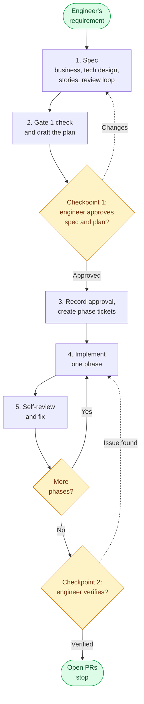

# auto

Lucy workflow. Run only when Lucy is addressed (see `../SKILL.md`), and only when the engineer asks for it.

The engineer drafts the requirement. Lucy defines the spec and plan, asks for **one review**, then implements each phase, reviews her own work, and asks for **final verification**. Rules: FLOW-11. It chains the normal workflows; nothing in them is skipped, only the pauses between them.

## Input

`auto <requirement>` — the requirement is pasted text, a file path, or an issue / ticket. Examples: "Lucy, auto: users can export the open document as DOCX", "Lucy, build #42 end to end". A short requirement is fine; Lucy asks what she needs (CORE-06).

## Steps

**0. Start.**
- Read the tracker (`docs/ai/flow/tracker.md`) and the project's guides (`docs/ai/flow/project-guides.md`).
- **Base branch:** the engineer's current branch. If it is the default branch (`main`, `master`), ask for a feature branch name and create it (the request authorises this, FLOW-11). The spec and plan are committed on it; phase branches stack on it.
- **Ticket:** with a tracker, use the design ticket if one is given. If only text is given, ask for the ticket, or offer to create the design issue (GitHub) with the requirement as its body. No tracker: the slug of the feature stands in.
- Say in one line what will happen: spec and plan → your review → implement → self-review → your verification.

**1. Spec.** Run `spec-draft` business, then `tech-design`, then `spec-draft` stories, each with its `spec-review` loop, on the requirement. Don't pause between them. If the feature has a UI flow change, ask once whether to build a `mockup`; the default is no.
- **Open questions that block** (a business rule you can't settle from the requirement, the code or a decision): ask the engineer **now**, together, with options (CORE-01, CORE-06). Everything else is written as `Q-n` for checkpoint 1.

**2. Gate 1 check and plan.** Run `spec-check` (readiness) and fix every blocker. Then run `plan` (draft only; including its Gate 2 self-check). The spec and plan are both drafts at this point.

**3. Checkpoint 1: review.** Present one message: what the feature does (§1 in a few lines), the design (§2 pattern and riskiest choices), stories and ACs (count and the list), the phases (table), the `Q-n` that remain with Lucy's recommended answer, and the Gate 1 and Gate 2 results. Ask: "Approve, or tell me what to change." Then wait.
- **Changes:** apply them, re-run `spec-review` on the touched sections and the plan self-check, and present only the diff of what changed. Repeat.
- **Approved:** record it in the spec and plan headers (`Approved by <engineer> in chat, <date>`, FLOW-11), commit the spec and plan on the base branch, comment on the design ticket if the tracker has one (`Spec and plan approved by <engineer> in chat`), and set it to `in progress` if it isn't. Don't close the issue or set `done`.
- Unanswered `Q-n` that matter: not approved until the engineer answers or accepts them.

**4. Phase tickets.** Run `create-tickets` (nothing to do with no tracker). No confirmation needed.

**5. Implement, each phase in plan order.**
- Run `implement-phase` for the phase on a stacked branch: the first from the base branch, the next from the previous phase's branch. It follows the guides (CORE-07) and writes a test per AC.
- Run `code-review` as a **self-review** (angles from the diff, `docs/ai/roles/pr-reviewer.md`). Fix every `blocker` and `major` finding yourself, then re-run only the angles that had findings. At most **2 fix rounds**. `minor` findings are fixed when cheap and listed otherwise.
- Run `pr-prepare` up to the PR description and the PR check (`check_pr.py --local --phase P<n>`; the approval record is in the headers). **Don't open the PR yet.**
- Then the next phase. Collect evidence for each AC as you go.

**6. Checkpoint 2: final verification.** Present one message per feature, with a section per phase: what to run or open to see it work (exact commands or steps, per AC), test and lint results, evidence collected, differences from the spec, self-review summary (what was found and fixed, what is left as minor), and anything not verified. Ask: "Verify it. Say 'verified' to open the PRs, or tell me what's wrong." Then wait.
- **Issue found:** fix it, re-run the affected tests and the angles that apply, update the checklist, and ask again.
- **Verified:** open the PR for each phase in order (`gh pr create`, base = the target branch for the first, the previous phase's branch for the next; title `[P<n>] <phase title>`; ready for review), set the phase tickets to `in review`, and list the PR links. Then stop: merging, approving the PRs and the final tracker statuses are for the humans.

## Stop and ask (any time)

Stop, say why, and wait when:
- a business rule or requirement is unclear (CORE-01, CORE-06);
- the code shows the spec or plan is wrong or incomplete (FLOW-05): propose the change and go back to checkpoint 1;
- a phase's tests still fail after two fix attempts;
- a review blocker is still open after 2 fix rounds, or two reviewers disagree on one;
- the work would touch something outside the requirement (CORE-03), or a guide forbids what was asked.

## Resume

If the conversation is interrupted, work out the stage from the repo and say it: no spec file → step 1; spec draft with no approval record → checkpoint 1; spec and plan approved → step 4 or 5 (phase branches that exist, the phases already committed); every phase done and no PRs → checkpoint 2; PRs open → done.

## Never

- Skip a checkpoint, or treat silence or a partial answer as approval.
- Open a PR, push, merge, close an issue or set a final status before checkpoint 2 and the engineer's yes (and never the last three at all).
- Change the approved spec or plan without a new checkpoint 1.
- Implement a phase before checkpoint 1 is approved.
