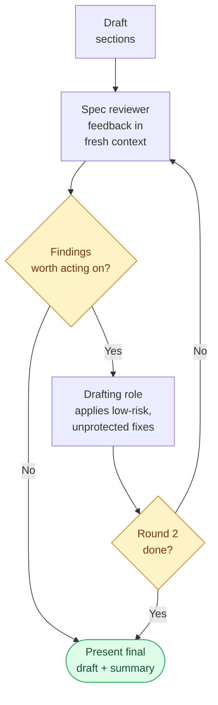

# spec-review

Lucy workflow. Run only when Lucy is addressed (see `../SKILL.md`).

A review-and-fix feedback loop on a draft spec, so the engineer only sees a reviewed, cleaned-up version. Runs **automatically at the end of `spec-draft` and `tech-design`** on the sections they just wrote, and on its own when asked ("Lucy, review the spec for …").

## Input

`spec-review <design ticket> [business|design|stories|all]` — default: the sections just drafted, or `all` when called on its own.

## The loop (max 2 rounds)



| Step | What it does |
| --- | --- |
| Review | Run the **spec reviewer** role (`docs/ai/roles/spec-reviewer.md`, feedback mode) on the sections in scope. If your tool supports subagents, use a fresh one (Claude Code: `spec-reviewer-agent`) so it doesn't share the drafting context; otherwise re-read the spec with only the reviewer role in mind |
| Decide | **Apply** findings that are low risk and not protected: fixes, clarifications, cuts, merges, moves to "Not handled", likely/costly cases to add. **Keep for the engineer** findings that are medium/high risk, protected, or need a business decision (those become `Q-n`). Drop findings that only reword |
| Apply | The role that drafted the section edits the spec file (PO agent for §1/§3, tech design agent for §2), so its rules still hold. Fix references; draft IDs may be renumbered to stay compact (approved IDs never are, FLOW-03) |
| Repeat | Second round only if round 1 changed the spec and the reviewer said "Another round worthwhile: yes". Stop after 2 rounds |

## Present

Show the final draft, then a short summary:

```markdown
## Review (2 rounds, n changes)
Fixed
- BR-3 contradicted the flowchart on refunds; aligned to the flowchart
Simplified
- Removed BR-5 (repeats BR-2's validation)
- Moved "retry after carrier timeout" to Not handled (rare, retried by hand)
- Merged US-3 into US-2 (always shipped together)
Added
- AC-1.4: double-submit of cancel (likely: users double-click)

## For you to decide
- R-6: drop the per-tenant config flag? Risk medium: <why>
```

Then continue the calling workflow's handoff (open questions, assumptions).

## Never

- Change anything protected (spec reviewer role) without the engineer's yes.
- Add scope or edge cases that aren't likely or costly.
- Run more than 2 rounds; diminishing returns.
