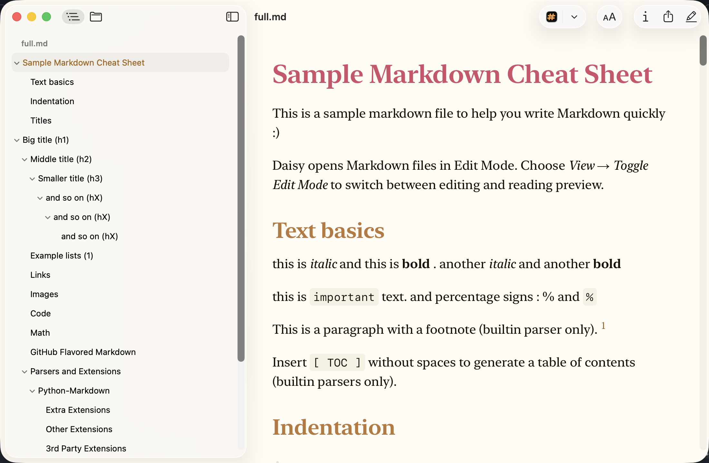
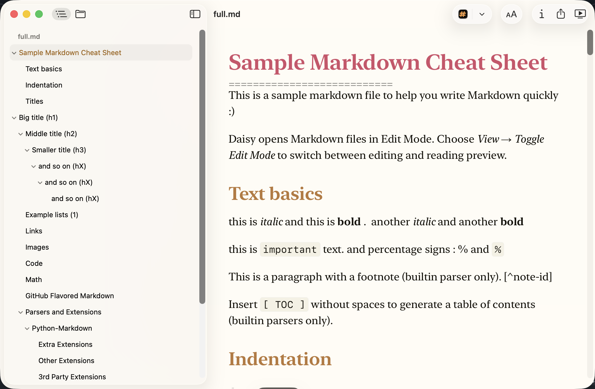

<h1 align="center">Daisy</h1>

<p align="center">
  
</p>

<p align="center">
  A fast, native macOS app for reading & editing Markdown files.
</p>

Daisy is built on [Markdown Preview](https://github.com/pluk-inc/markdown-preview) by pluk-inc. It keeps that app's core — fast, native reading and editing of Markdown — and adds advanced features around it: workspaces, tags and tasks, a journal, an agenda, query blocks, templates and more.

> **Note:** Daisy follows its own direction, so it is not a drop-in replacement. For the original app, use the [upstream repository](https://github.com/pluk-inc/markdown-preview).

<p align="center">&nbsp;&nbsp;&nbsp;</p>

## Installation

Download the signed and notarized DMG from [Releases](https://github.com/bluzky/daisy-app/releases). Requires macOS 15 or later (Apple Silicon or Intel).

## Screenshots

<p align="center">
  
</p>

<p align="center">
  
</p>

## Features

- **Read Mode** — native rendering with a document outline and file navigator; task checkboxes save to the file.
- **Edit Mode** — edit Markdown in place (<kbd>⌘E</kbd>), with live syntax preview, table editing, rich-text paste, and pasted or dropped files copied into a `<document>-assets` folder.
- **Workspaces** — one window frame per folder, with files as tabs. A single click in the Files sidebar opens a preview tab (italic) that the next click replaces.
- **Bookmarks** — pin files and folders at the top of the Files sidebar.
- **Slash commands** — type `/` for headings, lists, tables, code, Mermaid, math, callouts, `/today`, `/now`, `/link` and `/move`.
- **Tags, contexts and projects** — `#tag`, `@context`, `+project`, plus `due:`, `scheduled:` and `p:` on tasks, with suggestions as you type.
- **Indexed workspaces** — **File → Initialize Workspace** indexes the folder's Markdown files for suggestions, name pages, queries and sidebars. Only saved files are indexed.
- **Journal** — one entry per day in `journals/`, with an optional template and carry-over of unfinished tasks.
- **Agenda** — a calendar of scheduled and due tasks (<kbd>⇧⌘I</kbd>); check tasks off from it.
- **References** — files that link to or mention the open one (<kbd>⇧⌘R</kbd>).
- **Query blocks** — ```` ```tasks ```` and ```` ```notes ```` blocks list matching tasks or files, e.g. `+daisy -is:done due:<=7d sort:due`, as a list or a `$view:table`. See [query block guide](docs/query-blocks.md).
- **Code and text files** — open in a code editor with syntax highlighting; add your own types in **Settings → General**.
- **Templates** — insert snippets from your own template file; see [Templates](#templates).
- **Extensions** — code highlighting, callouts, KaTeX, Mermaid and colorful headings, each switchable in **Settings → Extensions**.
- **Search** — in-document find (<kbd>⌘F</kbd>) and OmniSearch (<kbd>⌘K</kbd>) for files, text and commands.
- **Quick Capture** — a global shortcut (<kbd>⌃⌥Space</kbd>) that opens your `Inbox.md` with a new timestamped heading.
- **Themes** — reading themes with font, spacing and color customization; some follow the system light/dark appearance.
- **Export** — PDF, HTML, PNG and Word (`.docx`, with [custom themes](docs/docx-theme-authoring.md)).
- **Quick Look** — `.md` previews in Finder, Spotlight and Mail.
- **Custom shortcuts** — rebind commands in **Settings → Shortcuts** (`~/.config/daisy/keymap.json`).
- **Command line** — `daisy .` opens from a shell; `daisy export report.md --format docx --output report.docx`. See [CLI docs](docs/command-line.md). Links use `daisy://file/<absolute path>`.

### Templates

Pick a template file in **Settings → General → Templates**, then type `/templates` in Edit Mode. Each template starts at a marker line:

```markdown
<!-- template: Meeting notes -->

# Meeting — {{date}}

- {{cursor}}
```

Variables: `{{date}}`, `{{time}}`, `{{datetime}}`, `{{weekday}}`, `{{cursor}}`, and `{{carryover}}` in journal templates. See [`samples/templates.md`](samples/templates.md).

## Supported file types

- Markdown: `.md`, `.markdown`, `.mdown`, `.mkd`, `.mdwn`, `.mdx`, `.mkdn`
- Code and text: `.txt` and common source and config files
- Anything else opens in its default app.

## Building from source

```sh
git clone git@github.com:bluzky/daisy-app.git
cd daisy-app
open daisy.xcodeproj
```

Build and run the `daisy` scheme. The editor bundle needs Node.js; Xcode builds it from `scripts/editor-bundle` when needed.

```
daisy/              Main app (AppKit, WKWebView)
quick-look/         Quick Look extension
scripts/            Release automation and the editor bundle
Version.xcconfig    App version
```

See the [render extension guide](docs/render-extensions.md) to add Markdown extensions.

## Privacy

Release builds send at most one anonymous "app became active" event per day (random install ID, app and macOS version, architecture, region). No document content, file names or personal data. Turn it off in **Settings → Privacy**. Debug builds, and builds without `POSTHOG_PROJECT_TOKEN` in `Secrets.xcconfig`, send nothing.

## Releasing

Bump `MARKETING_VERSION` and `CURRENT_PROJECT_VERSION` in `Version.xcconfig`, add a `CHANGELOG.md` entry, then run `./scripts/release.sh` from a clean tree. `./scripts/rollback-release.sh` reverts the appcast. Details are in the [release-process skill](.agents/skills/release-process/SKILL.md).

## Contributing

Pull requests are welcome; open an issue first for larger changes. Keep PRs focused, match the nearby code style, and test the change in the app. Run `swift test` in `tests/swift-tests` and `npm test` in `scripts/editor-bundle`.

## Acknowledgments

[swift-markdown](https://github.com/swiftlang/swift-markdown), [Mermaid](https://mermaid.js.org/), [KaTeX](https://katex.org/), [Sparkle](https://sparkle-project.org)

## License

[MIT](LICENSE)
