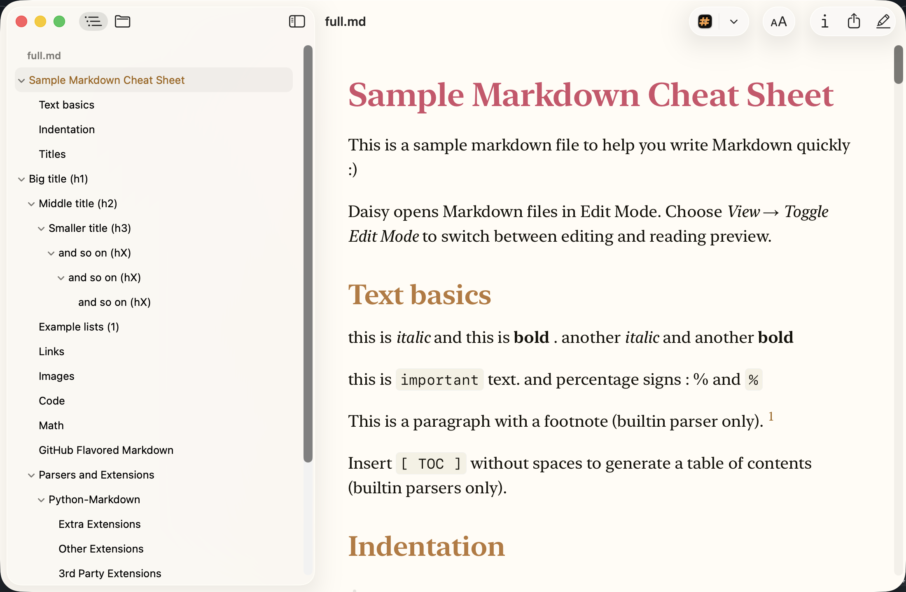
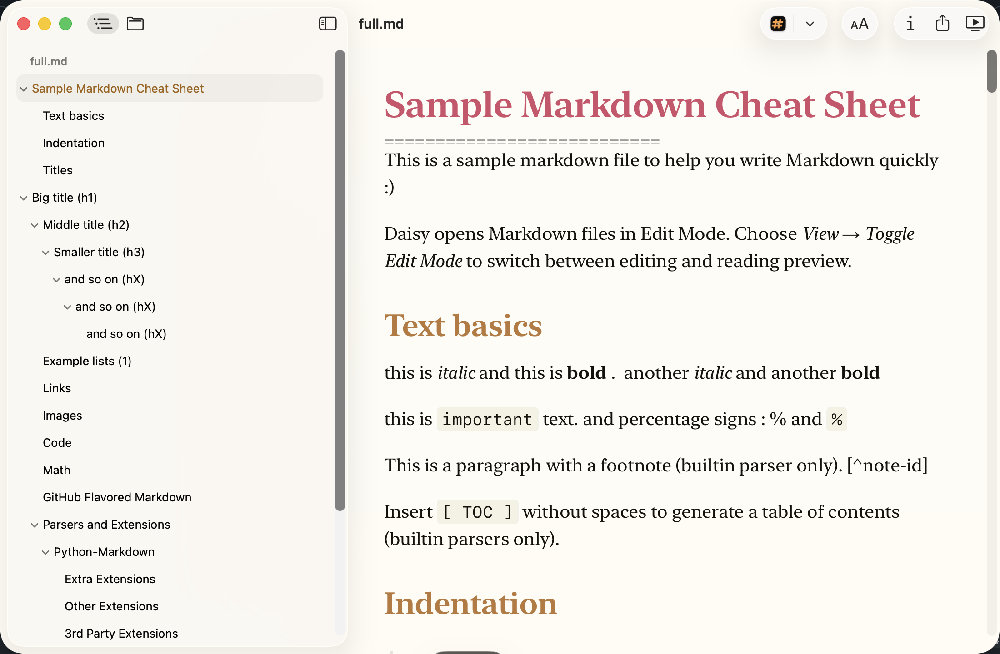

<h1 align="center">Daisy</h1>

<p align="center">
  
</p>

<p align="center">
  A fast, native macOS app for reading & editing Markdown files.
</p>

Daisy is built on [Markdown Preview](https://github.com/pluk-inc/markdown-preview) by pluk-inc. It keeps that app's core — fast, native reading and editing of Markdown — and adds advanced features around it: workspaces, tags and tasks, a journal, an agenda, query blocks, templates and more.

> **Note:** Daisy follows its own direction, so it is not a drop-in replacement. For the original app, use the [upstream repository](https://github.com/pluk-inc/markdown-preview).

<p align="center">&nbsp;&nbsp;&nbsp;</p>

## Installation

Download the signed and notarized DMG from [Releases](https://github.com/bluzky/daisy-app/releases). Requires macOS 15 or later (Apple Silicon or Intel).

## Screenshots

<p align="center">
  
</p>

<p align="center">
  
</p>

## Features

- **Read Mode** — native rendering with a document outline and file navigator; task checkboxes save to the file.
- **Edit Mode** — edit Markdown in place (<kbd>⌘E</kbd>), with live syntax preview, table editing, rich-text paste, pasted or dropped files copied into a `<document>-assets` folder, and <kbd>⌘.</kbd> to open the link, tag, context or project at the caret.
- **Workspaces** — one window frame per folder, with files as tabs. A single click in the Files sidebar opens a preview tab (italic) that the next click replaces.
- **Hide files from the tree** — **Settings → General → Hide from file tree** takes comma-separated names or globs (`journals, *.log`, `notes/drafts`) and keeps matching items out of the Files sidebar. **View → Toggle Hidden Files** (<kbd>⇧⌘.</kbd>) shows them again, along with dot-files.
- **Bookmarks** — pin files and folders at the top of the Files sidebar.
- **Slash commands** — type `/` for headings, lists, tables, columns, code, Mermaid, math, callouts, `/today`, `/now`, `/link`, `/move` and `/carryover`.
- **Tags, contexts and projects** — `#tag`, `@context`, `+project`, plus `due:`, `scheduled:` and `p:` on tasks, with suggestions as you type.
- **Indexed workspaces** — **File → Initialize Workspace** indexes the folder's Markdown files for suggestions, name pages, queries and sidebars. Only saved files are indexed.
- **Journal** — one entry per day in `journals/`, with an optional template and carry-over of unfinished tasks.
- **Agenda** — a calendar of scheduled and due tasks (<kbd>⇧⌘I</kbd>); check tasks off from it.
- **References** — files that link to or mention the open one (<kbd>⇧⌘R</kbd>).
- **Query blocks** — ```` ```tasks ```` and ```` ```notes ```` blocks list matching tasks or files, e.g. `+daisy -is:done due:<=7d sort:due`, as a list or a `$view:table`. See [query block guide](docs/query-blocks.md).
- **Code and text files** — open in a code editor with syntax highlighting; add your own types in **Settings → General**.
- **Templates** — insert snippets from your own template file; see [Templates](#templates).
- **Columns** — put blocks side by side with comments on their own lines: `<!-- columns -->`, then `<!-- column -->` between columns, then `<!-- end-columns -->`; type `/columns` to insert them. Two to four equal columns in Read mode, Quick Look and PDF; narrow windows stack them, other Markdown viewers just show the content in order, and the editor shows the comment lines. A group without its closing comment or with fewer than two columns stays plain. See [Columns](docs/columns.md).
- **Cards** — frame blocks as a panel with `<!-- card -->` and `<!-- end-card -->` on their own lines; type `/card` to insert them. Options go in the opening comment as `key=value`: `fill` (`none`, `surface`, `soft`, `tint`, `solid`), `border` (`none`, `thin`, `thick`), `bar` (a colored bar on the `left` or `top`), `color` (a palette name or a hex color), `shape` (`rounded`, `square`, `pill`, `circle`), `ink` (`light` or `dark` text), `padding` and `align`, and `style` as a preset for several of them (`plain`, `outline`, `filled`, `accent`, `solid`, `none`); there is no raw CSS. Cards work at the top level, inside columns (a lone card fills its column's height) and on slides; a card without its closing comment or with an invalid option stays plain. See [Cards](docs/cards.md).
- **Widgets** — in any file, three fenced blocks become widgets: ```` ```stat ```` tiles (`label`, `value`, `color`, `delta`, `trend`, `good: down`, `note`, a `link` shown as an arrow, and a card's `style`, `fill`, `border`, `bar`, `ink` and `padding` for the tile's look; several in one block share a row), ```` ```chart ```` bar, line, pie and donut charts from a Markdown table in the block (legend `top`, `bottom`, `left`, `right` or `none`; values drawn on the chart unless `values: false`; bars can be `stacked: true` and `direction: horizontal`; `height` in pixels, `grid: false` and `colors` as a comma-separated list; `legend`, `x-axis` and `y-axis` take indented `position`/`visible` options), ```` ```progress ```` bars or rings (`label`, `value`, `max`, `color`, `shape: ring` on the first item, `text` as a template with `{value}`, `{max}` and `{percent}`, and `striped: true` for moving stripes on bars). Four widgets are inline shortcodes, written as inline code so they fit in a sentence or a table cell: `` `{{sparkline: 3,5,2,8 color=success}}` `` draws a small trend line (`type=bar` for bars), `` `{{badge: "In review" color=warning}}` `` a status label (`style=tint`, `solid` or `outline`; `kind=pill`, `rounded` or `square`; `size=sm` to `lg`; `ink`; a ```` ```badge ```` block is no longer drawn), and `` `{{progress: 7/12}}` `` or `` `{{progress: 58%}}` `` a small progress bar (`text=`, `color`, `striped=true`), and `` `{{shape: 1}}` `` a few characters in a marker for numbered steps (`kind` circle, rounded, square, pill, hexagon or diamond; `style=solid`, `tint` or `outline`; `size=sm` to `xl`; `ink=light` or `dark` for the text color). Shortcode arguments are separated by spaces; quote a value with spaces, and options a widget doesn't take are ignored. One `color` key across widgets and cards takes `default` (or `neutral`), `accent`, `success`, `info`, `warning`, `danger` or a hex; each widget puts it where it belongs (a stat's value and its styled tile, a bar's fill, a badge's text and tint, a sparkline's line, a card's border, bar or fill). Read mode, Quick Look, PDF and the editor draw them (the editor shows a widget's source while the caret or either end of a selection is in it); other Markdown viewers show the blocks and shortcodes as plain text, and a block or shortcode with a missing or invalid field stays plain. All values live in the file; colors come from `--widget-*` CSS variables. See [Widgets](docs/widgets.md). **Daisy → Install AI Skills…** teaches your AI agent to write them (`daisy-widgets` skill).
- **Comments** — leave notes for yourself or an AI in the text, written as [CriticMarkup](https://criticmarkup.com): `{==commented text==}{>>the note<<}`, or `{>>a note<<}` on its own. Read mode and Quick Look highlight the text and show the note on hover; the editor looks the same, hiding the markup until the caret is on the line. **Insert → Comment** (<kbd>⇧⌘M</kbd>) wraps the selection and puts the caret in the note; pressed inside a comment it adds a reply. In Read mode, select text and click the bubble that appears at the end of it, type a note and press Return; it is written into the file. The Comments panel (**View → Comments**, <kbd>⌃⌘C</kbd>) lists every comment with Reply, Resolve and Copy for AI. Notes are one line; a second `{>>…<<}` right after the first is a reply. **Edit → Copy Comments for AI** (<kbd>⇧⌘C</kbd>) copies each comment with its line number and text as a brief to paste into a prompt.
- **Extensions** — code highlighting, callouts, comments, KaTeX and Mermaid, each switchable in **Settings → Extensions**.
- **Hide completed tasks** — **View → Hide Completed Tasks** (<kbd>⇧⌘H</kbd>, or its toolbar button) hides checked tasks in Read and Edit mode, in every window; the file is unchanged.
- **Search** — in-document find (<kbd>⌘F</kbd>) and OmniSearch (<kbd>⌘K</kbd>) for files, text and commands.
- **Quick Capture** — a global shortcut (<kbd>⌃⌥Space</kbd>) that opens your `Inbox.md` with a new timestamped heading.
- **Themes** — reading themes with font, spacing and color customization; some follow the system light/dark appearance. **View → Theme** lists every theme, including your own CSS themes in `~/.config/daisy/themes/`: one file styles the preview, the editor and slides. See [your own themes](docs/slides.md#your-own-themes).
- **Slides** — add `slides: true` to a file's frontmatter and it reads as a deck: `---` on its own line starts the next slide, a `???` line starts that slide's speaker notes, and each slide's layout comes from its content. Backgrounds (``), image sizes, `<!-- step -->` reveals, `<!-- column -->` columns, `<!-- space -->` and per-slide `layout`, `_class` and `color` directives are supported. Themes (built-in or your own CSS), headers, footers and page numbers, and a **Slide Preview** pane beside the editor. **View → Present** (<kbd>⌥⌘P</kbd>) shows any Markdown file full screen as slides, with a presenter window (notes, next slide, timer) on a second display. A deck exports and prints one slide per page. See the [slides guide](docs/slides.md). To have your AI agent write decks and widget pages, choose **Daisy → Install AI Skills…** and pick Claude Code, Codex or any folder; it installs the `daisy-slides` and `daisy-widgets` skills there.
- **Export** — PDF, HTML, PNG and Word (`.docx`, with [custom themes](docs/docx-theme-authoring.md)).
- **Quick Look** — `.md` previews in Finder, Spotlight and Mail.
- **Custom shortcuts** — rebind commands in **Settings → Shortcuts** (`~/.config/daisy/keymap.json`). See [Keyboard shortcuts](docs/keybindings.md) for the defaults.
- **Command line** — `daisy .` opens from a shell; `daisy export report.md --format docx --output report.docx`. See [CLI docs](docs/command-line.md). Links use `daisy://file/<absolute path>`.

### Templates

Pick a template file in **Settings → General → Templates**, then type `/templates` in Edit Mode. Each template starts at a marker line:

```markdown
<!-- template: Meeting notes -->

# Meeting — {{date}}

- {{cursor}}
```

Variables: `{{date}}`, `{{time}}`, `{{datetime}}`, `{{weekday}}`, `{{cursor}}`, and `{{carryover}}` in journal templates. See [`samples/templates.md`](samples/templates.md).

## Supported file types

- Markdown: `.md`, `.markdown`, `.mdown`, `.mkd`, `.mdwn`, `.mdx`, `.mkdn`
- Code and text: `.txt` and common source and config files
- Anything else opens in its default app.

## Building from source

```sh
git clone git@github.com:bluzky/daisy-app.git
cd daisy-app
open daisy.xcodeproj
```

Build and run the `daisy` scheme. The editor bundle needs Node.js; Xcode builds it from `scripts/editor-bundle` when needed.

```
daisy/              Main app (AppKit, WKWebView)
quick-look/         Quick Look extension
scripts/            Release automation and the editor bundle
Version.xcconfig    App version
```

See the [render extension guide](docs/render-extensions.md) to add Markdown extensions.

## Privacy

Release builds send at most one anonymous "app became active" event per day (random install ID, app and macOS version, architecture, region). No document content, file names or personal data. Turn it off in **Settings → Privacy**. Debug builds, and builds without `POSTHOG_PROJECT_TOKEN` in `Secrets.xcconfig`, send nothing.

## Releasing

Bump `MARKETING_VERSION` and `CURRENT_PROJECT_VERSION` in `Version.xcconfig`, add a `CHANGELOG.md` entry, then run `./scripts/release.sh` from a clean tree. `./scripts/rollback-release.sh` reverts the appcast. Details are in the [release-process skill](.agents/skills/release-process/SKILL.md).

## Contributing

Pull requests are welcome; open an issue first for larger changes. Keep PRs focused, match the nearby code style, and test the change in the app. Run `swift test` in `tests/swift-tests` and `npm test` in `scripts/editor-bundle`.

## Acknowledgments

[swift-markdown](https://github.com/swiftlang/swift-markdown), [Mermaid](https://mermaid.js.org/), [KaTeX](https://katex.org/), [Sparkle](https://sparkle-project.org)

## License

[MIT](LICENSE)
