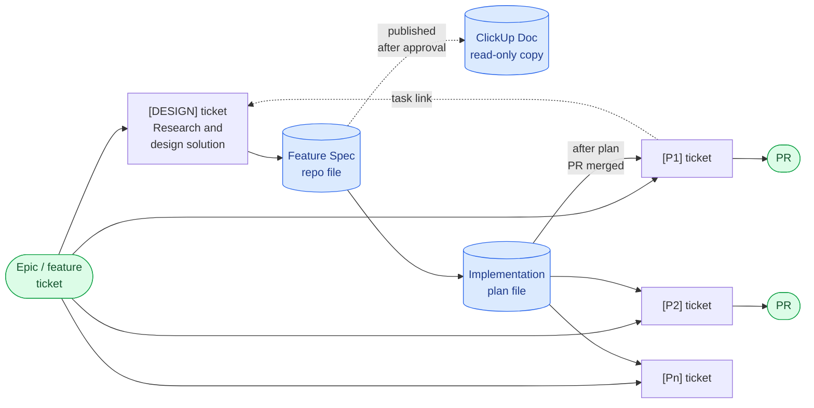

# ClickUp

Applies when `Lucy tracker: clickup` (the default). For `github` or `none`, see `docs/ai/flow/tracker.md`.

A feature is an **epic (feature) ticket** with **one design ticket** and **one phase ticket per phase** of the implementation plan, all siblings under the epic (`docs/features/<feature-slug>-plan.md`, FLOW-10). The Feature Spec lives in the repo (`docs/ai/flow/spec.md`); the design ticket links it, and moving the ticket to `done` is the approval. Phase tickets hold the implementation work; each is one PR. Agents read ClickUp; humans approve in it.

## Ticket model



| Ticket | Title | Covers |
| --- | --- | --- |
| **Epic / feature ticket** | The feature's name | Parent of the design and phase tickets. Owned by the team; Lucy only reads it and creates tickets under it |
| **Design ticket** | `[DESIGN] <feature>` | Research & design solution: Steps 1–3 and Gate 1 (spec, mockup, design review) |
| **Phase ticket** | `[P<n>] <phase title>` | Steps 4–5 and Gate 3 for one phase of the plan (its user stories, one PR), then QC and release |

## Statuses

All tickets share one status list: `todo` → `in progress` → `in review` → `dev ready` → `qc ready` → `ready for prod` → `done`. Design tickets skip the three delivery statuses.

| Status | Design ticket | Phase ticket |
| --- | --- | --- |
| `todo` | Created, not started | Created by `create-tickets`, not started |
| `in progress` | Steps 1–3: spec file in the repo, mockup | Step 4: implementing (`implement-phase`) |
| `in review` | Gate 1: spec PR open, tech lead reviewing | Step 5 + Gate 3: PR open, code review |
| `dev ready` | — (skipped) | PR merged; on the dev environment |
| `qc ready` | — (skipped) | Ready for QC testing |
| `ready for prod` | — (skipped) | QC passed, waiting for release |
| `done` | **Spec approved**: spec PR merged and published to ClickUp | Released to production |

TODO: confirm the meaning of `dev ready`, `qc ready` and `ready for prod` with the team; this harness only enforces up to the merge.

**Approval = design ticket `done` or `complete`.** Both statuses count as approved; wherever this harness says a design ticket is `done`, `complete` counts too. Only the tech lead moves a design ticket to `done`, after approving and merging the spec PR and after it's published to ClickUp. Agents and the PR check treat `done` as "spec approved" (FLOW-02). If the spec must change after that, move the design ticket back to `in review` until the tech lead re-approves.

Rules:

- One epic ticket per feature, with one design ticket under it. It links the Feature Spec file in the repo (in its description or a comment), and (after publishing) a comment with its ClickUp Doc link.
- Phase tickets are created **after** the plan PR is merged (`create-tickets`), one per phase `P<n>` in the plan. How stories are grouped into phases is decided in the plan (FLOW-10), not here.
- Phase tickets are **siblings** of the design ticket: all are subtasks of the same epic ticket, not of the design ticket. Each phase ticket carries a **ClickUp task link** to its design ticket; agents and the PR check find the approval through this link, never through the parent (the epic's status doesn't mean approval).
- One PR per phase ticket, covering all its ACs. If a phase is too big for one PR, change the plan.
- A phase's dependencies count as met once they are merged (`dev ready` or later).

## Status updates by Lucy

Lucy moves a ticket forward at two points: when work starts, and when its PR is opened.

| When | Ticket | Move to |
| --- | --- | --- |
| `spec-draft` or `tech-design` starts (before drafting) | Design | `in progress` |
| `spec-check` opens the spec PR | Design | `in review` |
| `implement-phase` starts (after the gate and dependency checks pass, before coding) | Phase | `in progress` |
| `pr-prepare` opens the PR | Phase | `in review` |

Rules:

- Move only **forward**: skip the update if the ticket is already at that status or later. Never move a ticket back.
- These two statuses only. Lucy never sets `dev ready`, `qc ready`, `ready for prod`, `done` or `complete` (CORE-02).
- No confirmation needed. Mention the status change in the reply.
- MCP: the server's update-task tool. CLI: `clickup task edit <id> --status "in progress"` (or `"in review"`). If the update fails, report it and carry on with the work; the engineer moves the ticket by hand.

## Links

There are no custom fields. Links are kept in text:

| Link | Where | Written by |
| --- | --- | --- |
| Feature Spec file, Plan file | Phase ticket description | `create-tickets` |
| Published ClickUp Doc | Comment on the design ticket, starting `Spec published: <Doc link> (from <commit>)` | `spec-publish`. Re-publishing finds the latest such comment |

Phase ticket description (written by `create-tickets`, copied from the plan and spec):

```markdown
Design ticket: <link>
Feature Spec: <link>
Plan: <link> → P<n>

Stories: US-1, US-2

US-1: As a <role>, I want <action>, so that <benefit>
- AC-1.1 (BR-x): Given …, when …, then …

US-2: … (repeat per story in this phase)

Breakdown:
| # | Context / module | What to do |
| 1 | … | … |

Depends on: [P<m>] <link>
```

## Publish location

Where approved specs are published is chosen per spec by the engineer (`spec-publish … to <ClickUp link>`): a Space, Folder or List, an existing Doc (new page), or a Doc page (replace).

Optional default, used when no location is given and the design ticket has no linked Doc yet:

- Default publish location: TODO (e.g. a `Feature Specs` Folder link), or leave empty to always ask.

## Agent access

Lucy reaches ClickUp in this order, using the first that works:

| # | Method | Use when | Check |
| --- | --- | --- | --- |
| 1 | **ClickUp MCP server** | Configured in the engineer's tool (per-tool setup: `docs/ai/tools.md`) | ClickUp tools are available in the session |
| 2 | **ClickUp CLI** | No MCP, but the CLI below is installed and logged in | `command -v <cli>` succeeds and a read command (e.g. get one ticket) works |
| 3 | **By hand** | Neither works | Lucy asks the engineer to paste the ticket and prints anything to create or update |

Say which method you're using in the reply (`Lucy · spec-draft · via CLI`). Never ask for, print or store API tokens; the MCP server or CLI holds the login.

### ClickUp CLI

The team uses **[triptechtravel/clickup-cli](https://github.com/triptechtravel/clickup-cli)** (Go). There's no official ClickUp CLI.

| | |
| --- | --- |
| Command | `clickup` |
| Install | `brew install triptechtravel/tap/clickup` (other platforms: see the repo's releases) |
| Login | `clickup auth login` once per engineer, with their own account; check with `clickup auth status` |
| Verified with | v0.39.0 (`clickup version`). Commands below checked against its `--help` |

Commands Lucy uses. Always add `--json` to reads and parse IDs from the JSON.

| Operation | Used by | Command |
| --- | --- | --- |
| Get a ticket (title, description, status, custom fields, parent, list, subtasks) | all workflows | `clickup task view <id> --json` (add `--recursive` for all descendants) |
| Get several tickets | `create-tickets`, `implement-phase` | `clickup task view <id1> <id2> … --json` |
| List a ticket's comments | `spec-draft` | `clickup comment list <id> --json` |
| List a feature's phase tickets | `create-tickets`, `implement-phase` | `clickup task view <epic-id> --json` → `.subtasks[]` (the design ticket's `parent` is the epic id) |
| Create a phase ticket under the epic | `create-tickets` | `clickup task create --list-id <list-id of design ticket> --parent <epic-id> --name "[P<n>] <phase title>" --markdown-description "<body>" --status todo --json`, then link it to the design ticket (`clickup task link <phase-ticket-id> <design-id>`; check `clickup task link --help` for the exact form) |
| Add a phase dependency | `create-tickets` | `clickup task dependency add <phase-ticket-id> --depends-on <other-phase-ticket-id>` |
| Move a ticket to `in progress` / `in review` | `spec-draft`, `tech-design`, `spec-check`, `implement-phase`, `pr-prepare` | `clickup task edit <id> --status "in progress"` (see "Status updates by Lucy") |
| Comment on a ticket | `spec-publish`, handoffs | `clickup comment add <id> "<text>"` |
| Find existing Docs | `spec-publish` | `clickup doc list --parent-id <id> --parent-type SPACE\|FOLDER\|LIST --json` |
| Create a Doc at a location | `spec-publish` | `clickup doc create --name "[FEATURE] <name>" --parent-id <id> --parent-type SPACE\|FOLDER\|LIST --json` |
| List a Doc's pages | `spec-publish` | `clickup doc page list <doc-id> --json` |
| Add the spec as a page | `spec-publish` | `clickup doc page create <doc-id> --name "<name>" --content "$(cat <spec-file-from-target-branch>)" --content-format text/md --json` |
| Replace a page (re-publish) | `spec-publish` | `clickup doc page edit <doc-id> <page-id> --content "$(cat <spec-file-from-target-branch>)" --content-format text/md` (default mode is replace) |

Resolving a publish location from a link: a Doc link `…/v/dc/<doc-id>/<page-id>` gives the Doc and page IDs; for a Space, Folder or List link, take the ID from the URL and the matching `--parent-type`. If unsure, ask the engineer.

Rules for CLI use:

- **Reads** run without asking.
- **Writes** (`task create`, `task edit`, `task dependency add`, `comment add`, `doc create`, `doc page create|edit`): run without asking when the engineer asked for the workflow and its checks pass (`spec-publish`: spec approved and merged; `create-tickets`: design ticket `done` and plan merged). List every command run in the reply. A write the engineer didn't ask for needs a yes first.
- Write long content (spec, descriptions) from a file, never retyped by hand: export the spec from the target branch first (`git show <target-branch>:docs/features/<slug>.md > <tmp file>`).
- `task edit --status` only for the `in progress` / `in review` updates in "Status updates by Lucy". Never use it for other statuses, and never use `task delete`, `task archive` or `task move` (CORE-02).
- If a command fails, show the error and fall back to doing that step by hand. Don't retry with guessed flags. If `clickup auth status` fails, ask the engineer to log in.
- If the installed version differs from the one above and a command fails, check `clickup <command> --help` and tell the engineer the table needs updating in the harness.

### Other access
- **PR check (`check_pr.py`):** a personal read-only `CLICKUP_API_TOKEN`. It calls `GET https://api.clickup.com/api/v2/task/{task_id}` for the phase ticket, then for its linked tasks, and reads the linked tasks' `status` (approved = `done` or `complete`, set by `DESIGN_APPROVED_STATUS`).

| Action | Agent allowed? |
| --- | --- |
| Read tickets, comments, linked tickets | Yes |
| Write drafts to ClickUp | No — drafts live in the repo |
| Publish an **approved, merged** spec to a ClickUp Doc (`spec-publish`) | Yes, when asked and the checks pass |
| Create phase tickets from a merged plan (`create-tickets`) | Yes, when asked, the design ticket is `done` or `complete` and the plan is merged |
| Comment on tickets (handoffs, open questions) | TODO: decide (recommended: yes) |
| Move a ticket to `in progress` / `in review` | Yes, at the points in "Status updates by Lucy" |
| Any other status change | No — humans move tickets |
| Move a design ticket to `done` | Never (CORE-02) |

Writes go through MCP or the CLI, without a confirmation prompt once the workflow's checks pass. If neither can write, `spec-publish` and `create-tickets` print what to create and the engineer does it by hand. Drafting never needs ClickUp write access.

## Links

- Ticket URL: `https://app.clickup.com/t/<task_id>` (the PR check extracts `<task_id>` from the PR description).
- Plan: `docs/features/<feature-slug>-plan.md` in the repo.
- Spec: `docs/features/<feature-slug>.md` in the repo; published copy at `https://app.clickup.com/<workspace_id>/v/dc/<doc_id>/…`
