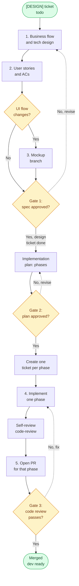

# Lifecycle

The harness view of the [[Development flow]]: each step's ticket, entry and exit criteria, and what the harness checks. Ticket model: `docs/ai/flow/tracker.md` (ClickUp details: `docs/ai/flow/clickup.md`). Ticket words below (design ticket, phase ticket, `done`, `in review`) map to the repo's tracker: GitHub uses issues, labels and closing; with no tracker the merged spec and plan are the approval. Where the spec lives and how it's reviewed: `docs/ai/flow/spec.md`.

## Auto flow

The engineer can ask Lucy to run the whole flow (`auto`, FLOW-11): she defines the spec and the plan from the engineer's requirement, asks for **one review** of both, then implements every phase, self-reviews and fixes, and asks for **final verification** before opening the PRs. The steps and gates below are the same; the engineer's recorded approval at the first checkpoint replaces the spec PR and plan PR merges, and PRs open only after the engineer verifies.

## When the flow applies

Full flow if **any** is true: new feature or user-facing flow · new DB table · more than one service or an external integration · changes money, stock, order status or permissions · more than ~3 days of dev.

Otherwise (bug fix, copy change, small tweak): one normal ticket, no design ticket; the PR still links the ticket.

## Steps and gates

Steps 4, 5 and Gate 3 repeat for every phase, in plan order. Phases without dependencies can run in parallel.

Lucy moves tickets to `in progress` when work starts and to `in review` when the PR opens (`docs/ai/flow/clickup.md` → "Status updates by Lucy"); humans move them further.

| Step | Ticket · status | Entry | Harness | Exit |
| --- | --- | --- | --- | --- |
| 1. Business flow & tech design | Design · `in progress` | Design ticket exists; spec file created on the engineer's branch | `spec-draft business` (§1, §4), then `tech-design` (§2, §4) | §1, §2 written; open questions listed |
| 2. User stories & ACs | Design · `in progress` | §1 reviewed | `spec-draft stories` (§3) | Every BR covered by an AC |
| 3. UI mockup *(if UI changes)* | Design · `in progress` | §3 written | `mockup` | Tech lead feedback applied |
| Gate 1. Design review | Design · `in review` | `spec-check` has no blockers; spec PR open | `spec-check` (submit) | Tech lead approves and merges the spec PR |
| Publish | Design · `in review` | Spec PR merged | `spec-publish` | ClickUp Doc created/updated; tech lead → design ticket `done` |
| Implementation plan | Design · `done` | Design ticket `done` or `complete` | `plan` (self-check against `docs/ai/checklists/gate-2-plan-review.md`) | Plan drafted; no blockers |
| Gate 2. Plan review | Design · `done` | Plan PR open into the target branch | `plan` (submit) | Tech lead approves and merges the plan PR |
| Create phase tickets | Design · `done` | Plan merged | `create-tickets` | One `[P<n>]` ticket per phase, subtask of the epic ticket (sibling of the design ticket), linked to it, `todo` |
| 4. Implement | Phase · `in progress` | Phase `todo`, dependencies merged (`dev ready`+) | `implement-phase <phase ticket>` | Every AC of the phase has a passing test |
| 4b. Self-review *(recommended)* | Phase · `in progress` | Phase implemented, tests pass | `code-review` (self-review mode) | Findings fixed or noted; no blockers |
| 5. Submit | Phase · `in review` | Tests pass | `pr-prepare` | PR open with links and evidence |
| Gate 3. Code review | Phase · `in review` | PR open, `check_pr.py` passed | `code-review` (business, structure, style, workflow JSON reviewers) on the PR | Tech lead approves → merge → phase `dev ready` |
| After merge | Phase · `qc ready` → `ready for prod` → `done` | Merged | — (outside this harness) | QC passed, released |

The design ticket is `done` once the spec PR is merged and published. If the spec must change later, open a new spec PR and move the ticket back to `in review` until the tech lead re-approves; Lucy won't implement new phases meanwhile.

## What the PR check verifies (`scripts/check_pr.py`)

Run locally by `pr-prepare` before the PR is opened. It isn't wired to CI, so the tech lead confirms these at code review.

| Check | Rule |
| --- | --- |
| PR links a phase ticket and the Feature Spec | FLOW-01 |
| The phase ticket title has a `[P<n>]` tag, and the plan has that phase | FLOW-07, FLOW-10 |
| The phase ticket's design ticket (linked task) is `done` or `complete` | FLOW-02 |
| PR lists the ACs it covers: all ACs of the phase's stories, and no others | FLOW-04, FLOW-07 |
| Each listed AC has a test with its ID in the name | FLOW-04 |
| Each listed AC has evidence in the PR | FLOW-04 |
| "Differences from the spec" section is filled (or "None") | FLOW-05 |
| Source branch is not `mockup/*` | FLOW-06 |

`--light` checks only the ticket link and the `mockup/*` rule (small changes outside the flow).
