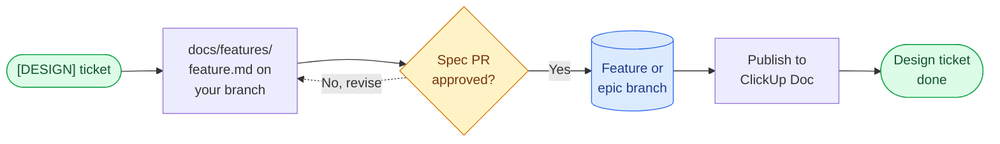

# Feature Spec: where it lives

The Feature Spec is **written and reviewed in the repo**. With the ClickUp tracker, ClickUp gets a copy only once the spec is finalized (approved); with GitHub or no tracker there is no copy (`docs/ai/flow/tracker.md`).

| # | Step | What happens |
| --- | --- | --- |
| 1 | Draft | Lucy (`spec-draft`, `tech-design`) writes `docs/features/<feature-slug>.md` from `docs/ai/templates/feature-spec.md`, on the **current branch**. The engineer decides the branch; Lucy never creates or switches branches for the spec |
| 2 | Self-check | `spec-check` against the Gate 1 checklist |
| 3 | Spec PR | A PR from the engineer's branch into the **target branch** (the feature or epic branch) containing the spec (plus diagrams/images it needs; other changes are up to the team). Title `[DESIGN] <feature>`, description links the design ticket and mockup. Design ticket → `in review` |
| 4 | Review | The tech lead reviews in the PR (line comments). The engineer answers every comment by changing the spec or replying |
| 5 | Approve | The tech lead approves and merges the spec PR. The target branch now holds the approved spec |
| 6 | Publish | `spec-publish` copies the merged spec into a ClickUp Doc `[FEATURE] <name>` at the location the engineer chooses (Space, Folder, List or an existing Doc), and links it on the design ticket |
| 7 | Done | The tech lead moves the design ticket to `done` = spec approved |

## Rules

- **Branch:** whatever the engineer is on. Lucy writes there and doesn't create, switch or name branches. If the current branch is the target branch itself when submitting for review, Lucy asks which branch to use, since a PR needs a separate source branch.
- **Target branch:** the feature or epic branch the spec PR merges into. Recorded in the spec header (*Target branch*). Lucy asks for it when opening the spec PR if it isn't set; she never guesses it.
- **Path:** `docs/features/<feature-slug>.md`, one file per feature. `<feature-slug>` is the design ticket title in kebab-case (e.g. `order-cancellation`). Extra files (images, long diagrams) go next to it as `docs/features/<feature-slug>-*.*`.
- **Source of truth:** the file on the target branch. The ClickUp Doc is a read-only copy for people outside the repo; never edit it directly.
- **Publish location:** chosen by the engineer per spec ("… publish the spec to <ClickUp link>"). Re-publishing updates the Doc already linked on the design ticket. With no location and no linked Doc, Lucy uses the default in `docs/ai/flow/clickup.md` if set, otherwise asks.
- **Never publish a draft.** Publish only a spec merged to the target branch after the tech lead approved its spec PR.
- **Finding the spec:** search `docs/features/` for the file whose header links the design ticket (or ask the engineer).
- **Changes after approval:** edit the file in a new spec PR, design ticket back to `in review`. After it merges, publish again and the tech lead moves the ticket back to `done`.
- **Reading the spec** (plan, phase tickets, implementation, PR review): always from the target branch, or from the open spec PR's branch while the spec is in review.
