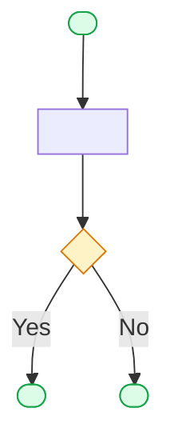
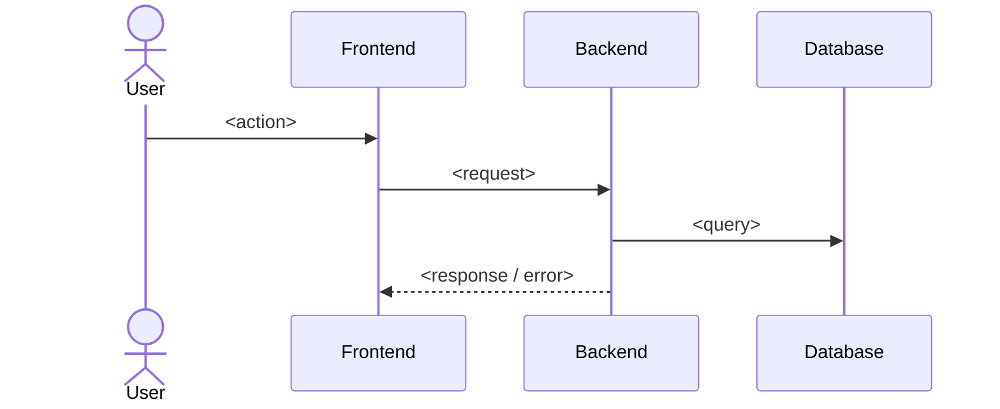

# [FEATURE] <name>

<!-- Canonical template. Agents and the PR check parse the headings and IDs: keep them unchanged. -->

| | |
| --- | --- |
| Design ticket | <[DESIGN] ticket link> |
| Target branch | <feature or epic branch the spec PR merges into> |
| Spec PR | <link, once opened> |
| ClickUp Doc | <added by spec-publish after approval — read-only copy> |
| Author (engineer) | <name> |
| Drafted with | PO agent (§1, §3), Tech design agent (§2) — reviewed by author |
| Reviewer | <tech lead> |
| Status | Draft / In review / Approved |
| Target release | <version or date> |
| Implementation plan | `docs/features/<feature-slug>-plan.md` (after Gate 1; phases and tickets live there) |

## 1. Business flow

**Problem:** <what is wrong or missing today, and for whom>

**Goal:** <what changes for the user or business; metric if possible>

**Out of scope:**
- <what this feature will NOT do>

**Not handled** (edge cases deliberately left out: rare, or fixable by hand):
- <case> — <why it's acceptable / what happens instead>

**Flow:**

**Business rules:**

| ID | Rule | Source |
| --- | --- | --- |
| BR-1 | <what must be true, in business words> | <task / Q-n / current behaviour> |

## 2. Technical design

**Sequence:**

**API changes:**

| Method | Path | Request | Response | Errors |
| --- | --- | --- | --- | --- |

**DB changes:**

| Table | Change | Columns / indexes | Migration & backfill | Volume / locks |
| --- | --- | --- | --- | --- |

**Jobs / events / config / feature flags:** <list or "none">

**Impact & risk:**

| Area | What changes | Impact | Risk | Mitigation |
| --- | --- | --- | --- | --- |

**Rollout:** <feature flag? phased?>

**Rollback:** <how to turn it off safely after real data exists>

## 3. User stories & acceptance criteria

### US-1: As a <role>, I want <action>, so that <benefit>

- AC-1.1 (BR-1): Given <state>, when <action>, then <result>
- AC-1.2 (BR-2): Given <state>, when <action>, then <error result>

<!-- Only stories and BRs that are needed; never add one to reach a number. Usually 1–4 ACs per story. Only behavior someone could get wrong; no common-sense ACs ("other rows unchanged", "nothing else happens"). -->

**Mockup:** <preview URL / branch `mockup/<feature>`, or "no UI change">

## 4. Open questions & decisions

| ID | Question | Options | Decision | By | Date |
| --- | --- | --- | --- | --- | --- |
| Q-1 | | | | tech lead | |
