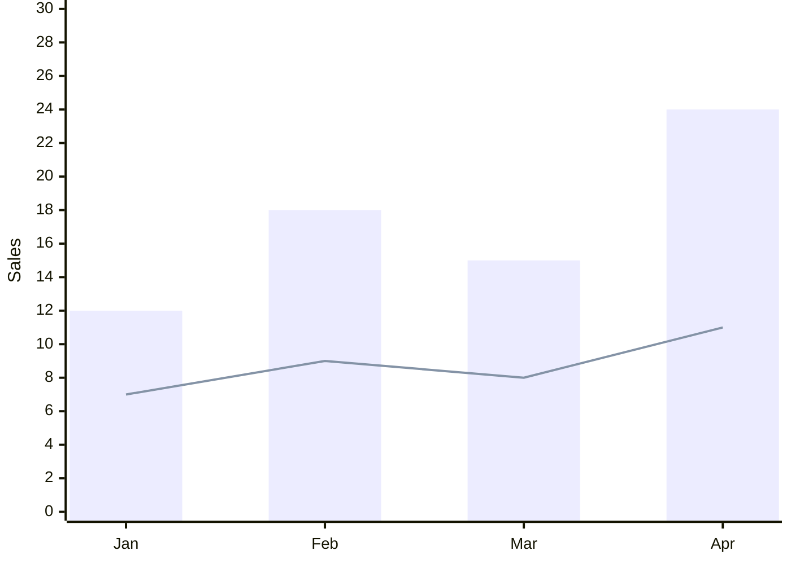
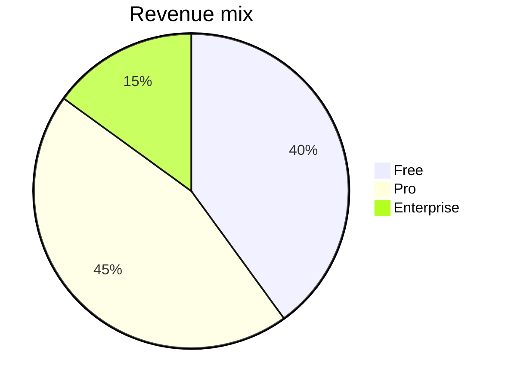

# Dashboard

Turn a Markdown file into a dashboard with three kinds of fenced block: `stat` tiles, `progress` bars and `badge` labels. Add this to the frontmatter:

```yaml
---
dashboard: true
---
```

Without it the same blocks are ordinary code blocks, so other documents never change. Every value is written in the file: there are no data files, no network fetches and no formulas. See [`samples/dashboard.md`](../samples/dashboard.md) for a complete example.

Each block is a few `key: value` lines. Where a block holds several items, a line of `---` separates them.

For charts, use Mermaid; see [Charts](#charts).

## Stat tiles

````markdown
```stat
label: Revenue
value: $48.2k
delta: +12%
trend: up
note: vs last month
link: #sales-by-month
---
label: Churn
value: 2.1%
delta: -0.4%
trend: down
good: down
```
````

| Key | Required | What it does |
| --- | --- | --- |
| `label` | yes | The tile's title, top left. |
| `value` | yes | The big number. Written as you want it shown: `$48.2k`, `3,204`, `2.1%`. |
| `delta` | no | The change, on the value's line at the tile's right edge. |
| `trend` | no | `up`, `down` or `flat`: the arrow before the delta, and its color. Ignored without a `delta`. |
| `good` | no | `down` for a metric where down is good, such as churn. The default is `up`. |
| `note` | no | A small line under the value. |
| `link` | no | An arrow in the tile's top right corner that opens like any Markdown link: a web address, a relative file (`reports/q3.md`) or a heading in the same file (`#sales-by-month`). |

- All the tiles in one block share a row and wrap on a narrow window.
- Color follows `trend` and `good`: a move in the good direction is green, the other red, and `flat` grey. So `trend: down` with `good: down` is green.
- A tile needs only `label` and `value`. A `delta` without a `trend` shows grey with no arrow. A `trend` without a `delta` is ignored.
- A `javascript:`, `data:` or `file:` link leaves the block plain.

## Progress

````markdown
```progress
label: Features
value: 7
max: 12
---
label: Tests passing
value: 182
max: 190
```
````

`label`, `value` and `max` are required. `value` is zero or more and `max` above zero; a value above its maximum shows a full bar. Each bar shows `value / max` beside its label, and the bars in one block stack.

## Badges

````markdown
```badge
text: Build passing
status: ok
---
text: Docs outdated
status: warn
```
````

`text` and `status` are required. `status` is `ok` (green), `warn` (amber) or `fail` (red). Badges in one block sit side by side.

## Charts

Daisy draws charts with [Mermaid](https://mermaid.js.org), which also renders on GitHub, GitLab, Obsidian and in most Markdown editors. Bar and line charts use `xychart-beta`; pie charts use `pie`:

````markdown



````

Mermaid charts don't need `dashboard: true`, and they keep Mermaid's own colors rather than the dashboard palette below.

## Colors

Widgets take their colors from CSS custom properties:

| Property | Used for |
| --- | --- |
| `--dashboard-accent` | Progress bars. |
| `--dashboard-positive`, `--dashboard-negative`, `--dashboard-warning`, `--dashboard-neutral` | Stat deltas and badges (green, red, amber, grey). They have separate light and dark values. |
| `--dashboard-text`, `--dashboard-surface` | Note and secondary text, progress track. They follow the page's theme colors. |
| `--dashboard-border`, `--dashboard-card` | Stat tile outline (the theme's grid color) and fill (the theme's aside background, so tiles stand out from the page). |

Daisy's themes and **Customize Theme** do not set the accent or status colors yet, so they are the same in every theme. Authors cannot set a color in the block itself.

## Invalid blocks and other viewers

A block with a missing required key, an unknown value (`status: purple`, `trend: sideways`), a value that should be a number but isn't, or a line that is not `key: value` is left as the plain code block it is in the file. The rest of the document still renders. Other Markdown viewers show every block that way.

## Where it renders

Read mode, Quick Look, PDF export and [slides](slides.md) (a deck with `dashboard: true` draws widgets inside its slides) draw the widgets. The editor shows the blocks as text, and DOCX export writes each block as the code block it is.
