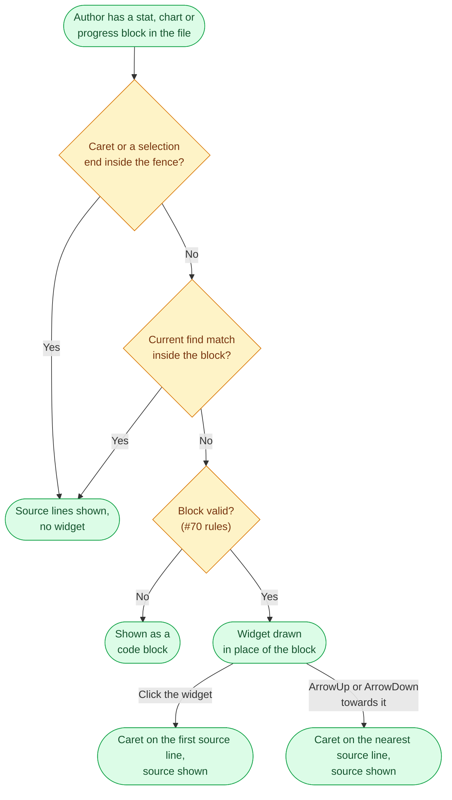
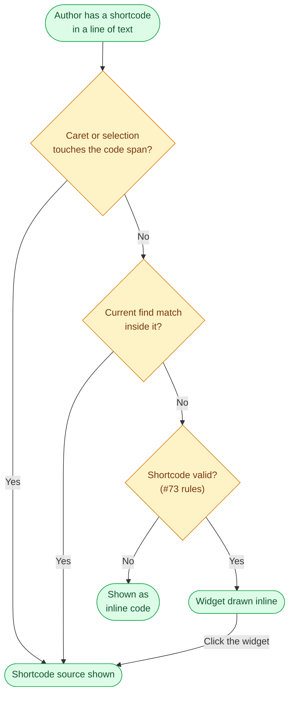
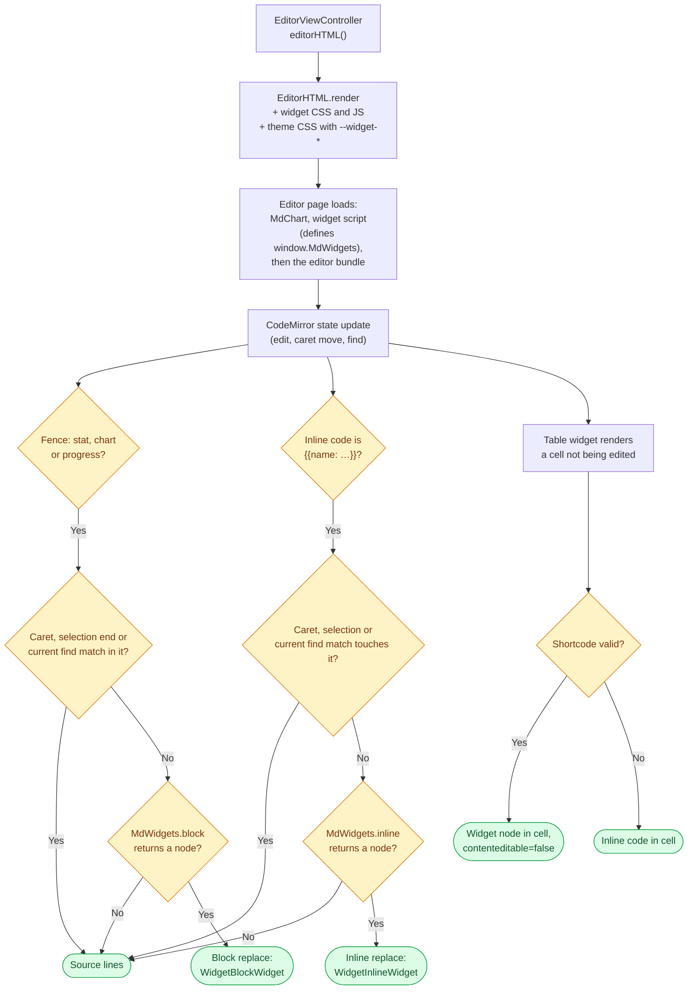

# [FEATURE] Widget previews in the editor

| | |
| --- | --- |
| Design ticket | [#78 [DESIGN] Widget previews in the editor](https://github.com/bluzky/daisy-app/issues/78) |
| Target branch | `main` |
| Spec PR | Not opened |
| ClickUp Doc | n/a (GitHub tracker) |
| Author (engineer) | Daniel (flex) |
| Drafted with | Draft — PO agent (§1, §3), Draft — Tech design agent (§2); not yet reviewed by the author |
| Reviewer | tech lead |
| Status | Draft, not approved (Gate 1 not passed) |
| Target release | next minor |
| Design slides | — |
| Implementation plan | `docs/features/editor-widget-previews-plan.md` (after Gate 1) |

Builds on [Render Markdown as a dashboard](markdown-widgets.md) (#70) and [Inline widget shortcodes](markdown-shortcodes.md) (#73). Their widgets, options and "an invalid widget stays code" rule (#70 BR-7, #73 BR-4) are reused unchanged. This feature only adds a place where they are drawn.

**Depends on** [Unified CSS themes](unified-css-themes.md) (#75), phase P2 ([PR #77](https://github.com/bluzky/daisy-app/pull/77)). The theme widget colour slots this spec brings into the editor (BR-5, AC-1.6, §2 part 3) exist only there. File and line references in this spec are to `feature/p2-unified-css-themes` at `31af8d3`, not to `main`. Implementation starts after #77 reaches `main`.

## 1. Business flow

**Problem:** Widgets are drawn in Read mode, Quick Look, PDF and slides, but the editor shows them as raw text (`docs/widgets.md:318`). An author building a dashboard sees `label: Revenue` / `value: 12,400` lines and `{{badge: …}}` code while writing, and has to switch to Read mode to check what the page looks like. Images and Mermaid diagrams are already drawn in the editor, so widgets are the odd ones out.

**Goal:** In the editor, widget blocks and shortcodes are drawn in place, the same way images and Mermaid diagrams are. Their source appears when the author moves the caret into them. The editor then reads like the page, and editing stays plain Markdown.

**Out of scope:**
- Cards and columns (`<!-- card … -->`, `<!-- columns -->`). They stay as their comment lines in the editor (Q-1).
- A live preview while the source is being edited. Inside a widget, only the source shows (Q-2).
- A setting to turn widgets off in the editor. Widgets are not a user toggle today (`daisy/Rendering/MarkdownHTML+Widgets.swift:168`).
- Source and text files opened in code mode. They are not Markdown.
- New widgets or new widget options.

**Not handled** (deliberately left out):
- A table header cell holding only a sparkline gets the "Column N" placeholder as its accessibility label, because the label reads the cell's text (`scripts/editor-bundle/src/table/widget.js:352-358`). Rare and harmless.
- In a slide deck, editor widgets use the reading theme's widget colours, not the deck theme's (`theme_overrides`). The deck's own look stays in the Slide Preview pane (Q-9).
- A widget fence inside a list item or block quote. It is drawn or left as source the way a Mermaid fence there is today, with no special handling.
- A shortcode whose code span wraps onto a second line stays inline code in the editor, though Read mode draws it (`scripts/editor-bundle/src/live-preview/build-decorations.js:48`; Q-10).
- A Mermaid block still shows its source only after a click or typing, so a keyboard move or Backspace can edit it while the diagram is drawn. This is current behaviour, to be handled separately (Q-12).
- A document with many large charts. Each chart is drawn when its block is built, with no extra lazy loading beyond what the editor already does.

### Flow 1: Widget block (`stat`, `chart`, `progress`)

The author writes or opens a fenced widget block. Shortcodes follow Flow 2.



### Flow 2: Inline shortcode (`{{sparkline: …}}`, `badge`, `progress`, `shape`)



A shortcode inside a table cell follows the same flow, with "the cell is being edited" in place of the caret check (BR-7).

**Business rules:**

| ID | Rule | Source |
| --- | --- | --- |
| BR-1 | A valid ```` ```stat ````, ```` ```chart ```` or ```` ```progress ```` block is drawn as its widget **in place of the whole block** while neither the caret nor either end of a selection is inside the fence. While one is, only its source lines show; nothing is drawn until it leaves. This holds however it got there (click, arrow keys, typing, deleting, undo), so an edit never changes hidden source. A selection reaching past both ends of the block leaves it drawn. | Engineer decision (2026-11-26, Q-2, Q-11). Differs from Mermaid fences, which show source only after a click or typing (`scripts/editor-bundle/src/pointer.js`, `activeCodeBlock`) |
| BR-2 | A valid shortcode is drawn **inline** while neither the caret nor either end of a selection is on its code span. While one is, its source shows. | Engineer decision (2026-11-26); same as images today (`scripts/editor-bundle/src/live-preview/build-decorations.js:452`) |
| BR-3 | A block or shortcode that Read mode would leave as code stays as code in the editor: the same validity rules apply (#70 BR-7, #73 BR-4). | #70 BR-7, #73 BR-4 |
| BR-4 | Clicking a drawn widget puts the caret in its source: a block's first source line (not the opening fence), or inside a shortcode's code span. The source then shows (BR-1, BR-2). | Engineer decision (2026-11-26); same as Mermaid (`scripts/editor-bundle/src/widgets/mermaid.js:29`) and images (`scripts/editor-bundle/src/widgets/basic.js:59`) |
| BR-5 | A widget in the editor looks the same as in Read mode for the same file and theme: same layout, palette, light and dark appearance, and the reading theme's widget colours. | Engineer decision (2026-11-26: reuse the Read mode renderer); #70 BR-8, #73 BR-7 (same widget everywhere it is drawn) |
| BR-6 | While **the current** find match lies inside a widget block or shortcode, it shows its source so the match can be seen. Other highlighted matches don't reveal the source. | Current behaviour for Mermaid fences and images (`scripts/editor-bundle/src/find.js:107`, `currentFindTouches`; `build-decorations.js:64`) |
| BR-7 | In an editor table, a valid shortcode in a cell is drawn while that cell isn't being edited. While the cell is being edited, it shows the shortcode's source. | Engineer decision (2026-11-26, Q-3). Differs from images, which show as source in cells today (`scripts/editor-bundle/src/table/cell-render.js:54`) |
| BR-8 | Copying a selection that includes a drawn widget puts its Markdown source on the clipboard. | Engineer decision (2026-11-26, Q-4); current behaviour for images and Mermaid: CodeMirror's default plain-text copy (`api.js` has no copy handler), and the table copy handler (`table/widget.js:651`) |
| BR-9 | In a slide deck (`slides: true`), widgets are drawn in the editor the same as in any other file (BR-1 to BR-8). | Engineer decision (2026-11-26, Q-5: yes, in phase 2) |

**Docs to update in the same change** (AGENTS.md, "Documentation that describes behaviour"): `docs/widgets.md:318` and `docs/slides.md:174` say the editor shows widgets as text, and `README.md:49` lists the places that draw widgets without the editor.

## 2. Technical design

**Pattern followed:** widget blocks reuse the Mermaid fence preview (`scripts/editor-bundle/src/mermaid-previews.js`, `src/widgets/mermaid.js`), with the rebuild rule of the tasks/notes fence preview (`src/query-blocks.js:288-305`), where a block with no result stays code. Shortcodes reuse the image preview in `src/live-preview/build-decorations.js:433-468`, and table cells reuse the inline rendering in `src/table/cell-render.js`. Nothing new is drawn by the editor: it calls the **Read mode widget script** (`widgetScript`, `daisy/Rendering/MarkdownHTML+Widgets.swift:645`), so both views share one parser and one renderer (BR-3, BR-5). The script and its CSS use only unscoped `.md-widget-*` classes and `window.MdChart` (`MarkdownHTML+WidgetChart.swift:577`), so they run on the editor page as they are. There is no host round trip, API, database or job.

**Diagram** (internal flow; the editor page is a WKWebView, the editor is CodeMirror 6):



**Parts:**

1. **Widget script exposes its builders.** In `widgetScript`, add `window.MdWidgets = Object.freeze({ block(language, source), inline(text), animate(node) })` next to the existing `registerExtension` call (`MarkdownHTML+Widgets.swift:1340`). `block` lowercases the language, as the formatter does (`EscapingHTMLFormatter.swift:1181`), and calls `BUILDERS[language]` (line 1288). `inline` takes a code span's content without the backticks, with CommonMark's single padding space stripped (as `cell-render.js:56-58` does). It reads the name the way `WidgetDocument.inlineWidgetName` does (line 73), because `SHORTCODE` (line 933) doesn't capture it, then matches `SHORTCODE` and calls `INLINE[name]` (line 1165). `animate` hooks moving stripes up to the existing motion observer. Each returns `null` on failure, as `upgrade()` does today. `upgrade()` (line 1301) is rewritten on top of these three functions, so Read mode and the editor can't drift apart.
2. **Assets on the editor page.** `EditorCapability` (`daisy/Rendering/MarkdownRenderExtension.swift:112`) gets an optional `bodyHTML` (default `""`), collected like `editorExtensionCSS` (line 273) into a new `EditorHTML.Configuration.extensionBodyHTML`. It holds complete `<script>` elements and is emitted unchanged, as `RenderAssets.bodyJS` is: `widgetScript` and `widgetChartScript` already include their `<script>` tags (`MarkdownHTML+Widgets.swift:645-646`). It is emitted **before** the editor bundle (`EditorHTML.swift:960`), so `MdWidgets` exists when the editor starts. `WidgetsExtension` (`MarkdownHTML+Widgets.swift:162`) returns `editor: EditorModule(moduleID: "widgets", css: widget CSS + chart CSS + editor spacing, bodyHTML: widgetChartScript + widgetScript)`. **Editor spacing:** block widgets are wrapped in a `.cm-md-widget-preview` element, and the widget root's own vertical margin (e.g. `.md-widget-stats { margin: 1em 0 }`) is zeroed inside it, so spacing comes from the lines around the block, as for Mermaid (`EditorHTML.swift:692-696`). The editor rules also size widgets as `border-box`, as Read mode does, and reset `text-indent` and `white-space`, so a widget doesn't inherit a heading or list line's. The combined widget styles and scripts are shared statics used by both views. The matching block metric in `src/live-preview/build-decorations.js:169-171` gives a fence drawn as a widget a new `METRICS.widget` (the host passes `bodyFontSize`, since a widget's own margin is `1em`), so the gaps around a widget match Read mode (BR-5). The widget stylesheet sets unscoped `:root` palette defaults (`MarkdownHTML+Widgets.swift:194-215`), against the `EditorCapability.css` comment (`MarkdownRenderExtension.swift:115-116`) that editor CSS must be scoped to a class the module adds. That is safe only because the `widgets` module can't be turned off; the comment is updated to allow page-wide variables from a module that is always on. `EditorViewController.swift:1011` passes it in. (Q-6.)
3. **Theme colours in the editor (BR-5, AC-1.6).** `ThemeColorsSetting.editorOverrideCSS` (`daisy/Theme/ThemeColorsSetting.swift:397`) emits only some colours today and says so: "The editor shows widgets as text, so only bold text takes a color" (line 418). Add the widget palette (`ThemeColorSlot.pageColorProperties`' widget entries, line 88), and `--widget-card` from the code background as `ThemeOverrides.css` does (`daisy/Rendering/MarkdownHTML.swift:121`). Their dark values must use the same selector as Read mode, `@media (prefers-color-scheme: dark) { :root:not([data-mdp-color-scheme="light"]) {…} }`, ideally through `ThemeOverrides.propertyRules` (`MarkdownHTML.swift:225`). The bare `:root` that `editorOverrideCSS` uses today inside the media query (`ThemeColorsSetting.swift:436-438`) is less specific than the widget stylesheet's dark defaults (`MarkdownHTML+Widgets.swift:211-215`), so a theme's dark widget colours would lose. Update that comment. Live theme changes already rewrite this stylesheet (`EditorViewController.swift:231`), and the reading theme's colours are already in `ThemeColorsSetting` (line 123, `init(theme:)`).
4. **Shared fence preview (BR-1, BR-4, BR-6).** Move the state field logic in `mermaid-previews.js:9-62` into `src/fence-previews.js`: `fencePreviewField({ languages, triggerPattern, widget })`, where `widget(details)` returns a `WidgetType` or `null`, and `null` means no decoration (the block stays code). Mermaid always returns a widget. It covers the active fence, `pointerPreview`, `currentFindTouches` and the rebuild on edits. `triggerPattern` is optional: with it, a document change rebuilds only when the changed text matches it and otherwise maps the old decorations, as Mermaid does today; without it, every document change rebuilds, as `query-blocks.js:296-303` does. An optional `revealedBySelection(selection, from, to)` leaves a fence as source for a selection, and the field then also rebuilds when a non-empty selection changes. `mermaidPreviews` becomes one use of it (pattern `/[`~]|mermaid/i`). The tasks/notes preview in `query-blocks.js` stays as it is: it also rebuilds on its own `queryResultsChanged` effect, and moving it is not needed for this feature. (Q-7.)
5. **Block widgets.** `src/widget-previews.js` uses `fencePreviewField` for `stat`, `chart` and `progress` with a `WidgetBlockWidget` (`src/widgets/widget.js`), and **no `triggerPattern`**, so every document change rebuilds. Mapping the old decorations would leave a stale widget when a value changes while the caret is outside the block (an undo, or a file reloaded from disk). The validity cache below keeps the rebuild cheap. Validity (BR-3) is decided when decorations are built: call `MdWidgets.block` and cache only whether it succeeded, by `language + source`, so an unchanged block isn't rebuilt on every transaction. The cache keeps only the keys seen in the latest build, so it doesn't grow, and it never holds the built node: a chart built while detached loses its resize observer (`MarkdownHTML+WidgetChart.swift:307-312`). Building a chart twice (once to check, once in `toDOM`) is intended. Only a valid block gets a replace decoration. `toDOM` builds a fresh node, calls `animate` and `view.requestMeasure()`, and watches the box with a `ResizeObserver` that calls `requestMeasure()` again, because a chart's redraw at its real width (`MarkdownHTML+WidgetChart.swift:302-303`) changes its height. The widget root calls `preventDefault` on `click`, so a stat's `link:` (`MarkdownHTML+Widgets.swift:801-806`) never follows its `href` in the editor, which has no navigation policy handler. On `mousedown` the widget puts the caret on the first source line, copying `widgets/mermaid.js:29-43` (BR-4). `eq` compares `language + source`. `widget-previews.js` registers the module as `"widgets"` through `registerEditorExtension` (`src/extensions.js`). **Showing the source (BR-1):** a widget hides its whole fence, so `activeCodeBlock` (`src/pointer.js`) also makes a widget fence active when any selection change or edit puts the caret in it, including on its first position, but not for the implicit cursor at offset 0. Either end of a selection inside the fence reveals it through `revealedBySelection`. CodeMirror's vertical motion steps over a block widget, so the module binds ArrowUp and ArrowDown to move the caret to the block's nearest source line.
6. **Inline widgets.** In `build-decorations.js`'s `InlineCode` branch (line 401), when the span's text is `{{name: …}}` and `!touches(node.from, node.to)` (line 64, which already counts the current find match; BR-2, BR-6), and `MdWidgets.inline` returns a node, push `Decoration.replace({ widget: new WidgetInlineWidget(text) })` and skip the code marks. Otherwise it stays code (BR-3). Validity uses the same cache as part 5, keyed by text, because live preview rebuilds on every change (`live-preview/plugins.js:40`). `eq` compares the text only, unlike `ImageWidget.eq` (`basic.js:30-36`), so an edit earlier in the line doesn't redraw every widget. Clicking the widget puts the caret just inside the span, found with `view.posAtDOM` as `widgets/mermaid.js:34` does, like `ImageWidget` (`widgets/basic.js:59`) (BR-4); `click` is prevented as in part 5. Shortcodes inside a footnote definition are skipped, as in Read mode (`MarkdownHTML+Footnotes.swift:349`; Q-8). Parts 6 and 7 live in core editor code, not in the `widgets` module, so they call `window.MdWidgets?.…` and do nothing on a page without the script (including the JSDOM smoke harness).
7. **Table cells (BR-7).** In `table/cell-render.js:33`, an `InlineCode` whose text is a valid shortcode appends the `MdWidgets.inline` node, marked `contenteditable="false"`, in place of the `<code>`. `\|` is unescaped before the script reads it, as GFM does. Focusing a cell already replaces its content with the raw Markdown (`table/widget.js:369`), so the source shows while the cell is edited with no extra code. A click on the widget has no text offset (`tableRenderedTextOffsets`, `widget.js:553`), so the cell is focused without a precise caret, as for a click on empty space.
8. **Copy (BR-8)** needs no code. Outside tables CodeMirror copies the document text, and the table copy handler (`table/widget.js:651`) copies cell Markdown from the model.
9. **Slide decks (BR-9)** need no code. The editor treats decks differently only for slash commands (`src/slash.js:182`), so parts 4–7 apply to decks as they are. Q-5 puts the deck check in phase 2.

**API changes:** none.

**DB changes:** none.

**Jobs / events / config / feature flags:** none. The `widgets` render extension isn't a user toggle (`MarkdownHTML+Widgets.swift:168`), so the editor module is always on.

**Impact & risk:**

| Area | What changes | Impact | Risk | Mitigation |
| --- | --- | --- | --- | --- |
| Read mode, Quick Look, PDF, slides (`widgetScript`) | `upgrade()` rewritten on top of `MdWidgets` | Every place that draws widgets today | Medium: a regression shows widgets as code everywhere | Existing widget tests in `tests/swift-tests` stay green; the change is a move, not a rewrite of the builders |
| Mermaid previews (`mermaid-previews.js`) | Moved onto the shared `fencePreviewField` | Mermaid in the editor | Low–medium | `smoke/code-blocks.mjs:201` Mermaid checks keep passing |
| Editor page (`EditorHTML`, `EditorCapability`) | New `bodyHTML` per editor module, emitted before the bundle | Every editor page; the widget and chart scripts (about 1,100 lines) load on every open | Low: plain script, no vendor bundle | Measure editor load before and after on a large file |
| Theme CSS (`editorOverrideCSS`) | Widget palette and `--widget-card` added | Editor colours for every theme | Low | Unit test on the generated CSS; update the existing tests that read it (`ThemeTests.swift:807-808,888`, `EditorScrollAnchorTests.swift:59,219`) |
| Editor block spacing (`build-decorations.js:169-171`) | Widget fences get a `widget` block metric (1em) | Gaps around widget blocks in the editor | Low | Compared with Read mode in the AC-1.6 screenshots |
| Inline code in the editor (`build-decorations.js`) | Shortcode spans become widgets | Every inline code span is checked against `SHORTCODE` | Low | The regex runs only on `InlineCode` nodes in the viewport |
| Source reveal (`pointer.js`) | `activeCodeBlock` also activates widget fences on keyboard moves and edits | Caret movement and selection around widget blocks; other fences unchanged | Low–medium | Smoke tests for keyboard entry, Backspace and selections; WebKit test for ArrowUp and ArrowDown |
| Editor tables (`cell-render.js`) | Widget nodes inside contenteditable cells | Cell click, caret and accessibility label | Medium: a non-text node in a contenteditable cell can upset caret mapping | `contenteditable="false"` on the node; WebKit test for click and arrow keys into the cell (JSDOM has no layout or `caretRangeFromPoint`) |
| Long documents | Charts built when their block's decoration is built, plus once more in `toDOM` | Typing speed in files with many charts | Low | Validity cache by source; CodeMirror only calls `toDOM` for visible blocks |
| Docs | `README.md:49`, `docs/widgets.md:318`, `docs/slides.md:174`, comments at `ThemeColorsSetting.swift:418` and `MarkdownRenderExtension.swift:115-116` | Same change (AGENTS.md) | — | Listed in the plan's last phase |

**Tests:**
- Editor smoke tests run in JSDOM without the widget script (`scripts/editor-bundle/smoke/harness.mjs`). `smoke/widget-previews.mjs` stubs `window.MdWidgets` and covers the editor rules: AC-1.1 to AC-1.5, AC-2.1 to AC-2.5 and AC-3.1.
- A WebKit test in `tests/swift-tests` (the `WebViewLayoutHarness` used by `EditorScrollAnchorTests.swift:132`) loads the real `EditorHTML` page with the real widget script. It checks that a stat block and a badge are drawn, that an invalid block (AC-1.3, `color: purple`) stays code, that clicking a stat with `link:` doesn't navigate, that clicking into a table cell with a sparkline (and moving into it with arrow keys) works, that ArrowUp and ArrowDown enter a drawn block, that stat tiles are sized as `border-box`, and that a theme's widget colours win in light and dark. This catches a page, ordering or validity mistake the stub can't. Existing WebKit widget tests already run the real script (`WidgetTests.swift:97`, `ShortcodeTests.swift:62`).
- AC-1.6 is UI-only: screenshots in light and dark with a theme that sets widget colours.

**BR → design:**

| BR | Where it is enforced |
| --- | --- |
| BR-1 | `fencePreviewField` (part 4): replace only when the caret isn't in the fence; `activeCodeBlock`, `revealedBySelection` and the arrow keys (part 5) |
| BR-2 | `build-decorations.js` `InlineCode` branch, `!touches` (part 6) |
| BR-3 | `MdWidgets.block` / `inline` return `null`, so no decoration is added (parts 1, 5, 6, 7) |
| BR-4 | `mousedown` handlers in `WidgetBlockWidget` / `WidgetInlineWidget` (parts 5, 6) |
| BR-5 | Same script and CSS as Read mode (parts 1, 2); theme colours (part 3) |
| BR-6 | `currentFindTouches` in `fencePreviewField`; `touches` for shortcodes (parts 4, 6) |
| BR-7 | `cell-render.js` plus the existing focus handler (part 7) |
| BR-8 | Existing copy behaviour (part 8) |
| BR-9 | No deck exception in the editor (part 9) |

**Ordering constraints:** part 1 and part 2 first, since everything else calls `MdWidgets`. Part 4 before part 5. Part 6 before part 7, which reuses the inline widget. Part 3 is independent. Deck checks (BR-9) come in phase 2 (Q-5).

**Rollout and rollback:** None. No data or settings change. Reverting the change restores the editor as it is today.

## 3. User stories & acceptance criteria

### US-1: As an author writing a dashboard, I want widget blocks drawn in the editor, so that I see the page as it will read without switching to Read mode

- AC-1.1 (BR-1): Given a valid ```` ```stat ```` block and the caret elsewhere in the file, when the editor shows it, then the stat tile is drawn in place of the fence lines.
- AC-1.2 (BR-1): Given a drawn ```` ```chart ```` block, when the caret moves into it with the arrow keys, then the source lines show and no chart is drawn; when the author changes a value and the caret leaves, the chart is drawn from the new source.
- AC-1.3 (BR-3): Given a ```` ```progress ```` block with `color: purple` and the caret outside it, when the editor shows it, then it is a code block, not a widget.
- AC-1.4 (BR-4): Given a drawn stat tile, when the author clicks it, then the caret is on the block's first source line and the source shows.
- AC-1.5 (BR-6): Given a drawn chart whose table contains "Revenue", when the current find match moves to that "Revenue", then the chart's source shows with the match highlighted.
- AC-1.6 (BR-5, UI-only): Given a reading theme that sets `--widget-*` colours, when a file with a stat tile and a badge is open in the editor, then both use the theme's colours, in light and in dark appearance, as in Read mode.

### US-2: As an author, I want shortcodes drawn inside my sentences in the editor, so that a line with badges and sparklines reads the way it will on the page

- AC-2.1 (BR-2): Given `` `{{badge: "In review" color=warning}}` `` in a sentence and the caret elsewhere, when the editor shows the line, then the badge is drawn inline; when the caret moves onto the code span, the shortcode's source shows.
- AC-2.2 (BR-3): Given `` `{{sparkline: 3}}` `` (one number), when the editor shows it, then it stays inline code.
- AC-2.3 (BR-4): Given a drawn badge, when the author clicks it, then the caret is inside the code span and the source shows.
- AC-2.4 (BR-7): Given a table row with `` `{{sparkline: 3,5,2,8}}` `` in a cell, when no cell in the table is being edited, then the sparkline is drawn in the cell; when the author starts editing that cell, the cell shows the shortcode's source.
- AC-2.5 (BR-8): Given a line with a drawn badge, when the author selects the whole line and copies it, then the clipboard holds the line's Markdown with the `` `{{badge: …}}` `` source.

### US-3: As an author writing a slide deck, I want widgets drawn in the editor too, so that a deck's widgets read the same way as in any other file

- AC-3.1 (BR-9): Given a file with `slides: true` that contains a valid ```` ```stat ```` block and a valid badge shortcode, with the caret elsewhere, when the editor shows it, then both are drawn as in a file without `slides: true`.

**Mockup:** no separate mockup; the widgets look as in Read mode (BR-5).

## 4. Open questions & decisions

| ID  | Question                                                                                                                                                                                                   | Options                                                                                                  | Decision                                                     | By        | Date       |
| --- | ---------------------------------------------------------------------------------------------------------------------------------------------------------------------------------------------------------- | -------------------------------------------------------------------------------------------------------- | ------------------------------------------------------------ | --------- | ---------- |
| Q-1 | How do cards and columns look in the editor?                                                                                                                                                               | Real layout / line decorations (a coloured rail and a label) / unchanged comment lines                   | Unchanged: out of scope                                      | engineer  | 2026-11-26 |
| Q-2 | What shows while the caret is inside a widget's source?                                                                                                                                                    | Source only / source plus a live preview under it                                                        | Source only, as Mermaid. No preview box while editing (BR-1) | engineer  | 2026-11-26 |
| Q-3 | Is a shortcode inside a table cell drawn in the editor? Editor tables draw their cells themselves, and an image in a cell shows as source text today (`scripts/editor-bundle/src/table/cell-render.js:54`) | (a) Source, like images in cells today / (b) Drawn while the cell isn't being edited, source while it is | (b). Drawn while the cell isn't being edited (BR-7)          | engineer  | 2026-11-26 |
| Q-4 | What does copying a selection that includes a drawn widget put on the clipboard?                                                                                                                           | The Markdown source / the drawn widget as rich content                                                   | The Markdown source, as today (BR-8)                         | engineer  | 2026-11-26 |
| Q-5 | Are widgets drawn in the editor for slide decks (`slides: true`) too?                                                                                                                                      | Yes, like any file / no, the Slide Preview pane shows them                                               | Yes phase 2 (BR-9)                                           | engineer  | 2026-11-26 |
| Q-6 | How does the editor page get the widget script? | (A) An optional `bodyHTML` (script elements) on `EditorCapability`, emitted before the bundle / (B) A flag in `EditorHTML` like `includesMermaid` (`EditorHTML.swift:923`) / (C) Move the widget script into a shared `.js` resource that both pages load | (A): an optional `bodyHTML` on `EditorCapability` | engineer | 2026-11-26 |
| Q-7 | Share the fence preview logic with Mermaid, or copy it? | (A) Move it into `fencePreviewField` used by both / (B) Copy `mermaid-previews.js` into `widget-previews.js` | (A): shared `fencePreviewField` | engineer | 2026-11-26 |
| Q-8 | Read mode doesn't draw shortcodes in footnotes (`MarkdownHTML+Footnotes.swift:349`, `docs/widgets.md:318`). Should the editor skip them too? | (a) Skip `InlineCode` inside a footnote definition, matching Read mode (BR-3) / (b) Draw them and list the difference under "Not handled" | (a): skip shortcodes in footnote definitions, as Read mode does | engineer | 2026-11-26 |
| Q-9 | A deck's theme can set widget colours (`theme_overrides`, `WidgetColor.slideThemeKey`, `MarkdownHTML+Widgets.swift:113-117`), but part 3 brings only the reading theme into the editor. Does BR-5 mean the deck theme's colours in a deck? | (a) The editor uses the reading theme's colours, also in decks; list it under "Not handled" / (b) Bring the deck theme's widget colours into the editor | (a): the reading theme's colours, also in decks (Not handled) | engineer | 2026-11-26 |
| Q-10 | A code span can wrap onto a second line. Read mode draws such a shortcode; the editor doesn't. | (a) List it under "Not handled" / (b) Draw it from a state field | (a): Not handled | engineer | 2026-11-26 |
| Q-11 | A selection can end inside a block while the widget is drawn, so Backspace deletes hidden text. | (a) Show the source when either end of a selection is inside the block / (b) Leave it drawn | (a) (BR-1) | engineer | 2026-11-26 |
| Q-12 | Mermaid blocks have the same hidden-source editing through the keyboard. Change them here too? | (a) Leave Mermaid unchanged and handle it separately / (b) Fix it in this feature | (a): separately (Not handled) | engineer | 2026-11-26 |
