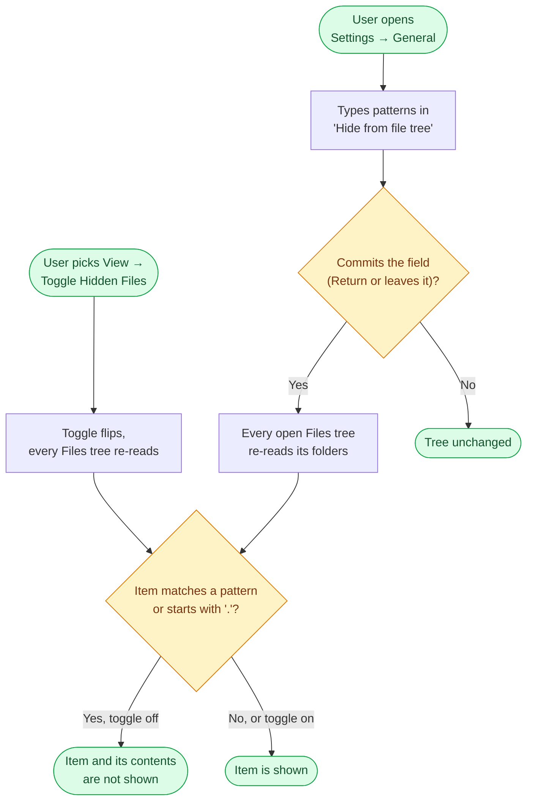
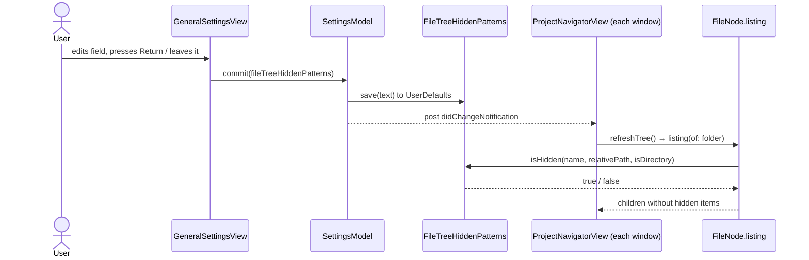

# [FEATURE] Hide files and folders from the file tree by pattern

| | |
| --- | --- |
| Design ticket | [#58 [DESIGN] Hide files and folders from the file tree by pattern](https://github.com/bluzky/daisy-app/issues/58) |
| Target branch | `chore/install-lucy` (the engineer's current branch, auto flow) |
| Spec PR | — (auto flow: phase PRs only) |
| ClickUp Doc | n/a (GitHub tracker) |
| Author (engineer) | Daniel (flex) |
| Drafted with | Lucy (PO + tech design roles), reviewed by author |
| Reviewer | tech lead |
| Status | Approved by Daniel (flex) in chat, 2026-11-18 (auto flow) |
| Target release | next minor |
| Implementation plan | `docs/features/file-tree-hidden-patterns-plan.md` |

## 1. Business flow

**Problem:** Journal entries (one file per day in `journals/`) pile up fast. Once the `journals` folder is expanded, the Files tree is full of journal notes and the rest of the workspace is hard to reach.

**Goal:** A setting lets the user hide files and folders from the Files tree by pattern, so a busy folder such as `journals` never clutters the tree. A View menu command (also a rebindable keymap command) shows or hides all hidden items at once, so they can still be reached when needed.

**Out of scope:**
- Hiding items from Omnisearch, the Journal calendar, links, or any feature other than the Files tree (decided by the engineer).
- A per-workspace setting or per-window toggle (both are app-wide).

**Not handled** (edge cases deliberately left out):
- `**` and `!` negation, and `{a,b}` alternatives (the comma is the separator) — use several comma-separated patterns instead.
- A file the user has open that is hidden by a pattern stays open; it just isn't shown or selected in the tree.
- Hidden items inside a bookmarked folder: the Bookmarks list is not the Files tree and is not filtered.

**Flow:**

**Business rules:**

| ID | Rule | Source |
| --- | --- | --- |
| BR-1 | The setting is one text value of comma-separated patterns, global to the app, empty by default (nothing hidden). Each pattern is trimmed; empty entries are ignored. | Requirement; engineer decision |
| BR-2 | A pattern without `/` matches an item's own name at any depth (`journals`, `*.log`). A pattern with `/` matches the item's path relative to the opened folder (`notes/journals`). Globs: `*` (any characters except `/`), `?` (one character), `[abc]` / `[a-z]`. Matching ignores letter case (Q-1). | Engineer decision: gitignore-style |
| BR-3 | A hidden folder is not shown, so nothing inside it is shown either. | Use case: hide `journals` entirely |
| BR-4 | A pattern ending in `/` matches folders only (`journals/` does not hide a file named `journals`). | Gitignore convention |
| BR-5 | The patterns apply to the Files tree of every window. The opened folder itself is never hidden. Dot-files (names starting with `.`) stay hidden as today. | Engineer decision: tree only |
| BR-6 | An edit takes effect when the user commits the field (Return, or the field loses focus), without reopening the folder or restarting. Clearing the field shows everything again. | Avoids hiding items for half-typed patterns |
| BR-7 | One app-wide switch, **Toggle Hidden Files**, off by default and remembered across launches. When on, every Files tree shows the items hidden by the patterns **and** dot-files; when off, both are hidden. It changes only what is shown, never the setting's text. | Engineer decision (Q-2, Q-4) |
| BR-8 | The switch is a View menu item titled **Toggle Hidden Files**, with a checkmark while hidden items are shown and a rebindable keymap command `view.toggleHiddenFiles`, default <kbd>⇧⌘.</kbd>. Toggling updates every open window at once. | Engineer decision (Q-3); same pattern as Hide Completed Tasks |

## 2. Technical design

Pattern: one pure matcher type, applied where the tree lists a folder, refreshed through a notification — the same way bookmarks and templates already notify the tree. No API, DB or network.

**Sequence:**

**API changes:** none.

**DB changes:** none. One new `UserDefaults` key, `MarkdownPreview.fileTreeHiddenPatterns` (string, default absent = empty).

**Jobs / events / config / feature flags:** one `Notification.Name` (`FileTreeHiddenPatterns.didChangeNotification`, posted by both the setting commit and the toggle); no feature flag. A second `UserDefaults` key, `MarkdownPreview.showHiddenFiles` (bool, default false).

**Components:**
- `daisy/Preferences/FileTreeHiddenPatterns.swift` (new; also holds the `showHiddenFiles` flag and the dot-file rule; symlinked into `tests/swift-tests/Sources/MarkdownHelpers/` like the other pure types): parses the string into patterns and answers `isHidden(name:relativePath:isDirectory:)`. Uses the system `fnmatch(3)` with `FNM_PATHNAME | FNM_CASEFOLD`, so there is no hand-written glob engine.
- `ProjectNavigatorView.swift`: `FileNode.listing` filters entries through it, and drops `.skipsHiddenFiles` when the flag is on so dot-files are listed. It needs the opened folder to compute the relative path, so `FileNode` carries its root URL. The navigator observes the notification and calls `refreshTree()` (the same call `bookmarksDidChange` makes).
- `SettingsModel.swift` and `GeneralSettingsView.swift`: a `fileTreeHiddenPatterns` property loaded in both places that load settings, a "File Tree" section with a text field, and a commit that saves and posts the notification.
- Keymap and menu: `KeymapCommand.viewToggleHiddenFiles` (context `.global`, default `shift+cmd+.`), a View menu item built like Hide Completed Tasks in `AppDelegate.swift`, an app-wide handler that flips the flag and posts the notification, and the title swap through menu validation. `docs/keybindings.md` gets the new row.
- `Localizable.strings`: the new labels.

**Impact & risk:**

| Area | What changes | Impact | Risk | Mitigation |
| --- | --- | --- | --- | --- |
| Files tree listing | Each listed entry is tested against the patterns | Every folder expand and file-watcher reload | Slower listing in huge folders with many patterns | Patterns parsed once per listing; a few `fnmatch` calls per entry; empty setting short-circuits |
| Reveal / select current file | A hidden path cannot be revealed | A file open in a hidden folder is not highlighted | Looks like a bug | Listed under "Not handled"; the path lookup already returns false when a node is missing |
| Dot-file listing | Dot-files appear when the switch is on | Folders such as `.git` can be large | Slow expand of a big `.git` | Only on explicit user choice; listing is lazy per folder |
| Settings sync | New value in two load paths | Stale value in the field | Forgetting one load path | Add to both, covered by AC-1.4 check |

**Rollout:** ships with the next release; empty by default, so behavior is unchanged until the user sets a pattern.

**Rollback:** a user clears the field. Removing the feature leaves an unused `UserDefaults` key, which is harmless.

## 3. User stories & acceptance criteria

### US-1: As a user with a fast-growing folder such as `journals`, I want to hide files and folders by pattern, so that the Files tree shows only what I want to navigate

- AC-1.1 (BR-1, BR-2, BR-3): Given the pattern `journals`, when the tree lists a folder, then every file or folder named `journals`, at any depth, is not shown, and neither is anything inside it.
- AC-1.2 (BR-1, BR-2): Given `*.log, drafts` (with a space after the comma), when the tree lists a folder, then `a.log` and `drafts` are hidden and other items stay.
- AC-1.3 (BR-2): Given `notes/journals`, when the tree lists folders, then `notes/journals` is hidden and `archive/journals` is still shown.
- AC-1.4 (BR-4): Given `journals/`, when a folder `journals` and a file `journals` exist, then only the folder is hidden.
- AC-1.5 (BR-5, BR-6): Given a tree showing a `journals` folder, when the user enters `journals` in Settings and commits, then the folder disappears from every open tree without reopening it; clearing the field brings it back.
- AC-1.6 (BR-5): Given a pattern that matches the opened folder's own name, when the tree is shown, then the opened folder is still shown.

- AC-1.7 (BR-7): Given a folder with `.notes` and `journals` (hidden by pattern), when the user turns Toggle Hidden Files on, then both are shown in every window; turning it off hides both again, and the pattern text is unchanged.
- AC-1.8 (BR-7): Given Toggle Hidden Files is on, when Daisy is relaunched, then it is still on.
- AC-1.9 (BR-8): Given the View menu, then the item reads **Toggle Hidden Files** and shows a checkmark while hidden items are shown; <kbd>⇧⌘.</kbd> flips it, and the key can be rebound in Keymap settings.

**Mockup:** no mockup; one text field in Settings → General.

## 4. Open questions & decisions

| ID | Question | Options | Decision | By | Date |
| --- | --- | --- | --- | --- | --- |
| Q-2 | Is the toggle app-wide and remembered? | A) all windows, remembered B) all windows, resets on launch C) per window | A) all windows, remembered | Daniel (flex), in chat | 2026-11-18 |
| Q-3 | Default shortcut? | A) ⇧⌘. B) none | A) ⇧⌘. (no clash found in `Keymap.swift`) | Daniel (flex), in chat | 2026-11-18 |
| Q-4 | One toggle for dot-files and pattern matches, or two? | A) one B) two | A) one | Daniel (flex), in chat | 2026-11-18 |
| Q-1 | Is matching case-insensitive? macOS volumes are case-insensitive by default, so `Journals` and `journals` are the same folder there. | A) case-insensitive (recommended) B) case-sensitive | A) case-insensitive | Daniel (flex), in chat | 2026-11-18 |
