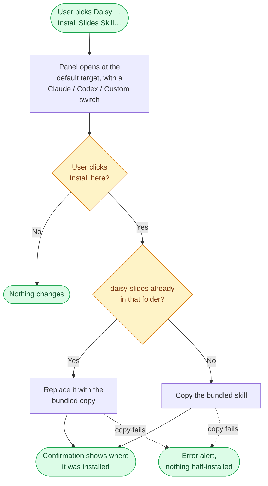
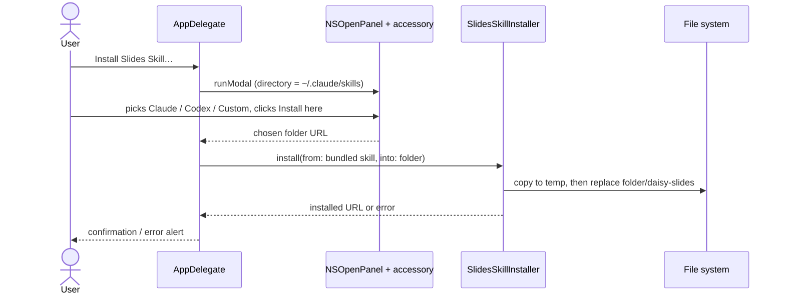

# [FEATURE] Install the Daisy slides skill from the menu

| | |
| --- | --- |
| Design ticket | none (slug `install-slides-skill`; engineer gave no ticket) |
| Target branch | `feature/59-file-tree-hidden-patterns` (the engineer's current branch, auto flow) |
| Spec PR | — (auto flow) |
| ClickUp Doc | n/a (GitHub tracker) |
| Author (engineer) | Daniel (flex) |
| Drafted with | Lucy (PO + tech design roles), reviewed by author |
| Reviewer | tech lead |
| Status | Approved by Daniel (flex) in chat, 2026-11-19 (auto flow) |
| Target release | next minor |
| Implementation plan | `docs/features/install-slides-skill-plan.md` |

## 1. Business flow

**Problem:** The `daisy-slides` agent skill teaches an AI agent to write decks in Daisy's slide format. It lives only in this repo, so a Daisy user cannot give it to their own Claude Code or Codex.

**Goal:** One menu action, **Install Slides Skill…**, copies the skill that ships inside the app into the skills folder the user picks. Claude Code and Codex are one click; any other folder works too.

**Out of scope:**
- Installing other skills, or updating the skill automatically when the app updates (re-run the action to refresh).
- Detecting which agents are installed, or editing any agent's config.
- An uninstall action (the user deletes the folder).

**Not handled:**
- A custom folder the agent does not read: the user chose it, the app only copies.
- Skills folder missing for an agent that is not installed: the app creates it (the user confirmed the folder in the panel).

**Flow:**

**Business rules:**

| ID | Rule | Source |
| --- | --- | --- |
| BR-1 | The action is a menu item **Install Slides Skill…** in the app menu, next to Install CLI…. | Requirement |
| BR-2 | A folder panel offers three targets: **Claude Code** (`~/.claude/skills`), **Codex** (`~/.codex/skills`) and **Custom folder**. Claude Code is the default. Choosing a preset points the panel at that folder; **Custom folder** leaves the panel where it is for the user to browse. | Requirement |
| BR-3 | The skill is installed as a folder named `daisy-slides` inside the chosen folder, containing exactly the skill that ships with this app version (`SKILL.md`, `references/`, `scripts/`). | Requirement |
| BR-4 | Nothing is written until the user confirms the panel. Cancelling changes nothing. | Safety |
| BR-5 | An existing `daisy-slides` folder in the target is replaced, so re-running refreshes it. Other files in the target are never touched. | Engineer decision (recommended default) |
| BR-6 | On success an alert names the installed path and offers **Reveal in Finder**; on failure an alert shows the reason and the target is left as it was. | Usability |

## 2. Technical design

Pattern: the skill is bundled as a real folder inside the app, and a small pure type does the copy, like `CommandLineToolInstaller`. The sandbox already allows writing to a folder the user picks in a panel (`files.user-selected.read-write`), so no entitlement changes.

**Sequence:**

**API changes:** none. **DB changes:** none. **Jobs / events / config / feature flags:** none.

**Components:**
- `daisy/Features/Settings/…` is not touched. New `daisy/App/SlidesSkillInstaller.swift` (symlinked into `tests/swift-tests/Sources/MarkdownHelpers/`): `Target` enum (`claudeCode`, `codex`, `custom`) with the default folder per preset from the real home directory (not the sandbox container), and `install(bundledSkill:into:)` that copies into a temp folder inside the target, then swaps it for `daisy-slides`.
- `AppDelegate.swift`: the menu item, the panel with a pop-up accessory (`showsHiddenFiles = true`, `canCreateDirectories = true`, prompt "Install here"), and the two alerts.
- Bundling: a new Run Script build phase copies `.agents/skills/daisy-slides` into the app's Resources as `daisy-slides-skill`, following symlinks (`rsync -aL`), so there is one source of truth and the guide symlink to `docs/slides.md` becomes a real file.
- `Localizable.strings`, `README.md` (and `docs/slides.md` if it mentions the skill).

**Impact & risk:**

| Area | What changes | Impact | Risk | Mitigation |
| --- | --- | --- | --- | --- |
| App bundle | +~50 KB skill folder | Negligible | Run Script fails or is skipped | Tests assert the bundled skill exists; build checked |
| `project.pbxproj` | New build phase | Shared project file | Xcode rewrites `DEVELOPMENT_TEAM` | Diff the file before finishing and revert any such hunk |
| Sandbox / hidden folders | Panel must show `.claude` | None | Home path is the container's | Use `getpwuid` home like the file search code |
| Replace on reinstall | `daisy-slides` is deleted first | Loses user edits to that folder | A user customized it | Replace via temp copy so a failed copy leaves the old one; wording in the confirmation |

**Rollout:** ships with the next release; nothing runs until the user picks the menu item.

**Rollback:** remove the menu item. Folders already installed stay (they are plain files).

## 3. User stories & acceptance criteria

### US-1: As a Daisy user, I want to install the Daisy slides skill into my agent's skills folder, so that my AI agent writes decks in Daisy's format

- AC-1.1 (BR-1): Given the app is running, when I open the app menu, then **Install Slides Skill…** is listed.
- AC-1.2 (BR-2): Given the panel opens, when I look at it, then Claude Code is selected and the panel shows `~/.claude/skills`; choosing Codex shows `~/.codex/skills`; choosing Custom folder lets me browse to any folder.
- AC-1.3 (BR-3, BR-4): Given I confirm a folder, when the install finishes, then `<folder>/daisy-slides/SKILL.md`, `references/slides-guide.md` and `scripts/check_deck.py` exist and match the bundled skill; if I cancel, nothing is written.
- AC-1.4 (BR-5): Given `<folder>/daisy-slides` already exists, when I install again, then it is replaced with the bundled copy and other files in `<folder>` are unchanged.
- AC-1.5 (BR-6): Given the install succeeds, then an alert shows the installed path with Reveal in Finder; given it fails, then an alert shows the reason and any existing `daisy-slides` is intact.

**Mockup:** no mockup; native panel and alerts.

## 4. Open questions & decisions

| ID | Question | Options | Decision | By | Date |
| --- | --- | --- | --- | --- | --- |
| Q-1 | Reinstalling over an existing `daisy-slides`: replace silently, or ask first? | Replace (recommended; the folder is Daisy's own) / Ask | Replace | Daniel (flex), approved with the spec | 2026-11-19 |
| Q-2 | Where does the menu item live? | App menu next to Install CLI… (recommended) / Help menu | App menu | Daniel (flex), approved with the spec | 2026-11-19 |
