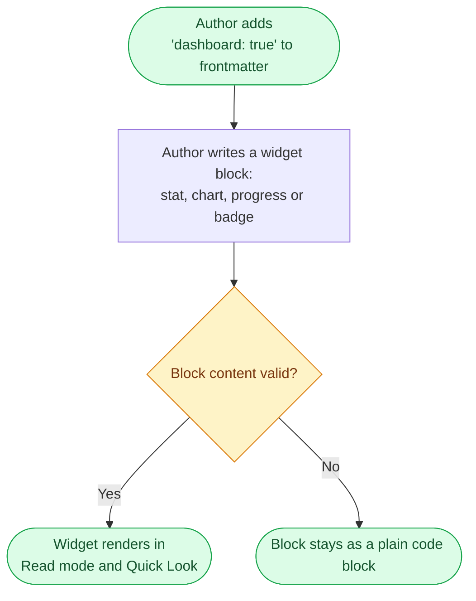
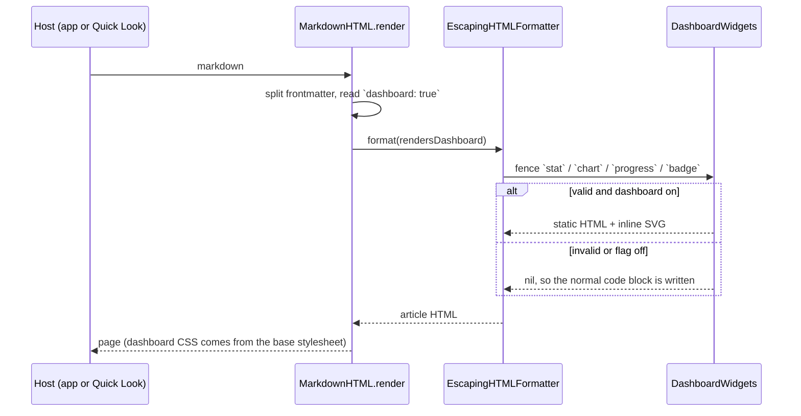
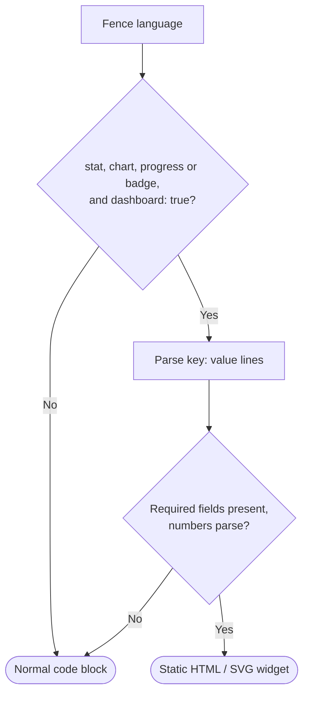

# [FEATURE] Render Markdown as a dashboard

| | |
| --- | --- |
| Design ticket | [#70 [DESIGN] Render Markdown as a dashboard](https://github.com/bluzky/daisy-app/issues/70) |
| Target branch | the engineer's current branch (`main` today; engineer decides) |
| Spec PR | — |
| ClickUp Doc | n/a |
| Author (engineer) | Daniel (flex) |
| Drafted with | Draft — PO agent (§1, §3), Draft — Tech design agent (§2) |
| Reviewer | tech lead |
| Status | Draft |
| Target release | next minor |
| Implementation plan | `docs/features/markdown-dashboard-plan.md` (after Gate 1) |

## 1. Business flow

**Problem:** A Markdown file that holds metrics (KPIs, progress, status, small charts) renders as plain paragraphs and tables. The numbers that matter are not visually distinct, so a status or KPI note cannot be read at a glance.

**Goal:** A document can opt in to a dashboard look using a few inline widgets (stat tiles, charts, progress bars, status badges). The file stays plain Markdown, remains readable in any other viewer, and shows the same in the app and in Quick Look.

**Out of scope** (decided with the engineer):
- Grid layout and cards. Widgets flow in the normal document order. The existing [Columns](../columns.md) feature is not changed.
- External data: no `data:` file references, no network fetches, no live reload of side files. Every value is written in the `.md` file itself.
- Arbitrary JavaScript, editing or filtering widgets, and a formula or expression language. Values are written already computed.

**Not handled** (deliberately left out):
- Interactive features such as drill-down, tooltips with history, or zoom — the preview is read-only.
- Charts with large datasets; charts are for a handful of inline values.
- Charting a table that sits outside a `chart` block, or referring to one by position, heading or ID — the data is always inside the block, so a normal table is never turned into a chart (engineer decision).
- Widgets in DOCX export — a widget exports as the code block it is in the Markdown (Q-5).

### Flow 1: Author writes a dashboard



### Flow 2: Same file in another viewer


**Business rules:**

| ID | Rule | Source |
| --- | --- | --- |
| BR-1 | Widgets render only when the document's frontmatter has `dashboard: true`. Without it, the same blocks show as ordinary code blocks. | Requirement (opt-in, like `slides: true`) |
| BR-2 | A **stat** shows a `label`, a `value`, an optional `delta` and an optional `trend` (`up`, `down` or `flat`). A single block may hold several stats; they render side by side in one row. | Engineer decision |
| BR-3 | A **chart** takes its values from a Markdown table written inside the chart block, in the same file. It supports bar, line and pie. | Engineer decision; Q-2, Q-6 |
| BR-4 | A **progress** bar shows a value against a maximum, with a label. | Requirement |
| BR-5 | A **badge** shows a short status text with a status color (for example ok, warn, fail). | Requirement |
| BR-6 | In any viewer that does not support dashboards, each widget degrades to readable plain content (a fenced block or a table). The file is never rewritten. | Requirement |
| BR-7 | A widget block with missing or invalid fields is shown as a plain code block, never as an error that hides the rest of the document. | Consistent with Columns (a malformed group stays plain) |
| BR-8 | Widgets render the same in Read mode, in Quick Look and in PDF export. | Requirement; lesson from #338; Q-5 |
| BR-9 | Trend color is derived from `trend`: up is positive, down is negative, flat is neutral. `trend` stays the direction of movement; an author marks a metric where down is good (for example churn) with `good: down`, which swaps the two colors. | Engineer decision (Q-3) |

## 2. Technical design

**Pattern followed:** fenced blocks read in the formatter, and the frontmatter opt-in of slides (`SlideDeck.isDeck`, `SlideDeck.swift:544`; read in `MarkdownHTML.swift:376-382`). One difference on purpose: the widgets are turned into **static HTML and inline SVG in Swift**, with no JavaScript, so the app, Quick Look and PDF all show them (BR-8). `columns` (`EscapingHTMLFormatter+Columns.swift`) is the model: the formatter writes the markup, the CSS lives in the base stylesheet (`MarkdownHTML+Stylesheet.swift:843`), there is no render extension, and malformed input stays plain (BR-7).

**Block syntax** (proposal, see Q-6): a fenced block named `stat`, `chart`, `progress` or `badge`. The body is `key: value` lines. Several items in one block are separated by a line with `---`; a `stat` block with several items renders as one row (BR-2).

````markdown
---
dashboard: true
---

```stat
label: Revenue
value: $48.2k
delta: +12%
trend: up
---
label: Churn
value: 2.1%
delta: -0.4%
trend: down
good: down
```

```chart
type: bar
| Month | Sales |
| ----- | ----- |
| Jan   | 12    |
| Feb   | 18    |
```

```progress
label: Release
value: 7
max: 12
```

```badge
text: Passing
status: ok
```
````

In another viewer each block is a normal code block holding readable `key: value` lines, and the chart keeps its table (BR-6).

**Diagrams:**





**API changes:** none. No endpoints, no URL scheme or host bridge messages.

**DB changes:** none. No persisted state, defaults key or workspace index change.

**Code changes:**

| Part | Change |
| --- | --- |
| Opt-in | New `DashboardDocument.isDashboard(frontmatter:format:)`, same shape as `SlideDeck.isDeck`. `MarkdownHTML.render` computes it next to `rendersSlides` and passes `rendersDashboard` to `EscapingHTMLFormatter.format`. |
| Parsing and HTML | New `DashboardWidgets` (Swift): parses the block body and returns HTML, or nil. `visitCodeBlock` (`EscapingHTMLFormatter.swift:1142`) asks it first when `rendersDashboard` is true and the language is one of the four; nil falls through to the existing code-block output. |
| Safety | Every string is HTML-escaped; numbers are parsed as `Double` and clamped. Colors come from fixed classes (`ok`, `warn`, `fail`, `up`, `down`, `flat`), never from author text. Charts are SVG built from the parsed numbers only. Bar and progress sizes use SVG or element attributes, not inline `style`, so they survive wherever styles are stripped (the slides doc notes the sanitizer strips them; not verified for the main page). |
| Styles | Dashboard CSS (`.md-dash-*`) is added to the base stylesheet in `MarkdownHTML+Stylesheet.swift`, next to `.md-columns`. Every host already receives that stylesheet, so no render extension, registry entry or Settings toggle is needed. Colors use the theme's existing custom properties with fallbacks, and follow light/dark. |
| Tests | `DashboardWidgetsTests` (per block, bad input, flag off), `MarkdownHTMLRenderTests` (frontmatter on and off; stylesheet present in the page). |
| Docs | `docs/dashboard.md`, README entry, `samples/dashboard.md`. |

**Jobs / events / config / feature flags:** none. The frontmatter flag is the only switch (BR-1).

**Impact & risk:**

| Area | What changes | Impact | Risk | Mitigation |
| --- | --- | --- | --- | --- |
| `EscapingHTMLFormatter.swift:1142` | One early branch in `visitCodeBlock` | Every document passes through it | Wrong branch changes ordinary code blocks | The branch needs `rendersDashboard`; default is false, so existing output is unchanged. Test with the flag off (AC-1.1). |
| `MarkdownHTML.swift:376-386`, `format(...)` signature | New parameter | One other caller of `format` (footnotes, `MarkdownHTML+Footnotes.swift:349`) | Compile breaks | Default value `false`; footnote formatting does not pass it, so a widget fence inside a footnote stays a code block. |
| Quick Look (`quick-look/PreviewProvider.swift:51`, `PreviewViewController.swift:632`) | None in the host | Quick Look shows widgets | Low: markup and CSS come from the same render path as the app, unlike extension assets that depend on the loading mode (the #338 shape) | A render test with the Quick Look settings checks the markup and stylesheet are in the page (AC-5.2); check once in a real Quick Look preview. |
| PDF export (`MarkdownWebView+PDFExport.swift`) | None expected | Widgets print as laid out | Colors dropped in print | Check `print-color-adjust`; verify visually. |
| DOCX export (`DocxExporter.swift`) | None | A widget block exports as the code block it is in the Markdown | None (matches Q-5 recommendation) | Covered by existing code-block export. |
| Frontmatter display (`MarkdownHTML.swift:473`) | None | `dashboard: true` is shown as a normal frontmatter property in Read mode | None | n/a |
| Slides (`SlideDeck`, `MarkdownHTML.swift:380-386`) | `slides: true` and `dashboard: true` together: `rendersDashboard` is computed independently of `rendersSlides`, and the slide walker reaches `visitCodeBlock` like any other block | Widgets render inside slides (Q-8) | Slide frames scale and clip their content, so a wide row of stats or a chart may overflow | Widgets use relative sizes and wrap; check one deck with widgets visually; widgets are not a slide layout, so no slide directive changes. |
| Docs, README, samples | New files and one README entry | Required by AGENTS.md | Stale claims | grep `README.md`, `samples/`, `docs/` for contradicting statements before merge. |

**BR trace:**

| BR | Enforced by |
| --- | --- |
| BR-1 | `DashboardDocument.isDashboard` and the `rendersDashboard` guard in `visitCodeBlock` |
| BR-2 | `DashboardWidgets.stat`: fields, `---` item split, row container |
| BR-3 | `DashboardWidgets.chart`: pipe table in the block body, bar, line, pie SVG |
| BR-4 | `DashboardWidgets.progress`: `value`, `max`, label |
| BR-5 | `DashboardWidgets.badge`: `text`, `status` class |
| BR-6 | Widgets are fences in the source; nothing is rewritten |
| BR-7 | Parsers return nil on any missing or invalid field; `visitCodeBlock` then writes the ordinary block |
| BR-8 | Static HTML/SVG, CSS in the base stylesheet, no JavaScript, no extension |
| BR-9 | `trend` picks the arrow and `up`/`down`/`flat` class; `good: down` flips the color mapping in the class name |

**Design options** (see Q-7):
- **A. Static HTML/SVG from Swift (recommended).** Works everywhere the renderer runs, no vendor bundle, no JS-ready race, prints, and is easy to unit test as strings. Cost: hand-written SVG for three chart types and no hover or tooltips.
- **B. JavaScript renderers like `query-blocks` / Mermaid, with a chart library.** Nicer charts and interaction. Cost: a vendor bundle, lazy loading, and the same Quick Look gap that hit Mermaid (#338).

**Ordering constraints:** opt-in flag and parser before any widget; `stat` first, then `progress` and `badge`, then `chart` (largest). The dashboard CSS ships with the first widget.

**Rollout and rollback:** None. Nothing renders without `dashboard: true`; removing the flag from a file restores plain code blocks.

## 3. User stories & acceptance criteria

### US-1: As a document author, I want to turn a Markdown file into a dashboard with a frontmatter flag, so that ordinary documents are never affected

- AC-1.1 (BR-1): Given a document without `dashboard: true`, when it is previewed, then widget blocks appear as plain code blocks.
- AC-1.2 (BR-1): Given `dashboard: true`, when it is previewed, then valid widget blocks render as widgets.
- AC-1.3 (BR-1): Given a slide deck (`slides: true`) that also has `dashboard: true`, when it is previewed, then valid widget blocks render inside their slides.

### US-2: As a document author, I want stat tiles, so that key numbers stand out

- AC-2.1 (BR-2): Given a stat block with `label` and `value`, when previewed, then a tile shows the label and value.
- AC-2.2 (BR-2): Given a block with several stats, when previewed, then the tiles appear side by side in one row.
- AC-2.3 (BR-2, BR-9): Given a stat with `delta` and `trend: up`, when previewed, then the delta shows with an up indicator in the positive color; `down` uses the negative color.
- AC-2.4 (BR-9): Given a stat with `good: down`, when `trend: down`, then the delta shows with a down indicator in the positive color (and `trend: up` in the negative color).

### US-3: As a document author, I want charts from data in the file, so that I can show a trend without external tools

- AC-3.1 (BR-3): Given a chart block holding a table of labels and numbers, when previewed, then a chart of those values renders.
- AC-3.2 (BR-3, BR-7): Given a chart whose values are not numeric, when previewed, then the block stays a plain code block.

### US-4: As a document author, I want progress bars and status badges, so that state is visible at a glance

- AC-4.1 (BR-4): Given a progress block with a value and a maximum, when previewed, then the bar fills in proportion.
- AC-4.2 (BR-5): Given a badge with a status, when previewed, then it shows the text in that status color.

### US-5: As a reader in any viewer or in Quick Look, I want the same file to stay readable and consistent

- AC-5.1 (BR-6): Given a dashboard file opened in a viewer without support, when displayed, then each widget shows as readable plain content.
- AC-5.2 (BR-8): Given a dashboard file, when previewed in Quick Look or exported to PDF, then widgets render as in Read mode.
- AC-5.3 (BR-7): Given one invalid widget block among valid ones, when previewed, then only that block stays plain and the rest render.

**Mockup:** no mockup branch; Daisy is a native app. A sample `samples/` dashboard file stands in as the visual reference.

**Documentation (same change, per AGENTS.md):** a new `docs/dashboard.md`, a README feature entry, and a sample dashboard file; grep `README.md`, `samples/`, `tests/fixtures/` and `docs/` for claims that "Markdown renders as plain text" style statements.

## 4. Open questions & decisions

| ID  | Question                                                                                                                 | Options                                                                                    | Decision                | By        | Date |
| --- | ------------------------------------------------------------------------------------------------------------------------ | ------------------------------------------------------------------------------------------ | ----------------------- | --------- | ---- |
| Q-1 | Which design ticket does this belong to, and is the tracker GitHub (like #58) or none?                                   | GitHub issue `[DESIGN] …` / none (slug only)                                               | create new github issue | engineer  |      |
| Q-2 | Which chart types in v1?                                                                                                 | bar + line + pie (recommended: bar + line, add pie later) / bar only                       | bar, line, pie          | tech lead |      |
| Q-3 | How does an author say "down is good"?                                                                                   | `good: down` on the stat (recommended) / a per-stat color override                         | `good: down` on the stat (option 1: `trend` stays direction) | tech lead |      |
| Q-4 | Is `dashboard: true` frontmatter the only opt-in, or should widgets also render without it?                              | frontmatter only (recommended: matches `slides: true`, protects normal docs) / always on   | agree                   | tech lead |      |
| Q-5 | How do widgets appear in PDF and DOCX export?                                                                            | PDF renders widgets, DOCX uses the plain fallback (recommended) / both render / both plain | as your recommendation  | tech lead |      |
| Q-6 | Exact block body syntax (YAML-like key: value lines vs table-based)? Proposal in §2: `key: value` lines, `---` between items, a pipe table inside `chart`. | YAML-like (recommended) / table                                                            | yaml                    | tech lead |      |
| Q-7 | Render widgets as static HTML/SVG in Swift, or with JavaScript and a chart library? | A: static HTML/SVG (recommended: Quick Look, PDF, no vendor bundle) / B: JavaScript renderers | | tech lead | |
| Q-8 | What happens when a file has both `slides: true` and `dashboard: true`? | Widgets ignored in decks for now (recommended) / widgets render inside slides | both apply: a deck with `dashboard: true` shows widgets in its slides | engineer | |
