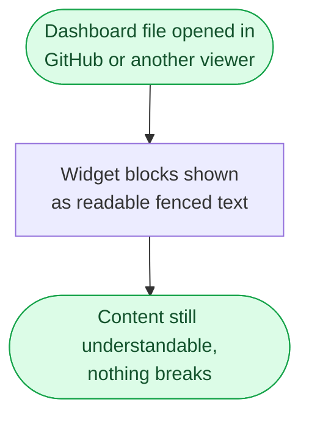
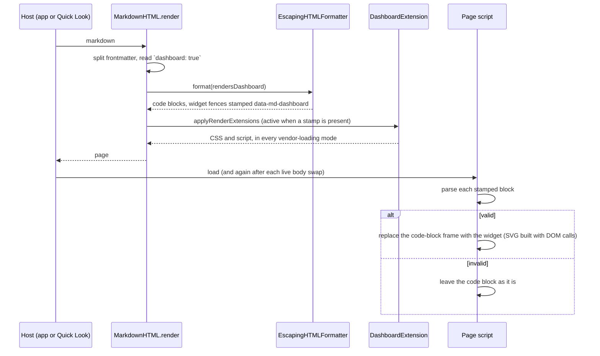
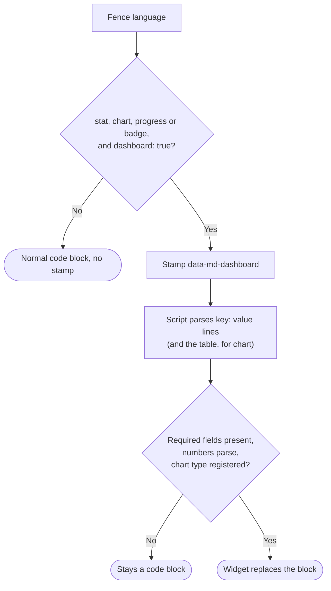

# [FEATURE] Render Markdown as a dashboard

| | |
| --- | --- |
| Design ticket | [#70 [DESIGN] Render Markdown as a dashboard](https://github.com/bluzky/daisy-app/issues/70) |
| Target branch | `main`. Spec on `docs/markdown-dashboard-spec`; implementation on `feat/markdown-dashboard` |
| Spec PR | [#71](https://github.com/bluzky/daisy-app/pull/71) (open; does not yet carry the changes below) |
| ClickUp Doc | n/a |
| Author (engineer) | Daniel (flex) |
| Drafted with | Draft — PO agent (§1, §3), Draft — Tech design agent (§2) |
| Reviewer | tech lead |
| Status | Draft, not approved (Gate 1 not passed). Stat, progress and badge implemented in one go at the engineer's request (PR #72). Charts (US-3, BR-3, BR-10, BR-13) brought back by Q-11 and implemented on the same branch. The themeable semantic palette (US-6, BR-11, BR-15; Q-14, Q-15) implemented on the same branch |
| Target release | next minor |
| Implementation plan | None: the engineer chose to implement in one go, without phases |

## 1. Business flow

**Problem:** A Markdown file that holds metrics (KPIs, progress, status, small charts) renders as plain paragraphs and tables. The numbers that matter are not visually distinct, so a status or KPI note cannot be read at a glance.

**Goal:** A document can opt in to a dashboard look using a few inline widgets (stat tiles, charts, progress bars, status badges). The file stays plain Markdown, remains readable in any other viewer, and shows the same in the app and in Quick Look.

**Out of scope** (decided with the engineer):
- Grid layout and cards. Widgets flow in the normal document order. The existing [Columns](../columns.md) feature is not changed.
- External data: no `data:` file references, no network fetches, no live reload of side files. Every value is written in the `.md` file itself.
- Author-written JavaScript, editing or filtering widgets, and a formula or expression language. Values are written already computed. (The app's own widget script is internal and not author-controlled.)
- Chart types other than bar, line and pie (stacked or horizontal bars, area, scatter), axis titles, a second y axis, and colors chosen per series by the author.
- Charting a table that sits outside a `chart` block, or referring to one by position, heading or ID. The data is always inside the block, so a normal table is never turned into a chart.
- Charts with large datasets; a chart is for a handful of inline values.

**Not handled** (deliberately left out):
- Interactive features such as drill-down, tooltips with history, or zoom — the preview is read-only.
- Widgets in DOCX export — a widget exports as the code block it is in the Markdown (Q-5).
- A setting for dashboard colors. Every app theme and Quick Look use the two built-in palettes (BR-15).
- Colors written in a block. A block never sets a color; the theme defines the palette (BR-11, BR-15).

### Flow 1: Author writes a dashboard


### Flow 2: Same file in another viewer



**Business rules:**

| ID | Rule | Source |
| --- | --- | --- |
| BR-1 | Widgets render only when the document's frontmatter has `dashboard: true`. Without it, the same blocks show as ordinary code blocks. | Requirement (opt-in, like `slides: true`) |
| BR-2 | A **stat** shows a `label`, a `value`, an optional `delta` on the value's line aligned right, an optional `trend` (`up`, `down` or `flat`) and an optional `note` under them. A single block may hold several stats; they render side by side in one row. | Engineer decision |
| BR-3 | A **chart** takes its values from a Markdown table written inside the chart block. The first column holds the labels and every other column is a series of numbers named by its header. It draws a `bar` chart (one bar per series for each label, side by side), a `line` chart (one line per series) or a `pie` chart (one slice per row, from a single number column). | Original requirement; Q-2, Q-6; brought back by Q-11 |
| BR-4 | A **progress** block draws one bar per item, each with a `label`, a `value` (zero or more) and a `max` (above zero), and shows `value / max`. Items are separated by `---`. A value above its maximum shows a full bar. | Requirement; engineer decision (Q-10) |
| BR-5 | A **badge** shows a short status text with a status color (for example ok, warn, fail). | Requirement |
| BR-6 | In any viewer that does not support dashboards, each widget degrades to readable plain content (a fenced block or a table). The file is never rewritten. | Requirement |
| BR-7 | A widget block with missing or invalid fields is shown as a plain code block, never as an error that hides the rest of the document. | Consistent with Columns (a malformed group stays plain) |
| BR-8 | Widgets render the same in Read mode, in Quick Look and in PDF export. | Requirement; lesson from #338; Q-5 |
| BR-9 | Trend color is derived from `trend`: up is positive, down is negative, flat is neutral. `trend` stays the direction of movement; an author marks a metric where down is good (for example churn) with `good: down`, which swaps the two colors. | Engineer decision (Q-3) |
| BR-10 | A chart shows a legend naming each series (bar, line) or each slice (pie). The author places it with `legend: top`, `bottom`, `left` or `right`, or hides it with `legend: none`. Without the key it sits at the bottom. On a window too narrow for a side legend, a `left` or `right` legend moves below the chart. | Engineer decision (Q-11, Q-12) |
| BR-11 | Every widget color comes from one shared **dashboard palette** of semantic colors: `accent` (progress bars), `positive`, `negative`, `warning`, `neutral` (stat deltas and badge statuses), and `series-1` … `series-8` (chart series and pie slices, in order). There are two palettes of standard colors, light and dark, following the page's appearance. Text, surface, border and card colors keep following the page theme. Blocks never name a color. | Engineer decision (Q-14, Q-15) |
| BR-12 | A stat may have a `link`, shown as an arrow in the tile's corner, that opens the way a Markdown link in the document does (URL, relative file, `#heading`). A link whose scheme the page never follows (`javascript:`, `data:`, `file:`, …, as in `ExternalLinkPolicy`) leaves the block plain (BR-7). | Engineer decision; current link behavior |
| BR-14 | ~~removed~~ — authors don't choose colors in a block; the theme defines them (Q-14). | Engineer decision |
| BR-15 | The palette has no setting: every app theme uses the two built-in palettes, and so does Quick Look. A slide deck's theme can override any palette color on its slides (`colors:` keys `dashboard_accent`, `dashboard_positive`, `dashboard_negative`, `dashboard_warning`, `dashboard_neutral`, `dashboard_series_1` … `dashboard_series_8`). | Engineer decision (Q-15) |
| BR-13 | A chart draws each value on the chart (above its bar or point, inside its slice) unless the block says `values: false`. Value labels use a fixed text size; a pie slice too small to hold its label (under about 5% of the total) shows no value label. | Engineer decision (Q-11) |

## 2. Technical design

**Pattern followed:** the in-page script of `query-blocks` (`MarkdownRenderExtension.swift:995`) and Mermaid (`MarkdownHTML+Mermaid.swift:545`): the formatter writes ordinary `<pre><code class="language-x">`, and an extension's script upgrades it in the page. The frontmatter opt-in follows slides (`SlideDeck.isDeck`, `SlideDeck.swift:544`; read in `MarkdownHTML.swift:376-382`). Decided in Q-7: the widgets are drawn by a small **JavaScript** script of our own, with no third-party library. Stat, progress and badge live in `daisy/Rendering/MarkdownHTML+Dashboard.swift`; charts are drawn by a small chart library of our own (`MdChart`) in `daisy/Rendering/MarkdownHTML+DashboardChart.swift` (Q-9, Q-11).

**Block syntax** (Q-6): a fenced block named `stat`, `chart`, `progress` or `badge`. The body of `stat`, `progress` and `badge` is `key: value` lines; a `chart` has a few `key: value` lines followed by a Markdown table (see *Chart block* below). Several items in one block are separated by a line with `---`; a `stat` block with several items renders as one row (BR-2), a `progress` block stacks its bars (BR-4).

````markdown
---
dashboard: true
---

```stat
label: Revenue
value: $48.2k
delta: +12%
trend: up
note: vs last month
link: #sales-by-month
---
label: Churn
value: 2.1%
delta: -0.4%
trend: down
good: down
```

```chart
type: bar
title: Sales by month
legend: right
| Month | 2025 | 2026 |
| ----- | ---- | ---- |
| Jan   | 12   | 15   |
| Feb   | 18   | 21   |
| Mar   | 15   | 24   |
```

```progress
label: Features
value: 7
max: 12
---
label: Tests passing
value: 182
max: 190
```

```badge
text: Passing
status: ok
```
````

**Keys** (`*` required; any other value for a listed key leaves the block plain, BR-7):

| Block | Keys | Notes |
| --- | --- | --- |
| `stat` | `label`*, `value`*, `delta`, `trend` (`up` `down` `flat`), `good` (`up` `down`), `note`, `link` | `---` between tiles; tiles share a row (BR-2, BR-9, BR-12) |
| `chart` | `type`* (`bar` `line` `pie`), `title`, `legend` (`top` `bottom` `left` `right` `none`; default `bottom`), `values` (`true` `false`; default `true`), then a table* | Keys first, table last; no `---` items (BR-3, BR-10, BR-13) |
| `progress` | `label`*, `value`* (≥ 0), `max`* (> 0) | `---` between bars; bars stack (BR-4) |
| `badge` | `text`*, `status`* (`ok` `warn` `fail`) | `---` between badges (BR-5) |

A stat shows whenever `label` and `value` are set; `delta` and `trend` are optional. A `delta` without a `trend` shows in the neutral color with no arrow; a `trend` without a `delta` is ignored (BR-9, engineer decision).

In another viewer each block is a normal code block holding readable `key: value` lines, and a chart keeps its table (BR-6).

**Chart block** (BR-3, BR-10, BR-13):

- **Body.** Zero or more `key: value` lines, then the table. Blank lines are ignored. A `key: value` line after the table starts, or any other line that is neither, makes the block invalid. Unknown keys are ignored, as in the other blocks.
- **Table.** A header row, a separator row (`| --- | --- |`, colons allowed) and at least one data row. Every row has the same number of cells as the header, and at least two columns. The first column holds the labels, as text. Every other column is a series: its header cell is the series name and every cell is a number. Numbers follow the progress rule: an optional sign, digits with an optional decimal part, and `,` thousands separators allowed. Units (`$`, `%`, `k`) are not part of a cell; put them in the title or the column header.
- **Bar.** One group per row, one bar per series inside the group, in the series' palette color. A y axis with 4–6 rounded ticks and grid lines; the axis always includes 0, so negative values draw below it. Category labels under the groups.
- **Line.** Same axes as bar. One line per series through one point per row, each point marked with a dot.
- **Pie.** Exactly one number column (Q-13). Every value is 0 or more and the total is above 0. One slice per row, clockwise from 12 o'clock, in palette order. Slices are colored by row, so the legend names the rows.
- **Values** (BR-13). On by default. Bar: above the bar (below it when negative). Line: above the point. Pie: the value inside its slice, at about two thirds of the radius. A pie slice under about 5% of the total shows no label. Values are formatted with the locale's separators, up to 2 decimals. `values: false` draws none.
- **Legend** (BR-10). One entry per series (bar, line) or per row (pie): a color swatch and the name. `top` and `bottom` lay the entries out in a centered row that wraps; `left` and `right` stack them in a column beside the chart. Below about 420px of width, a side legend moves under the chart. `none` draws no legend.
- **Title.** Optional, above the chart and its legend.
- **Size.** Bar and line draw into a 600×300 SVG viewBox scaled to the column width. A pie draws into a 300×300 viewBox and is never wider than 320px. Axis labels and values use fixed sizes in viewBox units, so they shrink with the chart on a narrow window but never grow with the data.
- **Colors** (BR-11). Eight series colors `--dashboard-series-1` … `--dashboard-series-8`, used in order and repeating after eight. Axis and label text use `--dashboard-text`, grid lines `--dashboard-border`. Every color is set by a class, never by author text.

**Dashboard palette** (BR-11, BR-15). Semantic CSS custom properties in the dashboard stylesheet, from `DashboardColor` (`MarkdownHTML+Dashboard.swift`). There are exactly **two palettes of standard colors**, light and dark, following the page's appearance (Q-15). No widget and no block names a hue.

| Token | Used by | Light | Dark |
| --- | --- | --- | --- |
| `--dashboard-accent` | progress bars | `#007AFF` | `#0A84FF` |
| `--dashboard-positive` | good deltas, `ok` badges | `#34C759` | `#30D158` |
| `--dashboard-negative` | bad deltas, `fail` badges | `#FF3B30` | `#FF453A` |
| `--dashboard-warning` | `warn` badges | `#FF9500` | `#FF9F0A` |
| `--dashboard-neutral` | flat deltas | `#8E8E93` | `#98989D` |
| `--dashboard-series-1` … `-8` | chart series / slices (then repeat) | `#007AFF`, `#FF9500`, `#30B0C7`, `#AF52DE`, `#34C759`, `#FF2D55`, `#FFCC00`, `#8E8E93` | `#0A84FF`, `#FF9F0A`, `#40C8E0`, `#BF5AF2`, `#30D158`, `#FF375F`, `#FFD60A`, `#98989D` |

- **Text, surface, border, card** (`--dashboard-text`, `-surface`, `-border`, `-card`) stay derived from the page theme; they are not part of the palette. A stat tile's fill has its own variable, `--dashboard-card`, and every theme sets it to its code block background: the dashboard stylesheet's defaults (`#f9f9f9` light, `#262626` dark, Daisy's default code background); an app theme's code background, from a preset or Customize Theme (`ThemeOverrides.css` emits `--dashboard-card` beside `--code-bg`); and a slide theme's `code_background` or its light/dark default (`SlideTheme.css`).
- **One set of Apple system colors** for every widget: status colors share their hues with the chart series (warning is series 2's orange, positive series 5's green). Stat deltas are text, so in the light palette they are the color mixed 65% with black (`--dashboard-text-mix`; 100% in dark).
- **Text on a palette color.** Badges are white text on their status color, in both palettes (engineer decision; white on the bright green and orange is about 2:1). Pie values are white with a soft dark outline, readable on every series color.
- **Classes, not styles.** Widgets carry role classes (`md-dash-good`, `md-dash-ok`, `md-chart-s3`, …) mapped to the tokens in CSS. Nothing from a block reaches a style.

**Changing the palette** (BR-15). There is no setting: built-in theme presets and Customize Theme don't touch dashboard colors, so every app theme uses the two palettes above. Only a slide deck's theme can change them.

| Level | Where | How |
| --- | --- | --- |
| Palettes | `dashboardStylesheet` | Light under `:root`, dark under the existing dark-scheme selectors, both generated from `DashboardColor.defaultHex`. The only palette for every app theme and Quick Look. |
| Slide theme | `SlideTheme.colors` keys `dashboard_accent`, `dashboard_positive`, `dashboard_negative`, `dashboard_warning`, `dashboard_neutral`, `dashboard_series_1` … `8` | Added to the deck's CSS like `tableColorProperties`, so a deck's theme wins inside that deck. |

**Chart library (`MdChart`).** A small SVG chart library of our own, separate from the block parser so that new chart types can be added without touching it (Q-11). It is a second script in the dashboard extension's assets, loaded before the widget script, and it sets `window.MdChart`:

| API | What it does |
| --- | --- |
| `MdChart.register(type, renderer)` | Adds a chart type. `renderer` is `{ legend: 'series' \| 'rows', size: { width, height }, validate(spec), draw(svg, spec, kit) }`. `validate` returns false to reject the data (the block stays plain); `draw` adds SVG to the plot. |
| `MdChart.has(type)` | Whether a type is registered. The `chart` block accepts any registered type, so the parser has no list of its own. |
| `MdChart.render(spec)` | Builds the figure, or returns `null` if the type is unknown or `validate` fails. `spec` is `{ type, title, legend, values, labels: [string], series: [{ name, values: [number] }] }`. |

`render` owns everything that is the same for every type: the figure, title, legend entries and their placement, the SVG root and its viewBox, accessibility (`role="img"`, `aria-label` from the title), and whether values are drawn. `kit` hands the renderer shared helpers: SVG element creation, value-label drawing (a no-op when `values` is false), number formatting, series color classes, a "nice" scale, and cartesian axes (scale, grid, tick and category labels) shared by bar and line. `bar`, `line` and `pie` are registered with the same public `register` call as any later type.

**How the opt-in reaches the script.** Extensions receive the Markdown body with the frontmatter already removed (`MarkdownHTML.swift:486-490`), so an extension cannot read `dashboard: true` itself. Instead the formatter, which is told `rendersDashboard`, stamps `data-md-dashboard` on the `<pre>` of each of the four fences when the flag is on. Without the flag nothing is stamped, so the script has nothing to act on (BR-1).

**Diagrams:**





**API changes:** none. No endpoints, URL scheme or host bridge messages.

**DB changes:** none. No persisted state, defaults key or workspace index change.

**Code changes:**

| Part | Change |
| --- | --- |
| Opt-in | New `DashboardDocument.isDashboard(frontmatter:format:)`, same shape as `SlideDeck.isDeck`. `MarkdownHTML.render` computes it next to `rendersSlides` and passes `rendersDashboard` to `EscapingHTMLFormatter.format`. |
| Formatter | `visitCodeBlock` (`EscapingHTMLFormatter.swift:1142`) adds `data-md-dashboard` to the `<pre>` when `rendersDashboard` is true and the language is one of `DashboardDocument.widgetLanguages` (`chart` added back to `stat`, `progress`, `badge`). Output is otherwise unchanged and highlighting is skipped for these, as for mermaid. |
| Extension | New `DashboardExtension` (`id: "dashboard"`, not user-toggleable like `SlidesExtension`, unique `order`). `isActive` looks for `data-md-dashboard` in the article HTML. Its assets (CSS and script) are returned in **both** vendor-loading modes. Quick Look uses `.inline`, and `query-blocks` returns nothing in that mode, so copying its `guard mode == .lazy` would lose Quick Look (the #338 shape). `scriptAssetIDs` includes the id so live body swaps keep the runtime. |
| Quick Look target | `project.pbxproj`: `Rendering/MarkdownHTML+Dashboard.swift` and `Rendering/MarkdownHTML+DashboardChart.swift` in the `quick-look` target's explicit file list (the app target picks them up through the synchronized folder). The only project change. |
| Chart library | New `daisy/Rendering/MarkdownHTML+DashboardChart.swift`: `dashboardChartScript` (`MdChart` with `bar`, `line`, `pie`) and `dashboardChartStylesheet` (series palette, axes, legend layouts). `DashboardExtension.assets` returns both, the chart script before the widget script, in both vendor-loading modes. `tests/swift-tests/Sources/MarkdownHelpers/` gets a symlink to it, like its siblings. |
| Chart block | The widget script gains a `chart` builder: it reads the `key: value` lines and the table, checks `legend` and `values`, and hands a spec to `MdChart.render`. An unknown type, a bad option or a bad table returns `null`, so the block stays plain (BR-7). |
| Localization | `en.lproj/Localizable.strings`: `"Dashboard"`, the extension's title key. |
| Script | One small script in the extension's assets, no library. It parses each stamped block (`key: value` items split by `---`), builds the stat tiles, progress bars and badges with `textContent` and attributes (never `innerHTML`), checks stat links against `ExternalLinkPolicy.blockedSchemes` (the widget is built after the page sanitizer ran), and replaces the page's code-block frame (`.md-code-wrap`, with its header, wrap and copy buttons) rather than only the `pre`. Colors are classes only. On any invalid field the block is left untouched (BR-7). |
| Styles | The palette is CSS custom properties: `--dashboard-accent` (progress bars), `--dashboard-positive`, `--dashboard-negative`, `--dashboard-warning`, `--dashboard-neutral` (deltas, badges; light and dark values), `--dashboard-series-1` … `--dashboard-series-8` (chart series), in a light and a dark palette (see *Dashboard palette*), and `--dashboard-text`, `--dashboard-surface`, `--dashboard-border`, `--dashboard-card`, which default to the page theme's own variables. Slide themes override the palette (BR-15). |
| Tests | `DashboardTests` (32): render-level tests for the stamp, the opt-in and assets in both loading modes, and WKWebView tests that load the real page and check each widget, invalid input, the delta's position, palette overrides, links and blocked schemes, the removed code frame, and that the Mermaid charts the docs mention render. `SlideDeckTests` (2 added): widgets in slides. `MarkdownRenderExtensionTests`: registry order and descriptors include `dashboard`. The slides linter's widget checks (`check_deck.py`) have no automated test. Tests carry AC IDs where they cover one (FLOW-04). Charts add WKWebView tests for AC-3.1 to AC-3.5: bars and lines per series, pie slices, each invalid case staying plain, the four legend positions and `none`, values on and off; plus a test that a type registered with `MdChart.register` renders, and one that chart text never becomes markup. The palette adds AC-6.1 to AC-6.5: the light and dark palettes, and slide theme keys. The test that a `chart` fence is not a widget is removed. |
| Docs | `docs/dashboard.md` (a Charts section for the `chart` block; Mermaid stays mentioned as an option that also renders on GitHub), README entry, `samples/dashboard.md` (its Mermaid charts become `chart` blocks), a Dashboard widgets section in `docs/slides.md`, `docs/render-extensions.md` (drops "Charts are not a dashboard widget"). |
| Slides skill | `.agents/skills/daisy-slides`: `SKILL.md` gains a Dashboard widgets section, now with `chart`; `references/dashboard-guide.md` is a symlink to `docs/dashboard.md`, copied as a real file by the existing *Bundle Slides Skill* build phase (`rsync -L`); `scripts/check_deck.py` validates widget blocks the way the page script does, `chart` included (type, legend, values, table shape, numbers, pie rules), and estimates their slide height. |

**Jobs / events / config / feature flags:** none. The frontmatter flag is the only switch (BR-1).

**Impact & risk:**

| Area | What changes | Impact | Risk | Mitigation |
| --- | --- | --- | --- | --- |
| `EscapingHTMLFormatter.swift:1142` | One attribute on three fence languages | Every document passes through it | Wrong branch changes ordinary code blocks | The attribute needs `rendersDashboard`; default false, so existing output is unchanged. Test with the flag off (AC-1.1). |
| `MarkdownHTML.swift:376-386`, `format(...)` signature | New parameter | One other caller of `format` (footnotes, `MarkdownHTML+Footnotes.swift:349`) | Compile breaks | Default `false`; footnote formatting does not pass it, so a widget fence inside a footnote stays a code block. |
| Render extension registry (`MarkdownRenderExtension.swift:190`) | One new entry | Orders must be unique (`validatedAndOrdered` traps on a duplicate) | App crash at start-up | Pick an unused `order`; the registry test covers it. |
| Quick Look (`quick-look/PreviewProvider.swift:51`, `PreviewViewController.swift:632`) | None in the host. Script and CSS come from the extension in `.inline` mode | Quick Look shows widgets only if its web view runs the script | **High until checked.** This is the same shape as #338: assets omitted or script not run in Quick Look | Assets are returned in `.inline`; tests load the `.inline` page in a WKWebView and widgets draw. Not yet checked in a real Quick Look preview (AC-5.2). |
| Quick Look target file list (`project.pbxproj`) | One membership line | The `quick-look` target lists its sources explicitly | Build fails if the file is missing (it did, before the line was added) | Added; app build passes. |
| Code-block frame (`MarkdownHTML+HostBridge.swift`, `decorateCodeBlocks`) | None in core | The page wraps every `pre` in `.md-code-wrap` with a language header and wrap/copy buttons | A widget left inside the frame shows the header, buttons and code background | The widget replaces the frame; an invalid block keeps it. Tested. |
| Flash before widgets | The code block shows until the script runs | Brief flash on load | Low | Script runs synchronously on load; `data-md-dashboard` blocks can be hidden by CSS until replaced if the flash shows. |
| PDF export (`MarkdownWebView+PDFExport.swift`) | None expected | Widgets print as built by the script | Print captures before the script runs; colors dropped in print | Script is synchronous; check the print path waits for load; check `print-color-adjust`; verify visually (BR-8). |
| DOCX export (`DocxExporter.swift`) | None | A widget block exports as the code block in the Markdown | None (Q-5) | Covered by existing code-block export. |
| Slides (`SlideDeck`, `MarkdownHTML.swift:380-386`) | `rendersDashboard` is computed independently of `rendersSlides`; the slide walker reaches `visitCodeBlock` like any block | Widgets render inside slides (Q-8) | A wide stat row may overflow a slide; the script must run for slide pages | Tested: a `---` inside a widget does not split the slide, and widgets draw inside slides. Still to check visually (AC-1.3). |
| Frontmatter display (`MarkdownHTML.swift:473`) | None | `dashboard: true` is shown as a normal frontmatter property in Read mode | None | n/a |
| Docs, README, samples | New files and one README entry | Required by AGENTS.md | Stale claims | grep `README.md`, `samples/`, `docs/` for contradicting statements before merge. |

**BR trace:**

| BR | Enforced by |
| --- | --- |
| BR-1 | `DashboardDocument.isDashboard` and the `rendersDashboard` guard that stamps the fence |
| BR-2 | Script `stat`: fields, `---` item split, row container |
| BR-3 | Script `chart`: table parse (labels, series, numbers); `MdChart` `bar`, `line`, `pie` renderers and their `validate` |
| BR-4 | Script `progress`: `label`, `value`, `max` per item; fill width capped at 100% |
| BR-5 | Script `badge`: `text`, `status` class |
| BR-6 | Widgets are fences in the source; nothing is rewritten |
| BR-7 | Script leaves the block untouched on any missing or invalid field |
| BR-8 | Extension assets in both loading modes; checked in a real Quick Look preview and a PDF export |
| BR-9 | `trend` picks the arrow and `up`/`down`/`flat` class; `good: down` swaps the color class |
| BR-10 | `MdChart.render`: legend entries and the `md-chart-legend-<position>` class; the chart stylesheet lays out each position and moves a side legend below on narrow widths |
| BR-11 | `--dashboard-*` properties, the status classes and the `md-chart-s1` … `s8` series classes in the dashboard stylesheets |
| BR-12 | Stat `link`: `safeLink` checks the scheme against `ExternalLinkPolicy.blockedSchemes`; the arrow is a plain `<a href>`, so the existing link handling opens it |
| BR-14 | ~~removed~~ |
| BR-15 | The two palettes in `dashboardStylesheet`; `SlideTheme` `dashboard_*` keys |
| BR-13 | `kit` value-label helper, a no-op when `values` is false; pie skips slices under ~5% |

**Design options considered** (Q-7, decided: B; Q-10 dropped charts, Q-11 brought them back as `MdChart`):
- **A. Static HTML/SVG written by Swift.** No script, no flash, works in Quick Look and PDF by construction. Not chosen.
- **B. JavaScript in the page (chosen).** Matches `query-blocks` and Mermaid, and leaves room for interaction later. Cost: depends on the host running page scripts, a short flash before widgets appear, and the Quick Look risk above.

**Ordering constraints:** none left: implemented in one change at the engineer's request.

**Verification so far:** `DashboardTests` (32, charts and palette included), the 2 dashboard tests in `SlideDeckTests` and `MarkdownRenderExtensionTests` (35) pass; `check_deck.py` was run by hand on valid and invalid chart decks; Debug app build passes; the sample was viewed in the app by the engineer while iterating on the layout. The full Swift suite has 24 failures in editor, print-style and empty-hint tests that fail identically without this change. Widgets inside a slide deck are covered by WKWebView tests. **Not yet checked:** a real Quick Look preview, a PDF export, a deck with widgets viewed or presented in the app, clicking a stat link in the app, the charts in the sample viewed in the app (light and dark)

**Rollout and rollback:** None. Nothing is stamped or drawn without `dashboard: true`; removing the flag restores plain code blocks.

## 3. User stories & acceptance criteria

### US-1: As a document author, I want to turn a Markdown file into a dashboard with a frontmatter flag, so that ordinary documents are never affected

- AC-1.1 (BR-1): Given a document without `dashboard: true`, when it is previewed, then widget blocks appear as plain code blocks.
- AC-1.2 (BR-1): Given `dashboard: true`, when it is previewed, then valid widget blocks render as widgets.
- AC-1.3 (BR-1): Given a slide deck (`slides: true`) that also has `dashboard: true`, when it is previewed, then valid widget blocks render inside their slides.

### US-2: As a document author, I want stat tiles, so that key numbers stand out

- AC-2.1 (BR-2): Given a stat block with `label` and `value`, when previewed, then a tile shows the label and value.
- AC-2.2 (BR-2): Given a block with several stats, when previewed, then the tiles appear side by side in one row.
- AC-2.3 (BR-2, BR-9): Given a stat with `delta` and `trend: up`, when previewed, then the delta shows with an up indicator in the positive color; `down` uses the negative color.
- AC-2.4 (BR-9): Given a stat with `good: down`, when `trend: down`, then the delta shows with a down indicator in the positive color (and `trend: up` in the negative color).
- AC-2.5 (BR-2): Given a stat with a `delta` and a `note`, when previewed, then the delta sits on the value's line at the right edge and the note under them.
- AC-2.6 (BR-12): Given a stat with a `link`, when previewed, then an arrow in the corner opens that link like a Markdown link; a `javascript:` link leaves the block plain.

### US-3: As a document author, I want charts from data in the file, so that I can show a trend or a split without external tools

- AC-3.1 (BR-3): Given a `chart` with `type: bar` (or `line`) and a table with a label column and two number columns, when previewed, then each row shows one bar per series (or each series is one line through one point per row), and each series has its own palette color.
- AC-3.2 (BR-3): Given a `chart` with `type: pie` and a table with one number column, when previewed, then one slice per row is drawn, sized by its share of the total.
- AC-3.3 (BR-3, BR-7): Given a `chart` with a missing or unknown `type`, a cell that is not a number, a row with a different number of cells, no table, or a pie with two number columns or a negative value, when previewed, then the block stays a plain code block.
- AC-3.4 (BR-10): Given `legend: left`, `right`, `top` or `bottom`, when previewed, then the legend sits on that side of the chart; with `legend: none` there is no legend; without the key it sits below the chart.
- AC-3.5 (BR-13): Given a `chart` without a `values` key, when previewed, then each bar, point and pie slice shows its value; with `values: false`, no values are drawn.

### US-6: As an author and reader, I want one dashboard palette with clear meanings, so that every widget matches

- AC-6.1 (BR-11): Given a dashboard with no color changes, when previewed, then progress bars use the accent, good deltas and `ok` badges the positive color, bad deltas and `fail` badges the negative color, `warn` badges the warning color, and chart series 1–8 the series colors, from the light palette in Light and the dark palette in Dark, under every built-in theme.
- AC-6.2: ~~removed~~ (BR-14 removed).
- AC-6.3: ~~removed~~ — no setting for dashboard colors (Q-15).
- AC-6.4: ~~removed~~ — built-in theme presets don't carry their own palette (Q-15).
- AC-6.5 (BR-15): Given a slide deck whose theme sets `dashboard_accent`, when previewed, then that deck's progress bars and first chart series use it, whatever the app theme.

### US-4: As a document author, I want progress bars and status badges, so that state is visible at a glance

- AC-4.1 (BR-4): Given a progress block whose items each have a `label`, a `value` and a `max`, when previewed, then each item shows one bar filled in proportion and its `value / max`; a missing `max`, a zero `max` or a negative `value` leaves the block plain.
- AC-4.2 (BR-5): Given a badge with a status, when previewed, then it shows the text in that status color.

### US-5: As a reader in any viewer or in Quick Look, I want the same file to stay readable and consistent

- AC-5.1 (BR-6): Given a dashboard file opened in a viewer without support, when displayed, then each widget shows as readable plain content.
- AC-5.2 (BR-8): Given a dashboard file, when previewed in Quick Look or exported to PDF, then widgets render as in Read mode.
- AC-5.3 (BR-7): Given one invalid widget block among valid ones, when previewed, then only that block stays plain and the rest render.
- AC-5.4 (BR-11): Given a theme that sets `--dashboard-accent` or `--dashboard-positive`, when previewed, then progress bars, or positive deltas and `ok` badges, use that color.

**Mockup:** no mockup branch; Daisy is a native app. A sample `samples/` dashboard file stands in as the visual reference.

**Documentation (same change, per AGENTS.md):** a new `docs/dashboard.md`, a README feature entry, and a sample dashboard file; grep `README.md`, `samples/`, `tests/fixtures/` and `docs/` for claims that "Markdown renders as plain text" style statements.

## 4. Open questions & decisions

| ID  | Question                                                                                                                 | Options                                                                                    | Decision                | By        | Date |
| --- | ------------------------------------------------------------------------------------------------------------------------ | ------------------------------------------------------------------------------------------ | ----------------------- | --------- | ---- |
| Q-1 | Which design ticket does this belong to, and is the tracker GitHub (like #58) or none?                                   | GitHub issue `[DESIGN] …` / none (slug only)                                               | created: #70 | engineer  |      |
| Q-2 | Which chart types in v1?                                                                                                 | bar + line + pie (recommended: bar + line, add pie later) / bar only                       | bar, line, pie (back in effect with Q-11) | tech lead |      |
| Q-3 | How does an author say "down is good"?                                                                                   | `good: down` on the stat (recommended) / a per-stat color override                         | `good: down` on the stat (option 1: `trend` stays direction) | tech lead |      |
| Q-4 | Is `dashboard: true` frontmatter the only opt-in, or should widgets also render without it?                              | frontmatter only (recommended: matches `slides: true`, protects normal docs) / always on   | agree                   | tech lead |      |
| Q-5 | How do widgets appear in PDF and DOCX export?                                                                            | PDF renders widgets, DOCX uses the plain fallback (recommended) / both render / both plain | as your recommendation  | tech lead |      |
| Q-6 | Exact block body syntax (YAML-like key: value lines vs table-based)? Proposal in §2: `key: value` lines, `---` between items, a pipe table inside `chart`. | YAML-like (recommended) / table                                                            | yaml                    | tech lead |      |
| Q-7 | Render widgets as static HTML/SVG in Swift, or with JavaScript and a chart library? | A: static HTML/SVG (recommended: Quick Look, PDF, no vendor bundle) / B: JavaScript renderers | B: JavaScript | engineer | |
| Q-8 | What happens when a file has both `slides: true` and `dashboard: true`? | Widgets ignored in decks for now (recommended) / widgets render inside slides | both apply: a deck with `dashboard: true` shows widgets in its slides | engineer | |
| Q-9 | JavaScript with a chart library, or a small script of our own? | Own script drawing SVG, no vendor bundle (recommended: a few KB, works in `.inline` Quick Look, nothing to load) / chart library (nicer charts, vendor bundle, loading and size cost) | Own script, no third-party library; charts use our own `MdChart` (Q-11) | engineer | |
| Q-10 | Should dashboards have their own chart syntax, or use Mermaid's `xychart-beta` and `pie`? | Own `chart` block (table data, grouped series, theme colors) / Mermaid (no new syntax, renders on GitHub and in other editors) | Mermaid for charts; `progress` back as its own block — superseded by Q-11 | engineer | |
| Q-11 | Bring the `chart` block back? | Own `chart` block drawn by a small extensible chart library of our own (bar, line, pie; legend position; values on the chart) / keep Mermaid | Own `chart` block with `MdChart`: Mermaid's charts don't fit dashboards (e.g. `xychart-beta` sizes value labels to the bar, so few bars give huge numbers; no theme palette). Mermaid still renders for authors who want it | engineer | 2026-11-24 |
| Q-12 | Default legend: always at the bottom, or hidden when a bar or line chart has a single series? | Always bottom (recommended: one rule, the series name is shown) / hidden for a single series | Always bottom | engineer | 2026-11-24 |
| Q-13 | A pie table with more than one number column: invalid, or use the first column? | Invalid, the block stays plain (recommended: no silently dropped data, BR-7) / use the first column | Invalid, plain code block | engineer | 2026-11-24 |
| Q-14 | One shared palette for all widgets, and may authors pick a color? | Roles only / named colors chosen in a block | One shared palette with **semantic** tokens (accent, positive, negative, warning, neutral, series 1–8); no block takes a color; the theme defines every color | engineer | 2026-11-24 |
| Q-15 | Where can a theme set the palette? | CSS + slide themes / also app theme presets and Customize Theme / CSS only | Two built-in palettes of standard colors, light and dark, for every app theme; no per-preset palettes and no setting. Slide themes can override a color | engineer | 2026-11-24 |
| Q-16 | ~~removed~~ — no block takes a color (Q-14). | | | | |
| Q-17 | ~~removed~~ — no block takes a color (Q-14). | | | | |
