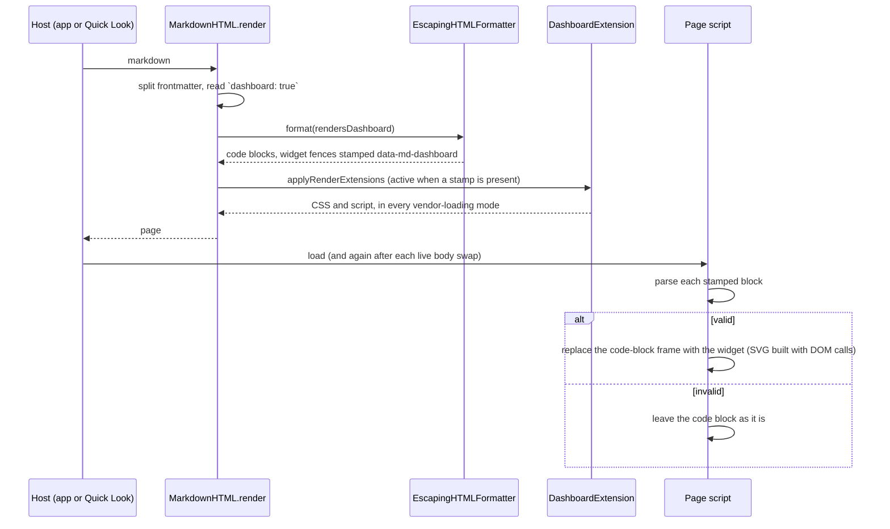
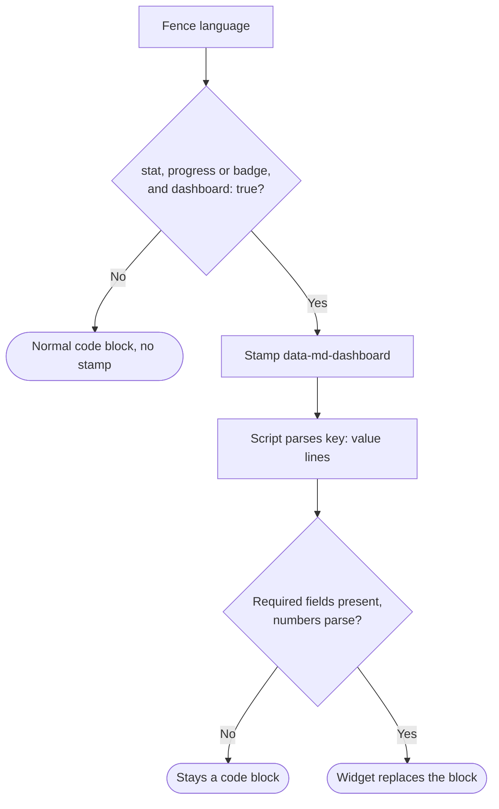

# [FEATURE] Render Markdown as a dashboard

| | |
| --- | --- |
| Design ticket | [#70 [DESIGN] Render Markdown as a dashboard](https://github.com/bluzky/daisy-app/issues/70) |
| Target branch | `main`. Spec on `docs/markdown-dashboard-spec`; implementation on `feat/markdown-dashboard` |
| Spec PR | [#71](https://github.com/bluzky/daisy-app/pull/71) (open; does not yet carry the changes below) |
| ClickUp Doc | n/a |
| Author (engineer) | Daniel (flex) |
| Drafted with | Draft — PO agent (§1, §3), Draft — Tech design agent (§2) |
| Reviewer | tech lead |
| Status | Draft, not approved (Gate 1 not passed). Implemented in one go at the engineer's request, uncommitted on `feat/markdown-dashboard` |
| Target release | next minor |
| Implementation plan | None: the engineer chose to implement in one go, without phases |

## 1. Business flow

**Problem:** A Markdown file that holds metrics (KPIs, progress, status, small charts) renders as plain paragraphs and tables. The numbers that matter are not visually distinct, so a status or KPI note cannot be read at a glance.

**Goal:** A document can opt in to a dashboard look using a few inline widgets (stat tiles, progress bars, status badges). The file stays plain Markdown, remains readable in any other viewer, and shows the same in the app and in Quick Look. Charts are drawn with Mermaid, which Daisy already renders.

**Out of scope** (decided with the engineer):
- Grid layout and cards. Widgets flow in the normal document order. The existing [Columns](../columns.md) feature is not changed.
- External data: no `data:` file references, no network fetches, no live reload of side files. Every value is written in the `.md` file itself.
- Author-written JavaScript, editing or filtering widgets, and a formula or expression language. Values are written already computed. (The app's own widget script is internal and not author-controlled.)
- Charts. Bar, line and pie charts are Mermaid's `xychart-beta` and `pie`, which Daisy already renders and which also render on GitHub and in other editors (engineer decision, Q-10). A `chart` fence is ordinary code.

**Not handled** (deliberately left out):
- Interactive features such as drill-down, tooltips with history, or zoom — the preview is read-only.
- Widgets in DOCX export — a widget exports as the code block it is in the Markdown (Q-5).
- Dashboard colors in Customize Theme, theme presets and slide themes — the `--dashboard-*` variables exist and a theme can override them, but no settings UI or preset sets them yet (follow-up).

### Flow 1: Author writes a dashboard


### Flow 2: Same file in another viewer


**Business rules:**

| ID | Rule | Source |
| --- | --- | --- |
| BR-1 | Widgets render only when the document's frontmatter has `dashboard: true`. Without it, the same blocks show as ordinary code blocks. | Requirement (opt-in, like `slides: true`) |
| BR-2 | A **stat** shows a `label`, a `value`, an optional `delta` on the value's line aligned right, an optional `trend` (`up`, `down` or `flat`) and an optional `note` under them. A single block may hold several stats; they render side by side in one row. | Engineer decision |
| BR-3 | ~~removed~~ — charts are Mermaid's (`xychart-beta`, `pie`), not a widget (Q-10). | Engineer decision |
| BR-4 | A **progress** block draws one bar per item, each with a `label`, a `value` (zero or more) and a `max` (above zero), and shows `value / max`. Items are separated by `---`. A value above its maximum shows a full bar. | Requirement; engineer decision (Q-10) |
| BR-5 | A **badge** shows a short status text with a status color (for example ok, warn, fail). | Requirement |
| BR-6 | In any viewer that does not support dashboards, each widget degrades to readable plain content (a fenced block or a table). The file is never rewritten. | Requirement |
| BR-7 | A widget block with missing or invalid fields is shown as a plain code block, never as an error that hides the rest of the document. | Consistent with Columns (a malformed group stays plain) |
| BR-8 | Widgets render the same in Read mode, in Quick Look and in PDF export. | Requirement; lesson from #338; Q-5 |
| BR-9 | Trend color is derived from `trend`: up is positive, down is negative, flat is neutral. `trend` stays the direction of movement; an author marks a metric where down is good (for example churn) with `good: down`, which swaps the two colors. | Engineer decision (Q-3) |
| BR-10 | ~~removed~~ — chart legend position, dropped with charts (Q-10). | Engineer decision |
| BR-11 | Progress, tile and badge colors come from a standard palette of theme variables (an accent, four status colors, and text, surface, border and card colors that follow the page theme), so a theme can recolor every widget. Authors cannot set colors in a block. | Engineer decision |
| BR-12 | A stat may have a `link`, shown as an arrow in the tile's corner, that opens the way a Markdown link in the document does (URL, relative file, `#heading`). A link whose scheme the page never follows (`javascript:`, `data:`, `file:`, …, as in `ExternalLinkPolicy`) leaves the block plain (BR-7). | Engineer decision; current link behavior |
| BR-13 | ~~removed~~ — values drawn on charts, dropped with charts (Q-10). | Engineer decision |

## 2. Technical design

**Pattern followed:** the in-page script of `query-blocks` (`MarkdownRenderExtension.swift:995`) and Mermaid (`MarkdownHTML+Mermaid.swift:545`): the formatter writes ordinary `<pre><code class="language-x">`, and an extension's script upgrades it in the page. The frontmatter opt-in follows slides (`SlideDeck.isDeck`, `SlideDeck.swift:544`; read in `MarkdownHTML.swift:376-382`). Decided in Q-7: the widgets are drawn by a small **JavaScript** script of our own, with no library. All of it is in `daisy/Rendering/MarkdownHTML+Dashboard.swift`.

**Block syntax** (Q-6): a fenced block named `stat`, `progress` or `badge`. The body is `key: value` lines. Several items in one block are separated by a line with `---`; a `stat` block with several items renders as one row (BR-2), a `progress` block stacks its bars (BR-4).

````markdown
---
dashboard: true
---

```stat
label: Revenue
value: $48.2k
delta: +12%
trend: up
note: vs last month
link: #sales-by-month
---
label: Churn
value: 2.1%
delta: -0.4%
trend: down
good: down
```

```progress
label: Features
value: 7
max: 12
---
label: Tests passing
value: 182
max: 190
```

```badge
text: Passing
status: ok
```
````

**Keys** (`*` required; any other value for a listed key leaves the block plain, BR-7):

| Block | Keys | Notes |
| --- | --- | --- |
| `stat` | `label`*, `value`*, `delta`, `trend` (`up` `down` `flat`), `good` (`up` `down`), `note`, `link` | `---` between tiles; tiles share a row (BR-2, BR-9, BR-12) |
| `progress` | `label`*, `value`* (≥ 0), `max`* (> 0) | `---` between bars; bars stack (BR-4) |
| `badge` | `text`*, `status`* (`ok` `warn` `fail`) | `---` between badges (BR-5) |

A stat shows whenever `label` and `value` are set; `delta` and `trend` are optional. A `delta` without a `trend` shows in the neutral color with no arrow; a `trend` without a `delta` is ignored (BR-9, engineer decision).

In another viewer each block is a normal code block holding readable `key: value` lines (BR-6).

**How the opt-in reaches the script.** Extensions receive the Markdown body with the frontmatter already removed (`MarkdownHTML.swift:486-490`), so an extension cannot read `dashboard: true` itself. Instead the formatter, which is told `rendersDashboard`, stamps `data-md-dashboard` on the `<pre>` of each of the three fences when the flag is on. Without the flag nothing is stamped, so the script has nothing to act on (BR-1).

**Diagrams:**





**API changes:** none. No endpoints, URL scheme or host bridge messages.

**DB changes:** none. No persisted state, defaults key or workspace index change.

**Code changes:**

| Part | Change |
| --- | --- |
| Opt-in | New `DashboardDocument.isDashboard(frontmatter:format:)`, same shape as `SlideDeck.isDeck`. `MarkdownHTML.render` computes it next to `rendersSlides` and passes `rendersDashboard` to `EscapingHTMLFormatter.format`. |
| Formatter | `visitCodeBlock` (`EscapingHTMLFormatter.swift:1142`) adds `data-md-dashboard` to the `<pre>` when `rendersDashboard` is true and the language is one of the three. Output is otherwise unchanged and highlighting is skipped for these three, as for mermaid. |
| Extension | New `DashboardExtension` (`id: "dashboard"`, not user-toggleable like `SlidesExtension`, unique `order`). `isActive` looks for `data-md-dashboard` in the article HTML. Its assets (CSS and script) are returned in **both** vendor-loading modes. Quick Look uses `.inline`, and `query-blocks` returns nothing in that mode, so copying its `guard mode == .lazy` would lose Quick Look (the #338 shape). `scriptAssetIDs` includes the id so live body swaps keep the runtime. |
| Quick Look target | `project.pbxproj`: `Rendering/MarkdownHTML+Dashboard.swift` added to the `quick-look` target's explicit file list (the app target picks it up through the synchronized folder). The only project change. |
| Localization | `en.lproj/Localizable.strings`: `"Dashboard"`, the extension's title key. |
| Script | One small script in the extension's assets, no library. It parses each stamped block (`key: value` items split by `---`), builds the stat tiles, progress bars and badges with `textContent` and attributes (never `innerHTML`), checks stat links against `ExternalLinkPolicy.blockedSchemes` (the widget is built after the page sanitizer ran), and replaces the page's code-block frame (`.md-code-wrap`, with its header, wrap and copy buttons) rather than only the `pre`. Colors are classes only. On any invalid field the block is left untouched (BR-7). |
| Styles | The palette is CSS custom properties: `--dashboard-accent` (progress bars), `--dashboard-positive`, `--dashboard-negative`, `--dashboard-warning`, `--dashboard-neutral` (deltas, badges; light and dark values), and `--dashboard-text`, `--dashboard-surface`, `--dashboard-border`, `--dashboard-card`, which default to the page theme's own variables. A theme overrides them; wiring them into Customize Theme, presets and slide themes is not part of this change. |
| Tests | `DashboardTests` (23): render-level tests for the stamp, the opt-in and assets in both loading modes, and WKWebView tests that load the real page and check each widget, invalid input, the delta's position, palette overrides, links and blocked schemes, the removed code frame, and that the Mermaid charts the docs recommend render. `SlideDeckTests` (2 added): widgets in slides. `MarkdownRenderExtensionTests`: registry order and descriptors include `dashboard`. The slides linter's widget checks (`check_deck.py`) have no automated test. Tests carry AC IDs where they cover one (FLOW-04). |
| Docs | `docs/dashboard.md`, README entry, `samples/dashboard.md`, a Dashboard widgets section in `docs/slides.md`, `docs/render-extensions.md`. |
| Slides skill | `.agents/skills/daisy-slides`: `SKILL.md` gains a Dashboard widgets section (and points to Mermaid for charts); `references/dashboard-guide.md` is a symlink to `docs/dashboard.md`, copied as a real file by the existing *Bundle Slides Skill* build phase (`rsync -L`); `scripts/check_deck.py` validates widget blocks the way the page script does and estimates their slide height. |

**Jobs / events / config / feature flags:** none. The frontmatter flag is the only switch (BR-1).

**Impact & risk:**

| Area | What changes | Impact | Risk | Mitigation |
| --- | --- | --- | --- | --- |
| `EscapingHTMLFormatter.swift:1142` | One attribute on three fence languages | Every document passes through it | Wrong branch changes ordinary code blocks | The attribute needs `rendersDashboard`; default false, so existing output is unchanged. Test with the flag off (AC-1.1). |
| `MarkdownHTML.swift:376-386`, `format(...)` signature | New parameter | One other caller of `format` (footnotes, `MarkdownHTML+Footnotes.swift:349`) | Compile breaks | Default `false`; footnote formatting does not pass it, so a widget fence inside a footnote stays a code block. |
| Render extension registry (`MarkdownRenderExtension.swift:190`) | One new entry | Orders must be unique (`validatedAndOrdered` traps on a duplicate) | App crash at start-up | Pick an unused `order`; the registry test covers it. |
| Quick Look (`quick-look/PreviewProvider.swift:51`, `PreviewViewController.swift:632`) | None in the host. Script and CSS come from the extension in `.inline` mode | Quick Look shows widgets only if its web view runs the script | **High until checked.** This is the same shape as #338: assets omitted or script not run in Quick Look | Assets are returned in `.inline`; tests load the `.inline` page in a WKWebView and widgets draw. Not yet checked in a real Quick Look preview (AC-5.2). |
| Quick Look target file list (`project.pbxproj`) | One membership line | The `quick-look` target lists its sources explicitly | Build fails if the file is missing (it did, before the line was added) | Added; app build passes. |
| Code-block frame (`MarkdownHTML+HostBridge.swift`, `decorateCodeBlocks`) | None in core | The page wraps every `pre` in `.md-code-wrap` with a language header and wrap/copy buttons | A widget left inside the frame shows the header, buttons and code background | The widget replaces the frame; an invalid block keeps it. Tested. |
| Flash before widgets | The code block shows until the script runs | Brief flash on load | Low | Script runs synchronously on load; `data-md-dashboard` blocks can be hidden by CSS until replaced if the flash shows. |
| PDF export (`MarkdownWebView+PDFExport.swift`) | None expected | Widgets print as built by the script | Print captures before the script runs; colors dropped in print | Script is synchronous; check the print path waits for load; check `print-color-adjust`; verify visually (BR-8). |
| DOCX export (`DocxExporter.swift`) | None | A widget block exports as the code block in the Markdown | None (Q-5) | Covered by existing code-block export. |
| Slides (`SlideDeck`, `MarkdownHTML.swift:380-386`) | `rendersDashboard` is computed independently of `rendersSlides`; the slide walker reaches `visitCodeBlock` like any block | Widgets render inside slides (Q-8) | A wide stat row may overflow a slide; the script must run for slide pages | Tested: a `---` inside a widget does not split the slide, and widgets draw inside slides. Still to check visually (AC-1.3). |
| Frontmatter display (`MarkdownHTML.swift:473`) | None | `dashboard: true` is shown as a normal frontmatter property in Read mode | None | n/a |
| Docs, README, samples | New files and one README entry | Required by AGENTS.md | Stale claims | grep `README.md`, `samples/`, `docs/` for contradicting statements before merge. |

**BR trace:**

| BR | Enforced by |
| --- | --- |
| BR-1 | `DashboardDocument.isDashboard` and the `rendersDashboard` guard that stamps the fence |
| BR-2 | Script `stat`: fields, `---` item split, row container |
| BR-3 | ~~removed~~ |
| BR-4 | Script `progress`: `label`, `value`, `max` per item; fill width capped at 100% |
| BR-5 | Script `badge`: `text`, `status` class |
| BR-6 | Widgets are fences in the source; nothing is rewritten |
| BR-7 | Script leaves the block untouched on any missing or invalid field |
| BR-8 | Extension assets in both loading modes; checked in a real Quick Look preview and a PDF export |
| BR-9 | `trend` picks the arrow and `up`/`down`/`flat` class; `good: down` swaps the color class |
| BR-10 | ~~removed~~ |
| BR-11 | `--dashboard-*` properties and the status classes in the dashboard stylesheet |
| BR-12 | Stat `link`: `safeLink` checks the scheme against `ExternalLinkPolicy.blockedSchemes`; the arrow is a plain `<a href>`, so the existing link handling opens it |
| BR-13 | ~~removed~~ |

**Design options considered** (Q-7, decided: B; Q-10 then dropped charts):
- **A. Static HTML/SVG written by Swift.** No script, no flash, works in Quick Look and PDF by construction. Not chosen.
- **B. JavaScript in the page (chosen).** Matches `query-blocks` and Mermaid, and leaves room for interaction later. Cost: depends on the host running page scripts, a short flash before widgets appear, and the Quick Look risk above.

**Ordering constraints:** none left: implemented in one change at the engineer's request.

**Verification so far:** `DashboardTests` (23), the 2 dashboard tests in `SlideDeckTests` and `MarkdownRenderExtensionTests` (35) pass; Debug app build passes; the sample was viewed in the app by the engineer while iterating on the layout. The full Swift suite has 24 failures in editor, print-style and empty-hint tests that fail identically without this change. Widgets inside a slide deck are covered by WKWebView tests. **Not yet checked:** a real Quick Look preview, a PDF export, a deck with widgets viewed or presented in the app, and clicking a stat link in the app.

**Rollout and rollback:** None. Nothing is stamped or drawn without `dashboard: true`; removing the flag restores plain code blocks.

## 3. User stories & acceptance criteria

### US-1: As a document author, I want to turn a Markdown file into a dashboard with a frontmatter flag, so that ordinary documents are never affected

- AC-1.1 (BR-1): Given a document without `dashboard: true`, when it is previewed, then widget blocks appear as plain code blocks.
- AC-1.2 (BR-1): Given `dashboard: true`, when it is previewed, then valid widget blocks render as widgets.
- AC-1.3 (BR-1): Given a slide deck (`slides: true`) that also has `dashboard: true`, when it is previewed, then valid widget blocks render inside their slides.

### US-2: As a document author, I want stat tiles, so that key numbers stand out

- AC-2.1 (BR-2): Given a stat block with `label` and `value`, when previewed, then a tile shows the label and value.
- AC-2.2 (BR-2): Given a block with several stats, when previewed, then the tiles appear side by side in one row.
- AC-2.3 (BR-2, BR-9): Given a stat with `delta` and `trend: up`, when previewed, then the delta shows with an up indicator in the positive color; `down` uses the negative color.
- AC-2.4 (BR-9): Given a stat with `good: down`, when `trend: down`, then the delta shows with a down indicator in the positive color (and `trend: up` in the negative color).
- AC-2.5 (BR-2): Given a stat with a `delta` and a `note`, when previewed, then the delta sits on the value's line at the right edge and the note under them.
- AC-2.6 (BR-12): Given a stat with a `link`, when previewed, then an arrow in the corner opens that link like a Markdown link; a `javascript:` link leaves the block plain.

### US-3: ~~removed~~ — charts (Q-10)

- AC-3.1 … AC-3.5: ~~removed~~ with charts.

### US-4: As a document author, I want progress bars and status badges, so that state is visible at a glance

- AC-4.1 (BR-4): Given a progress block whose items each have a `label`, a `value` and a `max`, when previewed, then each item shows one bar filled in proportion and its `value / max`; a missing `max`, a zero `max` or a negative `value` leaves the block plain.
- AC-4.2 (BR-5): Given a badge with a status, when previewed, then it shows the text in that status color.

### US-5: As a reader in any viewer or in Quick Look, I want the same file to stay readable and consistent

- AC-5.1 (BR-6): Given a dashboard file opened in a viewer without support, when displayed, then each widget shows as readable plain content.
- AC-5.2 (BR-8): Given a dashboard file, when previewed in Quick Look or exported to PDF, then widgets render as in Read mode.
- AC-5.3 (BR-7): Given one invalid widget block among valid ones, when previewed, then only that block stays plain and the rest render.
- AC-5.4 (BR-11): Given a theme that sets `--dashboard-accent` or `--dashboard-positive`, when previewed, then progress bars, or positive deltas and `ok` badges, use that color.

**Mockup:** no mockup branch; Daisy is a native app. A sample `samples/` dashboard file stands in as the visual reference.

**Documentation (same change, per AGENTS.md):** a new `docs/dashboard.md`, a README feature entry, and a sample dashboard file; grep `README.md`, `samples/`, `tests/fixtures/` and `docs/` for claims that "Markdown renders as plain text" style statements.

## 4. Open questions & decisions

| ID  | Question                                                                                                                 | Options                                                                                    | Decision                | By        | Date |
| --- | ------------------------------------------------------------------------------------------------------------------------ | ------------------------------------------------------------------------------------------ | ----------------------- | --------- | ---- |
| Q-1 | Which design ticket does this belong to, and is the tracker GitHub (like #58) or none?                                   | GitHub issue `[DESIGN] …` / none (slug only)                                               | created: #70 | engineer  |      |
| Q-2 | Which chart types in v1?                                                                                                 | bar + line + pie (recommended: bar + line, add pie later) / bar only                       | bar, line, pie — superseded by Q-10 | tech lead |      |
| Q-3 | How does an author say "down is good"?                                                                                   | `good: down` on the stat (recommended) / a per-stat color override                         | `good: down` on the stat (option 1: `trend` stays direction) | tech lead |      |
| Q-4 | Is `dashboard: true` frontmatter the only opt-in, or should widgets also render without it?                              | frontmatter only (recommended: matches `slides: true`, protects normal docs) / always on   | agree                   | tech lead |      |
| Q-5 | How do widgets appear in PDF and DOCX export?                                                                            | PDF renders widgets, DOCX uses the plain fallback (recommended) / both render / both plain | as your recommendation  | tech lead |      |
| Q-6 | Exact block body syntax (YAML-like key: value lines vs table-based)? Proposal in §2: `key: value` lines, `---` between items, a pipe table inside `chart`. | YAML-like (recommended) / table                                                            | yaml                    | tech lead |      |
| Q-7 | Render widgets as static HTML/SVG in Swift, or with JavaScript and a chart library? | A: static HTML/SVG (recommended: Quick Look, PDF, no vendor bundle) / B: JavaScript renderers | B: JavaScript | engineer | |
| Q-8 | What happens when a file has both `slides: true` and `dashboard: true`? | Widgets ignored in decks for now (recommended) / widgets render inside slides | both apply: a deck with `dashboard: true` shows widgets in its slides | engineer | |
| Q-9 | JavaScript with a chart library, or a small script of our own? | Own script drawing SVG, no vendor bundle (recommended: a few KB, works in `.inline` Quick Look, nothing to load) / chart library (nicer charts, vendor bundle, loading and size cost) | Own script, no library (the chart library was dropped with charts, Q-10) | engineer | |
| Q-10 | Should dashboards have their own chart syntax, or use Mermaid's `xychart-beta` and `pie`? | Own `chart` block (table data, grouped series, theme colors) / Mermaid (no new syntax, renders on GitHub and in other editors) | Mermaid for charts; `progress` back as its own block | engineer | |
