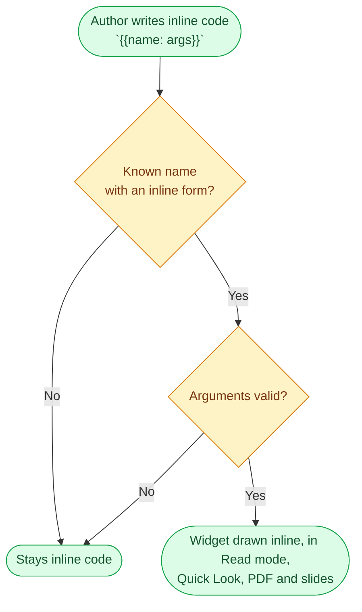
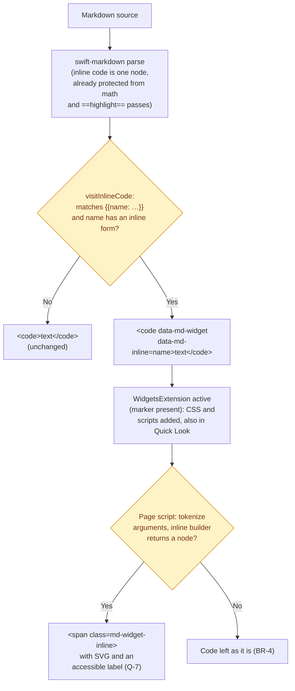

# [FEATURE] Inline widget shortcodes

| | |
| --- | --- |
| Design ticket | [#73 [DESIGN] Inline widget shortcodes](https://github.com/bluzky/daisy-app/issues/73) |
| Target branch | Not set yet (asked when the spec PR is opened) |
| Spec PR | Not opened |
| ClickUp Doc | n/a (GitHub tracker) |
| Author (engineer) | Daniel (flex) |
| Drafted with | Draft — PO agent (§1, §3), Draft — Tech design agent (§2); not yet reviewed by the author |
| Reviewer | tech lead |
| Status | Draft, not approved (Gate 1 not passed). Implemented on `feat/markdown-dashboard` at the engineer's request before approval (FLOW-02 waived by the engineer, as for #70); not committed |
| Target release | next minor |
| Design slides | `docs/features/markdown-shortcodes-slides.md` (before Gate 1) |
| Implementation plan | `docs/features/markdown-shortcodes-plan.md` (after Gate 1) |

Builds on [Render Markdown as a dashboard](markdown-widgets.md) (#70): its widgets, `color` key (BR-16 there) and fallback rule (BR-7 there) are reused as they are.

## 1. Business flow

**Problem:** Dashboard widgets exist only as fenced blocks, and a block can't sit inside a sentence, a list item or a table cell. A status table can't show a trend or a status pill on each row, so the numbers that matter in a row still read as plain text.

**Goal:** An author writes a widget **inline**, as a short shortcode inside inline code, next to the dashboard widgets that stay blocks. The inline widgets are a new **sparkline** (a small line drawn from a list of numbers), the **badge**, which moves from a block to a shortcode, and an inline **progress** bar next to the existing block. The file stays plain Markdown that reads fine in other viewers.

**Out of scope:**
- Shortcodes outside inline code (bare `` or `[[ … ]]` in text). `[[ ]]` stays free for wiki links (Q-1).
- Author-defined shortcodes, templates or scripts. Only widgets that ship in the app have a shortcode.
- New dashboard widgets other than the sparkline.
- A sparkline block, or a trend line inside a `stat` tile (Q-6). The sparkline is inline only for now.
- Changing how card options are parsed (`<!-- card … -->`).

**Not handled** (deliberately left out):
- A shortcode inside a footnote. It stays inline code, the same as a widget fence in a footnote today.
- A shortcode inside link text. It is drawn, but the link isn't checked to still be clickable around an SVG.
- A backslash escape inside a quoted argument. A value with `"` is quoted with `'…'`, and the other way round (Q-2).
- Shortcodes in DOCX export. They export as the inline code they are in the Markdown, the same as widget blocks (Q-5 of #70).

### Flow 1: Author writes a shortcode



**Business rules:**

| ID | Rule | Source |
| --- | --- | --- |
| BR-1 | An inline code span whose whole text is `{{name: arguments}}` is a **shortcode** when `name` is a widget with an inline form. The colon right after the name is required, even with no arguments. Spaces are allowed just inside the braces and after the colon, not before it. | Engineer decision (Q-1) |
| BR-2 | Arguments are separated by spaces: positional values first, then `key=value`. A value with spaces is wrapped in `"…"` or `'…'`. Keys are lowercase and never quoted, and a key may appear once. A value ending in a comma continues into the next one, so `3, 5, 2, 8` is one list without quotes. | Engineer decision (Q-2, Q-4) |
| BR-3 | A shortcode's `color` is the shared dashboard color key, with the same values (BR-16 of #70). Its first positional value is the widget's main value: a sparkline's numbers, a badge's text. | Engineer decision (in chat); #70 BR-16 |
| BR-4 | Arguments a widget doesn't support are **ignored** and the widget is still drawn: an unknown key, and positional values beyond the ones it takes. A code span that matches BR-1 but has broken arguments (an unclosed quote, an empty or repeated key), no main value, or a value its widget rejects for a known key (e.g. `color=purple`) stays the inline code it was. The rest of the document renders as usual either way. | Engineer decision (2026-11-25); fallback as #70 BR-7 |
| BR-5 | A **sparkline** draws its numbers, in order, as a line scaled between their lowest and highest value. Inline, it is the height of the surrounding text so it sits on the line. Its `color` colors the line. It needs at least two numbers. When every number is the same, the line is flat across the middle. `type=bar` draws one bar per number instead, growing from zero (down for a negative number), a zero as a thin sliver; `type` is `line` (default) or `bar`, and any other value leaves the code as it is (BR-4). It takes no other options. Its values stay readable as text for find, copy and VoiceOver (e.g. "Sparkline: 3, 5, 2, 8"). | Ticket #73; engineer decisions (Q-5, Q-7, Q-8); "at least two numbers" still to confirm |
| BR-6 | ~~removed~~: no sparkline block for now (Q-6). | Engineer decision (Q-6) |
| BR-7 | Shortcodes render the same in Read mode, Quick Look, PDF export and slides. | Ticket #73; same as #70 BR-8 |
| BR-8 | A **badge** is written only inline: `{{badge: text color=…}}`, its text as the positional value and `color` as before (#70 BR-5). A ```` ```badge ```` fenced block is no longer a widget and shows as a plain code block, including in files written before this change. Several badges side by side are several shortcodes in one line. | Engineer decision (Q-3); replaces the block form in #70 BR-1 and BR-5 |
| BR-9 | An inline **progress** bar, `{{progress: 7/12}}` or `{{progress: 58%}}`, draws a bar half the text's height from a fraction (value 0 or more, maximum above 0) or a percentage; a value above the maximum is a full bar. Only the bar is drawn unless `text=` adds text after it, with the block's template (`{value}`, `{max}`, `{percent}`); `color` and `striped=true` work as on the block. The ```` ```progress ```` block stays as it is. | Engineer decision (2026-11-25) |

## 2. Technical design

**Pattern followed:** the dashboard widget fences (#70). The formatter writes ordinary HTML with a marker attribute and leaves the text as it is. `WidgetsExtension` adds its script when that marker is present. The script upgrades each marked element through a table of builders, and leaves it alone when a builder returns `null`. Shortcodes add a second marker on inline `<code>` and an inline lookup next to `BUILDERS`. There is no new extension, parser pass or vendor library.

**Diagram:**



**Changes:**

| Part | Change | Where |
| --- | --- | --- |
| Widget registry | Remove `badge` from `widgetLanguages` (BR-8); `sparkline` is not added there (Q-6). Add a new `inlineWidgets` set: `sparkline`, `badge`, `progress` (`progress` is in both sets). Only the formatter reads the Swift sets. The script keeps its own `BUILDERS` and `INLINE` literals, and the checker its own `WIDGETS` and `INLINE_WIDGETS` sets; tests keep them in sync (`ShortcodeTests.testEveryInlineWidgetHasABuilder`, `testTheSkillCheckersKnowTheSameWidgets`). | `daisy/Rendering/MarkdownHTML+Widgets.swift:36` |
| Formatter | `visitInlineCode`: when `rendersWidgets` is on and the text matches `^\{\{\s*([a-z][a-z0-9-]*):(.*)\}\}$` with a name in `inlineWidgets`, write `<code data-md-widget data-md-inline="name">` with the escaped text. Otherwise the output is unchanged. Footnotes don't pass `rendersWidgets`, so a shortcode there stays code. | `daisy/Rendering/EscapingHTMLFormatter.swift:1500` |
| Protection | None needed: inline code is already protected from math extraction and from `==highlight==` preparation. | `daisy/Rendering/MarkdownHTML+Math.swift:127`, `daisy/Rendering/EscapingHTMLFormatter.swift:358` |
| Extension | None: `isActive` already looks for `data-md-widget`, and its assets are returned in both vendor-loading modes. | `daisy/Rendering/MarkdownHTML+Widgets.swift:122` |
| Script: tokenizer | New `tokenize(text)` that splits on spaces with `"…"`/`'…'` quoting (and Q-4's comma rule). It returns `{ positional, options }`, or `null` for an unclosed quote or an empty or repeated key. Each builder reads only the keys and positional values it supports and ignores the rest (BR-4). | Dashboard script, next to `parse` (`MarkdownHTML+Widgets.swift:455`) |
| Script: sparkline | An inline builder: an SVG `polyline` scaled to min and max from the first positional value, or with `type=bar` one `rect` per value on a scale that includes zero; colored with `readColor`/`paint` (`:428`, `:435`), the line in the text shade and the bars in the fill shade. No block builder (Q-6). | Dashboard script |
| Script: upgrade | `upgrade()` also scans `code[data-md-inline]`, calls `INLINE[name]`, and replaces the `<code>` with a `<span class="md-widget-inline">`. Its `aria-label` and `title` hold the values (Q-7). | `MarkdownHTML+Widgets.swift:789` |
| CSS | `.md-widget-inline` with `height: 1em` and `vertical-align` on the text baseline. | Dashboard stylesheet |
| AI skill | `daisy-widgets`: document the shortcode and the sparkline. Add `sparkline` and the inline set to the checker's rules, and check shortcodes with the same tokenizer before code spans are blanked (today `CODE_SPAN.sub` hides them, so the checker never sees one). The checker **warns** on ignored arguments, since the page drops them silently (an unquoted `{{badge: In review}}` shows only "In"). | `.agents/skills/daisy-widgets/SKILL.md`, `scripts/check_deck.py:37,44`, `scripts/check_widgets.py:54` |
| Script: badge | The badge builder takes the inline tokens (text, `color`) instead of `key: value` lines, and `badge` leaves `BUILDERS`. The pill markup and `isLight` dark-text rule stay as they are. | `MarkdownHTML+Widgets.swift:640`, `:775` |
| Docs | Add shortcodes and the sparkline, and change every ```` ```badge ```` block to the shortcode, in the same change (AGENTS.md rule). The dashboard spec's BR-1 and BR-5 also need updating; that is proposed for #70, not edited here (CORE-04). | `README.md:49`, `docs/widgets.md`, `samples/widgets.md`, `samples/widgets-deck.md`, `.agents/skills/daisy-widgets/SKILL.md`, `.agents/skills/daisy-slides/SKILL.md`, `docs/slides.md`, `docs/features/markdown-dashboard.md` |
| Tests | Rewrite the badge cases in `WidgetTests` (8 use a ```` ```badge ```` block) for the shortcode, and add one that a ```` ```badge ```` block stays code. | `tests/swift-tests/Tests/MarkdownHelpersTests/WidgetTests.swift` |

**API changes:** None. **DB changes:** None. **Jobs / events / config / feature flags:** None (the dashboard extension is not user-toggleable).

**Impact & risk:**

| Area | What changes | Impact | Risk | Mitigation |
| --- | --- | --- | --- | --- |
| Existing inline code | Inline code that matches BR-1 with a known name is now drawn | A code sample such as `` `{{badge: x}}` `` would turn into a widget | Low: it needs `{{`, a known name and a colon right after it, which template languages (`{{ user.name }}`, `{{#if}}`, `{{.Name}}`) don't produce | BR-4 fallback; tests with Jinja, Handlebars and Go template samples |
| Quick Look | Inline widgets in the sandboxed preview | Shows widgets only if its web view runs the script | Medium until checked (the #338 shape) | Assets already load in `.inline` mode; a WKWebView test on the `.inline` page; check a real Quick Look preview |
| Slides, PDF | Same HTML and script | Inline SVG must scale with slide text and print | Low | SVG sized in `em`; check one slide and one PDF |
| Find, copy, VoiceOver | The code's text is replaced by an SVG | Values are no longer page text | Low | Accessible label (Q-7) |
| Existing badge blocks | ```` ```badge ```` stops being a widget (BR-8) | Files written since #70, by people or by agents using the installed skill, show badges as code blocks until rewritten | Medium: the change is visible, and older installed copies of the skill keep teaching the block | Release note in `CHANGELOG.md`, samples and both skills updated, and **Install AI Skills…** run again to replace old copies |
| DOCX export | None | Shortcodes export as inline code | None | Existing behaviour |
| Editor | None | Edit mode shows the source | None | `scripts/editor-bundle/src` has no dashboard code |
| AI skill checker | New syntax | Agents could write shortcodes the checker rejects or misses | Low | Same names and tokenizer as the script; checker tests |

**Rollout and rollback:** None. The change is in the rendering only, and reverting it turns shortcodes back into inline code.

## 3. User stories & acceptance criteria

### US-1: As an author, I want to put a small widget inside a sentence or a table cell, so that each row of a status table shows its trend at a glance

- AC-1.1 (BR-1, BR-5): Given a table cell holding `` `{{sparkline: 3,5,2,8,6}}` ``, when the document renders, then a sparkline of those five values replaces the code, at the height of the cell's text.
- AC-1.2 (BR-2, BR-3): Given `` `{{sparkline: "3,5,2,8" color=success}}` ``, when the document renders, then the line is drawn from those four values in the success color.
- AC-1.3 (BR-1, BR-4): Given `` `{{sparklien: 1,2}}` ``, `` `{{sparkline 1,2}}` `` (no colon), `` `{{sparkline: 1,2 color="red}}` `` (unclosed quote), `` `{{sparkline: 1,2 color=purple}}` `` (a value the widget rejects) or `` `{{ user.name }}` ``, when the document renders, then each stays inline code and the rest of the document renders as usual.
- AC-1.4 (BR-7): Given a document with an inline sparkline, when it is shown in Quick Look, exported to PDF or presented as a slide, then the sparkline is drawn there as in Read mode.
- AC-1.5 (BR-8): Given `` `{{badge: "In review" color=warning}}` `` in a table cell and a ```` ```badge ```` block with `text: Shipped` elsewhere, when the document renders, then the cell shows an "In review" pill on a warning fill, and the block shows as a plain code block.
- AC-1.6 (BR-4): Given `` `{{sparkline: 1,4,2 size=big}}` `` or `` `{{badge: In review}}` ``, when the document renders, then the sparkline is drawn without `size`, and the badge reads "In": the unsupported key and the extra positional value are ignored.
- AC-1.7 (BR-5): Given `` `{{sparkline: 4,8,0,-4 type=bar color=success}}` ``, when the document renders, then four success-colored bars are drawn from a zero line: two up, a thin sliver for the zero and one hanging down; `type=area` would leave the code as it is.
- AC-1.8 (BR-9): Given `` `{{progress: 7/12 color=success}}` ``, `` `{{progress: 58%}}` `` and `` `{{progress: 15/10}}` `` in table cells, when the document renders, then each cell shows only a bar, filled 58%, 58% and 100%; `` `{{progress: 7}}` `` stays inline code.

### US-2: ~~removed~~ (no sparkline block for now, Q-6)

**Mockup:** no separate mockup; the samples (`samples/widgets.md`) show the result.

## 4. Open questions & decisions

| ID | Question | Options | Decision | By | Date |
| --- | --- | --- | --- | --- | --- |
| Q-1 | What does an inline shortcode look like? | `{{name: args}}` inside inline code / `{{name args}}` / `[[name args]]` / bare `` in text / swift-markdown's `^[…](…)` | `{{name: args}}` inside inline code. The colon cuts false matches with template code, and `[[ ]]` stays free for wiki links | engineer | 2026-11-25 |
| Q-2 | How is an argument with spaces written? | Quotes `"…"`/`'…'` without escapes / backslash escapes / join unquoted words into one value | Quotes, no backslash escapes; one rule for every widget | engineer | 2026-11-25 |
| Q-3 | Which widgets have an inline form besides the sparkline? | `badge` / `badge` and a one-line `progress` / sparkline only | `badge`, and the inline form **replaces** the ```` ```badge ```` block: the block is removed, not kept for old files (BR-8). Later: `progress` too, **next to** its block (BR-9) | engineer | 2026-11-25 |
| Q-4 | Is `3, 5, 2, 8` (spaces after commas) accepted unquoted? | Require quotes / a token ending in a comma continues into the next | Continue: a value ending in a comma joins the next one (BR-2) | engineer | 2026-11-25 |
| Q-5 | Which options does the sparkline take besides `values` and `color`? | None for now / `type=bar` / `min`, `max` / a dot on the last point | None at first; then `type=bar` added on request (`line` stays the default). No min/max or dot (BR-5) | engineer | 2026-11-25 |
| Q-6 | How big is a block sparkline, and does it carry a label? | Full width with a `height` key like charts / text height like inline / a `spark` key on a `stat` tile instead of a block | No sparkline block for now: the sparkline is inline only. A `spark` key on `stat` is not part of this feature | engineer | 2026-11-25 |
| Q-7 | What do find, copy and VoiceOver get for a drawn shortcode? | The values as its label / the source shortcode / nothing | The values, e.g. "Sparkline: 3, 5, 2, 8" (BR-5) | engineer | 2026-11-25 |
| Q-8 | How does a sparkline look when every value is the same (e.g. `0,0,0`)? Scaling between min and max has no range | A flat line across the middle / a flat line at the bottom / the shortcode stays code | A flat line across the middle (BR-5) | engineer | 2026-11-25 |
