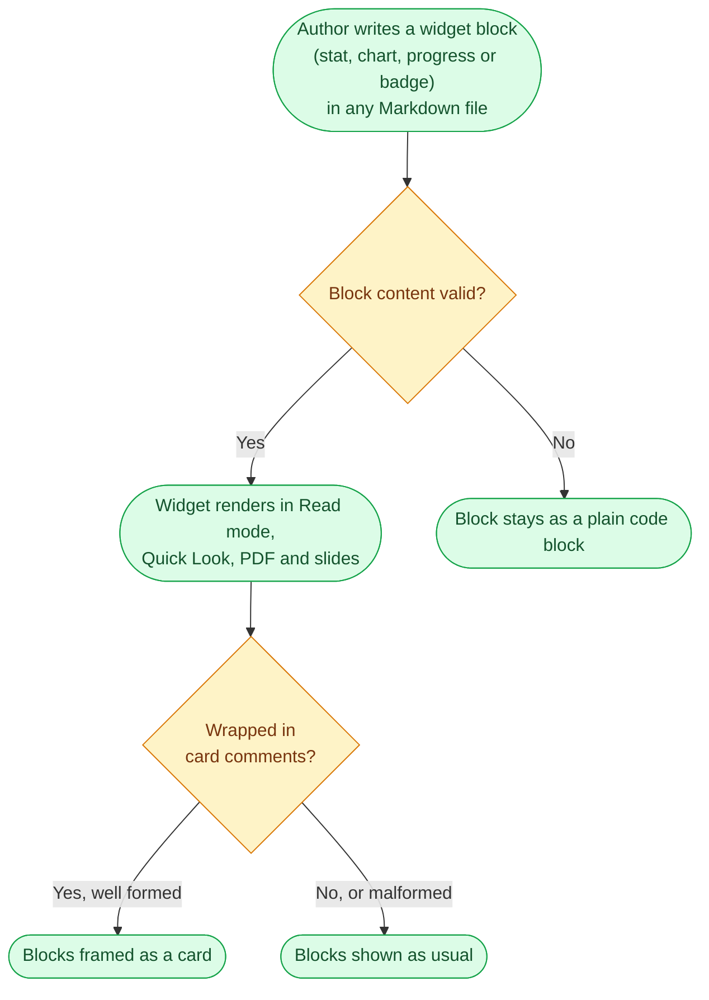
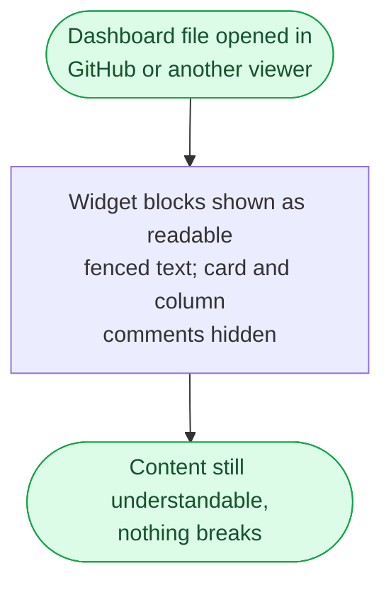
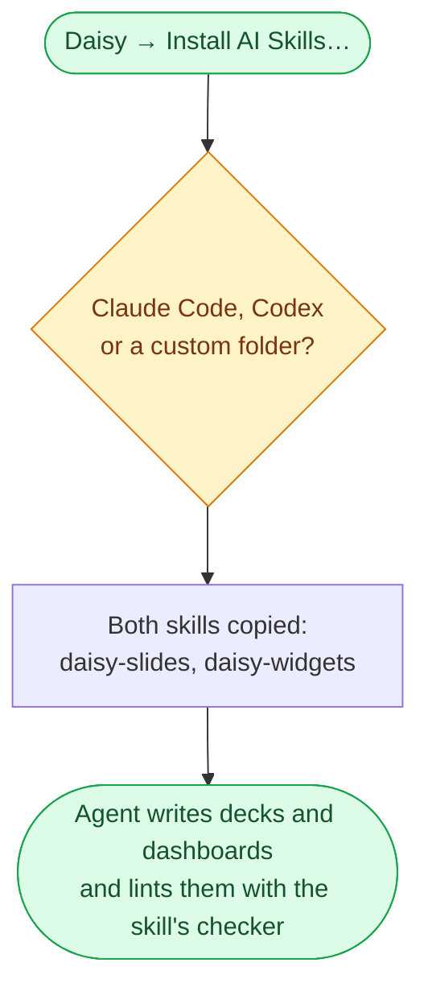
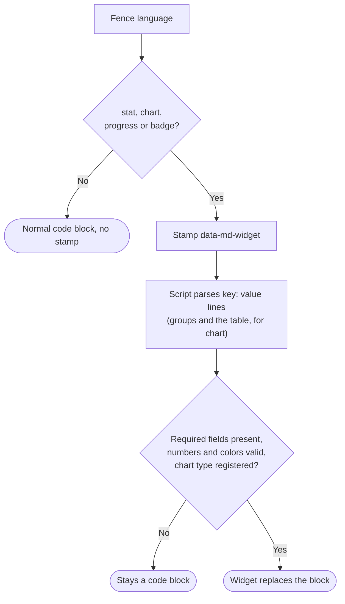

# [FEATURE] Render Markdown as a dashboard

| | |
| --- | --- |
| Design ticket | [#70 [DESIGN] Render Markdown as a dashboard](https://github.com/bluzky/daisy-app/issues/70) |
| Target branch | `main`. Spec on `docs/markdown-dashboard-spec`; implementation on `feat/markdown-dashboard` |
| Spec PR | [#71](https://github.com/bluzky/daisy-app/pull/71) (open; does not yet carry the changes below) |
| Implementation PR | [#72](https://github.com/bluzky/daisy-app/pull/72) (open) |
| ClickUp Doc | n/a |
| Author (engineer) | Daniel (flex) |
| Drafted with | Draft — PO agent (§1, §3), Draft — Tech design agent (§2); updated to match the implementation on 2026-11-25 |
| Reviewer | tech lead |
| Status | Draft, not approved (Gate 1 not passed). Implemented in one go at the engineer's request, and extended while iterating: widgets in every document (no opt-in, Q-18), chart options and the donut type (Q-22), one role-based `color` key (Q-19, Q-20), cards (Q-21), the `daisy-widgets` AI skill (Q-23) and ring progress with a `text` template (Q-25, Q-26) |
| Target release | next minor |
| Implementation plan | None: the engineer chose to implement in one go, without phases |

> **Renamed to widgets.** The feature was first called a dashboard. Widgets are ordinary Markdown in any document, so the code, CSS (`md-widget-*`, `--widget-*`), slide theme keys (`widget_*`), docs (`docs/widgets.md`), samples and the `daisy-widgets` skill now say "widget"; the old names no longer work. Ticket titles, branch names and the history below keep the word "dashboard".

## 1. Business flow

**Problem:** A Markdown file that holds metrics (KPIs, progress, status, small charts) renders as plain paragraphs and tables. The numbers that matter are not visually distinct, so a status or KPI note cannot be read at a glance.

**Goal:** Any Markdown document can use a few inline widgets (stat tiles, charts, progress bars, status badges) and frame blocks as cards, so it reads as a dashboard. The file stays plain Markdown, remains readable in any other viewer, and shows the same in the app, in Quick Look and on slides. AI agents can learn the format from a skill the app installs.

**Out of scope** (decided with the engineer):
- A grid layout beyond the existing [Columns](../columns.md). Cards (BR-19) sit in the document or in a column; columns don't go inside a card.
- External data: no `data:` file references, no network fetches, no live reload of side files. Every value is written in the `.md` file itself.
- Author-written JavaScript, editing or filtering widgets, and a formula or expression language. Values are written already computed. (The app's own widget script is internal and not author-controlled.)
- Chart types other than bar (grouped, stacked, horizontal), line, pie and donut (area, scatter), axis titles and a second y axis.
- Charting a table that sits outside a `chart` block, or referring to one by position, heading or ID. The data is always inside the block, so a normal table is never turned into a chart.
- Charts with large datasets; a chart is for a handful of inline values.
- Raw CSS in a block or a card. Colors are palette names or checked hex values (BR-16, BR-19).

**Not handled** (deliberately left out):
- Interactive features such as drill-down, tooltips with history, or zoom — the preview is read-only.
- Widgets and cards in DOCX export — a widget exports as the code block it is in the Markdown, and a card's blocks export one after another (Q-5).
- A setting for dashboard colors. Every app theme and Quick Look use the two built-in palettes (BR-15).
- A label in the middle of a donut other than its total; a gauge is a ring progress block instead (BR-22).

### Flow 1: Author writes a dashboard



### Flow 2: Same file in another viewer



### Flow 3: Author teaches an AI agent the format



**Business rules:**

| ID | Rule | Source |
| --- | --- | --- |
| BR-1 | In any document, a fenced block named `stat`, `chart` or `progress` is a widget (`badge` was one until #73 made it an inline shortcode, see [markdown-shortcodes.md](markdown-shortcodes.md) BR-8). There is no opt-in; a document without such blocks is unchanged. | Engineer decision (Q-18, replaces the frontmatter opt-in of Q-4) |
| BR-2 | A **stat** shows a `label`, a `value`, an optional `delta` on the value's line aligned right, an optional `trend` (`up`, `down` or `flat`) and an optional `note` under them. Its optional `color` colors the value (BR-16). A single block may hold several stats; they render side by side in one row. | Engineer decision; Q-19 |
| BR-3 | A **chart** takes its values from a Markdown table written inside the chart block. The first column holds the labels and every other column is a series of numbers named by its header. It draws a `bar` chart (one bar per series for each label, side by side), a `line` chart (one line per series), a `pie` chart or a `donut` chart (one slice per row, from a single number column). | Original requirement; Q-2, Q-6, Q-11, Q-22 |
| BR-4 | A **progress** block draws one row per item: its `label`, a bar, then `value / max`. Each item has a `label`, a `value` (zero or more) and a `max` (above zero); items are separated by `---`, and the labels, bars and values of one block line up. A value above its maximum shows a full bar. Its optional `color` colors the bar (BR-16). | Requirement; engineer decisions (Q-10, layout while iterating) |
| BR-5 | A **badge** (written inline as `{{badge: text color=…}}` since #73, BR-8 there) shows a short `text` in its color on a pale tint of that color. Its optional `color` (BR-16) sets both; without one it is grey. On a light page the text is darkened, a hex color too. | Requirement; Q-19 |
| BR-6 | In any viewer that does not support dashboards, each widget degrades to readable plain content (a fenced block), and card and column comments are invisible. The file is never rewritten. | Requirement |
| BR-7 | A widget block with missing or invalid fields is shown as a plain code block, never as an error that hides the rest of the document. A malformed card leaves its blocks unframed. | Consistent with Columns (a malformed group stays plain) |
| BR-8 | Widgets and cards render the same in Read mode, in Quick Look, in PDF export and on slides. | Requirement; lesson from #338; Q-5, Q-8 |
| BR-9 | Trend color is derived from `trend`: up is `success`, down is `danger`, flat is `default`. `trend` stays the direction of movement; an author marks a metric where down is good (for example churn) with `good: down`, which swaps the two colors. | Engineer decision (Q-3) |
| BR-10 | A chart shows a legend naming each series (bar, line) or each slice (pie, donut). Its position is `top`, `bottom` (default), `left` or `right`, or it is hidden — either in one line (`legend: right`, `legend: none`) or as a group with `position` and `visible` on indented lines. On a window too narrow for a side legend, a `left` or `right` legend moves below the chart. | Engineer decision (Q-11, Q-12, Q-22) |
| BR-11 | Every widget color comes from one shared **dashboard palette** of semantic colors: `default` (grey), `accent`, `success`, `info`, `warning`, `danger`, and `series-1` … `series-8` (chart series and slices, in order). There are two palettes of standard colors, light and dark, following the page's appearance. Text, surface, border and card colors keep following the page theme. | Engineer decision (Q-14, Q-15; names Q-20) |
| BR-12 | A stat may have a `link`, shown as an arrow in the tile's corner, that opens the way a Markdown link in the document does (URL, relative file, `#heading`). A link whose scheme the page never follows (`javascript:`, `data:`, `file:`, …, as in `ExternalLinkPolicy`) leaves the block plain (BR-7). | Engineer decision; current link behavior |
| BR-13 | A chart draws each value on the chart (above its bar or point, inside its slice or stacked segment) unless the block says `values: false`. Value labels use a fixed 10px size; a slice too small to hold its label (under about 5% of the total) and a stacked segment too short for its number show no value. | Engineer decision (Q-11; size while iterating) |
| BR-14 | ~~removed~~ — superseded by BR-16 (Q-19). | Engineer decision |
| BR-15 | The palette has no setting: every app theme uses the two built-in palettes, and so does Quick Look. A slide deck's theme can override any palette color on its slides (`colors:` keys `widget_default`, `widget_accent`, `widget_success`, `widget_info`, `widget_warning`, `widget_danger`, `widget_series_1` … `widget_series_8`). | Engineer decision (Q-15; names Q-20) |
| BR-16 | **One `color` key, by role.** A stat (its value), a progress bar (its fill), a badge (its text and tint) and a card (its border, accent bar or tint) take `color`; a chart's `colors` takes a comma list of the same values, for its series or slices in order. A value is a palette name (`default`, `accent`, `success`, `info`, `warning`, `danger`; `neutral` is another name for `default`) or a hex (`#RGB`, `#RRGGBB`). The author says what it means; each widget puts it in its own place and keeps text readable. `default` is the widget's normal look. Any other value leaves the block plain (BR-7). Names follow light and dark; a hex is the same in both. | Engineer decision (Q-19, Q-20) |
| BR-17 | **Chart layout options.** Bar charts take `stacked: true` (one bar per row, positives up and negatives down from zero, the row's total at the end) and `direction: horizontal` (rows down the left). Any chart takes `height` (80–1200 px; a pie's or donut's diameter) and `grid: false` (grid lines hidden, the zero line kept); bar and line charts take `x-axis` / `y-axis` groups with `visible: false`, named as drawn. Line points run from the left edge to the right edge. A chart is drawn at the width it is shown at, so its text keeps the same size in a column, a wide window or on a slide. | Engineer decision (Q-22) |
| BR-18 | A **donut** is a pie with a hole and the total in the middle; `values: false` hides the total too. | Engineer decision (Q-22) |
| BR-19 | A **card** frames the blocks between `<!-- card … -->` and `<!-- end-card -->`, each on its own line. Options are `key=value` in the opening comment: `style` (`plain`, `outline`, `filled`, `accent`), `color` (BR-16), `tint`, `padding` (`compact`, `normal`, `roomy`), `align` (`start`, `center`) and `edge` (`left`, `top`; where an accent card's bar sits). There is no CSS. A card needs its closing comment, a block and valid options; it can sit in a column (a lone card fills its column's height), but not span a column break, hold columns or nest. Cards work in slide decks too. | Engineer decision (Q-21) |
| BR-20 | `striped: true` on a progress bar draws moving stripes over its fill to mark work in progress. The stripes move only while the bar is on screen, stand still for Reduce Motion and in print and PDF, and a full bar has none. | Engineer decision (while iterating) |
| BR-22 | **Ring progress and value text.** `shape: ring` on a progress block's first item draws every item as a ring — an arc from 12 o'clock as long as the share, its value text in the middle, its label under — side by side; `shape` on a later item, an unknown shape, or `striped: true` on a ring leaves the block plain. `text` sets the value text of a bar or ring as a template: `{value}`, `{max}`, `{percent}` (rounded, at most 100%), other words as typed, or `none`; by default `{value} / {max}` for a bar and `{percent}` for a ring. | Engineer decision (Q-25, Q-26) |
| BR-21 | **Daisy → Install AI Skills…** installs both agent skills that ship in the app, `daisy-slides` and `daisy-widgets`, into Claude Code's, Codex's or a chosen skills folder, replacing earlier copies. | Engineer decision (Q-23) |

## 2. Technical design

**Pattern followed:** the in-page script of `query-blocks` and Mermaid: the formatter writes ordinary `<pre><code class="language-x">`, and an extension's script upgrades it in the page. Decided in Q-7: widgets are drawn by a small **JavaScript** script of our own, with no third-party library. Stat, progress and badge live in `daisy/Rendering/MarkdownHTML+Widgets.swift`; charts are drawn by a small chart library of our own (`MdChart`) in `daisy/Rendering/MarkdownHTML+WidgetChart.swift` (Q-9, Q-11). Cards follow Columns instead: the formatter writes them as HTML from comment blocks (`EscapingHTMLFormatter+Cards.swift`, next to `EscapingHTMLFormatter+Columns.swift`).

**Block syntax** (Q-6): a fenced block named `stat`, `chart`, `progress` or `badge`. The body of `stat`, `progress` and `badge` is `key: value` lines; a `chart` has `key: value` lines (and indented groups) followed by a Markdown table (see *Chart block* below). Several items in one block are separated by a line with `---`; a `stat` block with several items renders as one row (BR-2), a `progress` block stacks its rows (BR-4).

````markdown
```stat
label: Revenue
value: $48.2k
color: success
delta: +12%
trend: up
note: vs last month
link: #sales-by-month
---
label: Churn
value: 2.1%
delta: -0.4%
trend: down
good: down
```

```chart
type: bar
title: Sales by month
stacked: true
height: 240
colors: accent, success
legend:
  position: right
| Month | 2025 | 2026 |
| ----- | ---- | ---- |
| Jan   | 12   | 15   |
| Feb   | 18   | 21   |
```

```progress
label: Features
value: 7
max: 12
striped: true
---
label: Tests passing
value: 182
max: 190
color: success
```

`{{badge: Passing color=success}}`

<!-- card style=accent edge=top color=warning -->
### Enterprise is the next lever
- 4 pilots running
<!-- end-card -->
````

**Keys** (`*` required; any other value for a listed key leaves the block plain, BR-7):

| Block | Keys | Notes |
| --- | --- | --- |
| `stat` | `label`*, `value`*, `color`, `delta`, `trend` (`up` `down` `flat`), `good` (`up` `down`), `note`, `link` | `---` between tiles; tiles share a row (BR-2, BR-9, BR-12, BR-16) |
| `chart` | `type`* (`bar` `line` `pie` `donut`), `title`, `legend` (`top` `bottom` `left` `right` `none`, or a group with `position`, `visible`), `values` (`true` `false`), `stacked`, `direction` (`vertical` `horizontal`), `height` (80–1200, `px` optional), `grid` (`true` `false`), `colors`, `x-axis` / `y-axis` (groups with `visible`), then a table* | Keys first, table last; no `---` items (BR-3, BR-10, BR-13, BR-17, BR-18) |
| `progress` | `shape` (`bar` `ring`; first item only), `label`*, `value`* (≥ 0), `max`* (> 0), `color`, `text` (template or `none`), `striped` (`true` `false`; bars only) | `---` between items; bars stack, rings sit side by side (BR-4, BR-16, BR-20, BR-22) |
| `badge` | `text`*, `color` | `---` between badges (BR-5, BR-16) |
| card comment | `style`, `color`, `tint`, `padding`, `align`, `edge`, as `key=value` | `<!-- card … -->` … `<!-- end-card -->` (BR-19) |

A stat shows whenever `label` and `value` are set. A `delta` without a `trend` shows in the `default` color with no arrow; a `trend` without a `delta` is ignored (BR-9). A badge's old `status` key is not read: the badge is grey, and both skills' checkers warn about it.

In another viewer each block is a normal code block holding readable `key: value` lines, a chart keeps its table, and card comments are invisible (BR-6).

**Chart block** (BR-3, BR-10, BR-13, BR-17, BR-18):

- **Body.** Zero or more `key: value` lines, then the table. A key with no value (`legend:`, `x-axis:`, `y-axis:`) opens a group that takes the indented `key: value` lines under it. Blank lines are ignored. A `key: value` line after the table starts, an indented line outside a group, or any other line that is neither, makes the block invalid. Unknown keys are ignored, as in the other blocks.
- **Table.** A header row, a separator row (`| --- | --- |`, colons allowed) and at least one data row. Every row has the same number of cells as the header, and at least two columns. The first column holds the labels, as text. Every other column is a series: its header cell is the series name and every cell is a number (optional sign, digits with an optional decimal part, `,` thousands separators). Units (`$`, `%`, `k`) are not part of a cell; put them in the title or the column header.
- **Bar.** One group per row, one bar per series inside the group, square corners. A value axis with rounded ticks and grid lines that always includes 0. `stacked: true` draws one bar per row with its series stacked, each segment's value inside it when it fits and the row's total past the end. `direction: horizontal` lays the bars sideways with the row labels on the left, sized to the longest label, and grows the chart by row.
- **Line.** Same value axis as bar. One line per series through one point per row; the first point sits on the left edge of the plot and the last on the right. The end points' values lean inward, clear of the axis labels.
- **Pie, donut.** Exactly one number column (Q-13). Every value is 0 or more and the total is above 0. One slice per row, clockwise from 12 o'clock, in palette order; slices are colored by row, so the legend names the rows. A donut leaves the middle open and writes the total there.
- **Values** (BR-13). On by default, 10px. Bar: above the bar (below it when negative; past its end when horizontal). Line: above the point. Pie and donut: inside the slice. Formatted with the locale's separators, up to 2 decimals. `values: false` draws none.
- **Legend** (BR-10). One entry per series or per row: a color swatch and the name. `top` and `bottom` lay the entries out in a centered row that wraps; `left` and `right` stack them beside the chart. Below about 420px of width, a side legend moves under the chart.
- **Axes and grid** (BR-17). `x-axis` is the labels along the bottom and `y-axis` the labels up the left, as drawn; `visible: false` removes them and gives their room to the plot. `grid: false` removes the grid lines and keeps the zero line and the axis numbers.
- **Size** (BR-17). The plot is drawn at its shown width (one viewBox unit is one CSS pixel) and redrawn by a `ResizeObserver` when that width changes, so text keeps its real size. Bar and line charts are half as tall as wide, at least 200px; a horizontal bar chart is as tall as its rows need; a pie or donut is at most 320px. `height` overrides all of these.
- **Colors** (BR-11, BR-16). Eight series classes `md-chart-s1` … `s8`, each `var(--md-chart-color-N, var(--widget-series-N))`. A chart's `colors` sets `--md-chart-color-N` on its figure from the script: a checked hex, or `var(--widget-<name>)` for a palette name; `default` and series past the list keep the series color.

**Dashboard palette** (BR-11, BR-15). Semantic CSS custom properties in the dashboard stylesheet, from `WidgetColor` (`MarkdownHTML+Widgets.swift`). There are exactly **two palettes of standard colors**, light and dark, following the page's appearance (Q-15).

| Token | Used by | Light | Dark |
| --- | --- | --- | --- |
| `--widget-default` | badges without a color, flat deltas | `#8E8E93` | `#98989D` |
| `--widget-accent` | progress bars and cards without a color | `#007AFF` | `#0A84FF` |
| `--widget-success` | good deltas | `#34C759` | `#30D158` |
| `--widget-info` | `color: info` | `#30B0C7` | `#40C8E0` |
| `--widget-warning` | `color: warning` | `#FF9500` | `#FF9F0A` |
| `--widget-danger` | bad deltas | `#FF3B30` | `#FF453A` |
| `--widget-series-1` … `-8` | chart series / slices (then repeat) | `#007AFF`, `#FF9500`, `#30B0C7`, `#AF52DE`, `#34C759`, `#FF2D55`, `#FFCC00`, `#8E8E93` | `#0A84FF`, `#FF9F0A`, `#40C8E0`, `#BF5AF2`, `#30D158`, `#FF375F`, `#FFD60A`, `#98989D` |

- **Text, surface, border, card, track** (`--widget-text`, `-surface`, `-border`, `-card`, `-track`) stay derived from the page theme. The track of a bar or ring is `color-mix(currentColor 12%, transparent)`, so it shows on the page, in a card and on a slide. A stat tile's fill, `--widget-card`, is the theme's code block background in every app theme and slide theme.
- **One set of Apple system colors** for every widget: status colors share their hues with the chart series (`warning` is series 2's orange, `success` series 5's green).
- **`color` by role** (BR-16). A palette name adds the class `md-widget-c-<name>`, which sets `--md-widget-color` (for a fill) and `--md-widget-ink` (the same color for text: in the light palette mixed 65% with black via `--widget-text-mix`, 100% in dark). A hex sets both properties to the hex, from the widget script after checking it (`md-widget-c-custom`). A stat value reads `--md-widget-ink`; a progress fill and a badge read `--md-widget-color`, falling back to the accent and `default` respectively. A badge's background is that color at 18% opacity and its text the color mixed with black by `--widget-text-mix` (a hex included). Pie values are white with a soft dark outline.
- **Classes and checked custom properties, never author styles.** Nothing from a block reaches a `style` attribute; hex values are validated twice (parser and renderer) before they become a custom property.

**Changing the palette** (BR-15). There is no setting: built-in theme presets and Customize Theme don't touch dashboard colors. Only a slide deck's theme can change them.

| Level | Where | How |
| --- | --- | --- |
| Palettes | `widgetStylesheet` | Light under `:root`, dark under the existing dark-scheme selectors, both generated from `WidgetColor.defaultHex`. The only palette for every app theme and Quick Look. |
| Slide theme | `SlideTheme.colors` keys `widget_default`, `widget_accent`, `widget_success`, `widget_info`, `widget_warning`, `widget_danger`, `widget_series_1` … `8` | Added to the deck's CSS like `tableColorProperties`, so a deck's theme wins inside that deck. |

**Cards** (BR-19). `DocumentCards` parses a comment block that is exactly `<!-- card … -->` or `<!-- end-card -->`; `CardStyle` parses the `key=value` options (values optionally quoted) and rejects unknown keys, repeats and out-of-set values. The document walk (`visitDocumentBlocks`) frames a well-formed card at the top level and inside each column (`visitBlocksWithCards`); an opener inside an open card drops the outer one, and a card holding a columns marker frames nothing. `SlideDeck` records cards per slide as ranges of its blocks and keeps only those inside one region (above the columns, one column, below them, or the whole slide); the slide renderer frames them. A card is `<div class="md-card md-card-<style> …">`. The page sanitizer drops every `style` attribute (`FORBID_ATTR: ['style']`), so a palette color is a class (`md-card-color-<name>`) and a hex rides in `data-md-card-color`; `CardColorExtension` (registered, not toggleable, loaded only when a card has one) checks it again and sets `--md-card-color`. Card styles are in the base stylesheet, built on `--code-bg` and `--grid`, with `--md-card-<name>` palette variables that follow `--widget-<name>` when a theme sets it. Sizes are in em, so cards scale with slide text.

**Chart library (`MdChart`).** A small SVG chart library of our own, separate from the block parser so that new chart types can be added without touching it (Q-11). It is a second script in the dashboard extension's assets, loaded before the widget script, and it sets `window.MdChart`:

| API | What it does |
| --- | --- |
| `MdChart.register(type, renderer)` | Adds a chart type. `renderer` is `{ legend: 'series' \| 'rows', size(spec, width) \| { width, height }, round, validate(spec), draw(svg, spec, kit) }`. `validate` returns false to reject the data (the block stays plain); `draw` adds SVG to the plot; `round` marks a pie-like chart whose `height` caps its width. |
| `MdChart.has(type)` | Whether a type is registered. The `chart` block accepts any registered type, so the parser has no list of its own. |
| `MdChart.render(spec)` | Builds the figure, or returns `null` if the type is unknown or `validate` fails. `spec` is `{ type, title, legend, values, stacked, direction, height, grid, colors, xAxis, yAxis, labels: [string], series: [{ name, values: [number] }] }`. |

`render` owns everything that is the same for every type: the figure, title, legend entries and their placement, the SVG root drawn at its shown width and redrawn on resize, accessibility (`role="img"`, `aria-label` from the title), custom series colors, and whether values are drawn. `kit` hands the renderer shared helpers: SVG element creation, value-label drawing (a no-op when `values` is false), number formatting, series color classes, a "nice" scale, and cartesian axes shared by bar and line (vertical or horizontal, banded or edge-to-edge rows, optional axes and grid). `bar`, `line`, `pie` and `donut` are registered with the same public `register` call as any later type; pie and donut share one slice-drawing function.

**AI skills** (BR-21). `.agents/skills/daisy-widgets` is a second agent skill: `SKILL.md` (widgets, colors, charts, cards and columns, silent traps, writing tips), `references/` symlinks to `docs/widgets.md`, `docs/cards.md`, `docs/columns.md`, and `scripts/check_widgets.py`, which imports the slides skill's `check_deck.py` (through a symlink) for the widget and card rules and adds document-level checks (cards and column groups that never close, cards that cross a column break, nested cards, columns inside a card). The *Bundle AI Skills* build phase `rsync -aL`s both skills into the app's resources as `<name>-skill`, resolving the symlinks. `AgentSkillsInstaller` (renamed from `SlidesSkillInstaller`) lists both skills and installs each with the same staged, backed-up replace; the **Install AI Skills…** menu item (was *Install Slides Skill…*) installs both into one folder.

**Diagrams:**

```mermaid
sequenceDiagram
    participant H as Host (app or Quick Look)
    participant R as MarkdownHTML.render
    participant F as EscapingHTMLFormatter
    participant X as Dashboard and card-color extensions
    participant P as Page script
    H->>R: markdown
    R->>F: format(rendersWidgets: true)
    F-->>R: widget fences stamped data-md-widget; cards as md-card divs
    R->>X: applyRenderExtensions (each active when its marker is present)
    X-->>R: CSS and scripts, in every vendor-loading mode
    R-->>H: page
    H->>P: load (and again after each live body swap)
    P->>P: parse each stamped block, read color values
    alt valid
        P->>P: replace the code-block frame with the widget (SVG built with DOM calls, redrawn on resize)
    else invalid
        P->>P: leave the code block as it is
    end
    P->>P: set --md-card-color from each checked data-md-card-color
```



**API changes:** none. No endpoints, URL scheme or host bridge messages.

**DB changes:** none. No persisted state, defaults key or workspace index change.

**Code changes:**

| Part | Change |
| --- | --- |
| Formatter | `MarkdownHTML.render` passes `rendersWidgets: true` for every document (Q-18; the old `isDashboard` check removed). `visitCodeBlock` adds `data-md-widget` to the `<pre>` of the four widget languages and skips highlighting them. Footnote formatting doesn't pass the flag, so a widget fence inside a footnote stays a code block. |
| Extension | `WidgetsExtension` (`id: "widgets"`, not user-toggleable). `isActive` looks for `data-md-widget`. Its assets (CSS and both scripts) are returned in **both** vendor-loading modes, so Quick Look's `.inline` page gets them (the #338 shape). `scriptAssetIDs` includes the id so live body swaps keep the runtime. |
| Widget script | Parses stamped blocks (`key: value` items split by `---`), builds stat tiles, progress rows and badges with `textContent` and attributes (never `innerHTML`), reads `color` with one shared `readColor`/`paint` pair (BR-16), checks stat links against `ExternalLinkPolicy.blockedSchemes`, runs striped fills only while on screen (`IntersectionObserver`), and replaces the page's code-block frame (`.md-code-wrap`). The `chart` builder reads options, groups and the table, then hands a spec to `MdChart.render`. On any invalid field the block is left untouched (BR-7). |
| Chart library | `MarkdownHTML+WidgetChart.swift`: `widgetChartScript` (`MdChart` with `bar`, `line`, `pie`, `donut`) and `widgetChartStylesheet` (series colors, axes, legend layouts). |
| Cards | New `EscapingHTMLFormatter+Cards.swift` (`CardStyle`, `DocumentCards`, `CardColorExtension`); `EscapingHTMLFormatter+Columns.swift` frames cards at the top level and in columns; `SlideDeck.swift` and `EscapingHTMLFormatter.swift` read and frame cards on slides; card styles in `MarkdownHTML+Stylesheet.swift`, slide spacing in `MarkdownHTML+Slides.swift`. |
| Editor | `/card` slash command in `scripts/editor-bundle/src/slash.js` (the built bundle is gitignored; rebuild with `npm run build`). |
| Quick Look target | `project.pbxproj`: `MarkdownHTML+Widgets.swift`, `MarkdownHTML+WidgetChart.swift` and `EscapingHTMLFormatter+Cards.swift` in the `quick-look` target's explicit file list (the app target picks them up through the synchronized folder). |
| Skills | `.agents/skills/daisy-widgets` (new); `.agents/skills/daisy-slides` gains cards, the color key and a link to the dashboard skill; `check_deck.py` validates widgets, colors, chart options and groups, and card options. `daisy/App/AgentSkillsInstaller.swift` (renamed), the **Install AI Skills…** menu item in `AppDelegate.swift`, and the *Bundle AI Skills* build phase in `project.pbxproj` (only its script, name and outputs changed; signing untouched). |
| Localization | `en.lproj/Localizable.strings`: `"Widgets"`, `"Card Colors"`, and the Install AI Skills menu, dialog and error strings. |
| Tests | `WidgetTests` (48), `DocumentCardsTests` (12), `AgentSkillsInstallerTests` (7, renamed), the dashboard tests in `SlideDeckTests` (2) and the registry tests in `MarkdownRenderExtensionTests` (including `card-colors`). Older tests carry AC IDs (FLOW-04); tests added while iterating are named for their behavior. |
| Docs | `docs/widgets.md` (widgets, charts, the Colors section with the one `color` key), new `docs/cards.md`, `docs/columns.md`, `docs/slides.md` (Cards and Dashboard widgets sections, theme keys), `docs/render-extensions.md`, README entries (Dashboard, Cards, Install AI Skills), `samples/widgets.md` and a new `samples/widgets-deck.md`. |

**Jobs / events / config / feature flags:** none.

**Impact & risk:**

| Area | What changes | Impact | Risk | Mitigation |
| --- | --- | --- | --- | --- |
| Every document | Widget fences are drawn in any file (Q-18) | A file that already uses a `stat`, `chart`, `progress` or `badge` fence for something else now tries to draw it | An unrelated block becomes a widget | A block that doesn't parse stays the code block it was (BR-7); documents without these fences don't load the script. |
| `EscapingHTMLFormatter` | Stamp on four fence languages; card framing in the document and slide walks | Every document passes through it | Ordinary code blocks or comments change | Only exact widget languages and exact card comments are touched; tests cover malformed cards, lists and columns. |
| Page sanitizer | None; cards work around `FORBID_ATTR: ['style']` | — | A future change allowing `style` would invite author CSS | Hex colors stay in data attributes and are checked twice; tests assert no `style=` in card output. |
| Render extension registry | Two entries (`widgets`, `card-colors`) | Orders must be unique | App crash at start-up | Unused orders; the registry test covers order and descriptors. |
| Quick Look | None in the host; assets come from the extensions in `.inline` mode | Quick Look shows widgets and card colors only if its web view runs the scripts | **High until checked** (the #338 shape) | Assets are returned in `.inline`; WKWebView tests load the `.inline` page. Not yet checked in a real Quick Look preview. |
| Quick Look target file list | Three membership lines | The `quick-look` target lists its sources explicitly | Build fails if a file is missing | Added; Debug and Release builds pass. |
| Chart sizing | Plots redraw on resize | Slight work on window resize | A redraw loop | The plot redraws only when its width changes by a pixel or more; the CSS width is unaffected by the viewBox. |
| PDF export | None expected | Widgets print as built; striped fills stop | Print captures before the script runs, or at a different width than the screen | Scripts are synchronous; a chart keeps the width it was drawn at if print relayouts without a resize. Verify visually (BR-8). |
| DOCX export | None | Widgets export as code blocks, cards as their blocks | None (Q-5) | Existing code-block export. |
| Slides | Widgets and cards render inside slides | Charts don't shrink on a slide | A tall chart is cut off | `height`; the deck checker estimates chart height; the sample deck was measured in WebKit. |
| Install AI Skills | Installs two folders instead of one | Existing `daisy-slides` installs are replaced, `daisy-widgets` added | A failed second copy leaves the first installed | Each skill is staged and backed up separately; the error names the missing skill. |
| Docs, README, samples | Updated and new files | Required by AGENTS.md | Stale claims | Grepped `README.md`, `samples/`, `docs/` and both skills for the old names (`positive`, `status:`, `dashboard: true`). `docs/features/` history is left as written. |

**BR trace:**

| BR | Enforced by |
| --- | --- |
| BR-1 | `rendersWidgets: true` in `MarkdownHTML.render`; the stamp in `visitCodeBlock` |
| BR-2 | Script `stat`: fields, `---` item split, row container, `paint` on the value |
| BR-3 | Script `chart`: table parse; `MdChart` `bar`, `line`, `pie`, `donut` renderers and their `validate` |
| BR-4 | Script `progress`: `label`, `value`, `max` per item; fill width capped at 100%; the grid layout in the dashboard stylesheet |
| BR-5 | Script `badge`: `text`, `paint` |
| BR-6 | Widgets are fences and cards are comments in the source; nothing is rewritten |
| BR-7 | Script leaves the block untouched on any missing or invalid field; `DocumentCards.card` returns nil for a malformed card |
| BR-8 | Extension assets in both loading modes; cards drawn by the formatter |
| BR-9 | `trend` picks the arrow and `md-widget-good`/`bad`/`flat`; `good: down` swaps them |
| BR-10 | Script `legendPosition`; `MdChart.render` legend classes; the chart stylesheet's side-legend fallback |
| BR-11 | `WidgetColor` and the `--widget-*` properties in `widgetStylesheet` |
| BR-12 | Stat `link`: `safeLink` checks the scheme against `ExternalLinkPolicy.blockedSchemes` |
| BR-13 | `kit.value`, a no-op when `values` is false; pie and segment size checks |
| BR-14 | ~~removed~~ |
| BR-15 | The two palettes in `widgetStylesheet`; `SlideTheme` `widget_*` keys from `WidgetColor.slideThemeKey` |
| BR-16 | `readColor` / `paint` and the `md-widget-c-*` classes; chart `colors` mapping; `CardStyle` `color`; `is_color` in `check_deck.py` |
| BR-17 | `cartesian` (horizontal, edges, axes, grid), the bar renderer, `sizeFor`, the `ResizeObserver` in `render` |
| BR-18 | `drawSlices` with a hole; `md-chart-donut-total` |
| BR-19 | `CardStyle`, `DocumentCards`, `visitBlocksWithCards`, `SlideDeck.applyCard` and region filter, `CardColorExtension`, card CSS |
| BR-22 | Script `progress` (`shape`, `progressText`, `ringItem`): the ring's arc is a circle with `pathLength="100"` and a dash pattern; the ring CSS in `widgetStylesheet` |
| BR-20 | `md-widget-fill-striped` CSS, the `IntersectionObserver` in the widget script, the reduced-motion and print rules |
| BR-21 | `AgentSkillsInstaller.skills` / `installAll`, `installAgentSkills` in `AppDelegate`, the *Bundle AI Skills* build phase |

**Design options considered** (Q-7, decided: B; Q-10 dropped charts, Q-11 brought them back as `MdChart`; Q-19 decided: A):
- **A. Static HTML/SVG written by Swift.** No script, no flash, works in Quick Look and PDF by construction. Not chosen.
- **B. JavaScript in the page (chosen).** Matches `query-blocks` and Mermaid, and leaves room for interaction later. Cost: depends on the host running page scripts, a short flash before widgets appear, and the Quick Look risk above.
- Color (Q-19): **A. one role-based `color` key (chosen)** / B. separate `color` (text) and `background` (fill) keys / C. A plus a `background` escape hatch on stat tiles.

**Ordering constraints:** none left: implemented in one change at the engineer's request.

**Verification so far:** Debug and Release app builds pass. `WidgetTests` (48), `DocumentCardsTests` (12), `AgentSkillsInstallerTests` (7), `SlideDeckTests` and `MarkdownRenderExtensionTests` pass (127 in those suites, 2026-11-25); the palette test is pinned to light mode, so it no longer depends on the Mac's appearance. The full Swift suite has 27 failures in print-style, editor-layout, editor-typing, content-width and empty-hint tests that fail the same way on a clean checkout of the previous commit. The editor smoke tests (962 checks, including `/card`) pass. Both skills' checkers were run by hand on the samples and on invalid files, and from inside the built app. `samples/widgets-deck.md` was rendered in WebKit at 1280×720: no slide overflows, and the content slides were inspected as screenshots, including the ring gauges (dark) and the dashboard sample's ring card (light and dark). The engineer viewed the samples in the Debug app while iterating. **Not yet checked:** a real Quick Look preview, a PDF export, presenting the deck full screen, clicking a stat link in the app, **Install AI Skills…** run from the menu, and the samples under every built-in slide theme (the paper theme showed a `filled` card stretching tall with a clashing green tint; see Q-24).

**Rollout and rollback:** None. To roll back, revert the branch; a document's widget fences and card comments then show as code blocks and invisible comments.

## 3. User stories & acceptance criteria

### US-1: As a document author, I want dashboard blocks to work in any Markdown file, so that I don't have to opt in

- AC-1.1 (BR-1): Given a document with no widget fences, when it is previewed, then it renders exactly as before and the dashboard script is not loaded.
- AC-1.2 (BR-1): Given any document with valid widget blocks and no frontmatter, when it is previewed, then they render as widgets.
- AC-1.3 (BR-1, BR-8): Given a slide deck (`slides: true`) with widget blocks, when it is previewed, then valid widget blocks render inside their slides.

### US-2: As a document author, I want stat tiles, so that key numbers stand out

- AC-2.1 (BR-2): Given a stat block with `label` and `value`, when previewed, then a tile shows the label and value.
- AC-2.2 (BR-2): Given a block with several stats, when previewed, then the tiles appear side by side in one row.
- AC-2.3 (BR-2, BR-9): Given a stat with `delta` and `trend: up`, when previewed, then the delta shows with an up indicator in the `success` color; `down` uses `danger`.
- AC-2.4 (BR-9): Given a stat with `good: down`, when `trend: down`, then the delta shows with a down indicator in the `success` color (and `trend: up` in `danger`).
- AC-2.5 (BR-2): Given a stat with a `delta` and a `note`, when previewed, then the delta sits on the value's line at the right edge and the note under them.
- AC-2.6 (BR-12): Given a stat with a `link`, when previewed, then an arrow in the corner opens that link like a Markdown link; a `javascript:` link leaves the block plain.
- AC-2.7 (BR-2, BR-16): Given a stat with `color: danger`, when previewed, then its value is red (darkened on a light page); with `color: #FF00FF` it is exactly that color; with `color: default` it keeps the tile's text color.

### US-3: As a document author, I want charts from data in the file, so that I can show a trend or a split without external tools

- AC-3.1 (BR-3): Given a `chart` with `type: bar` (or `line`) and a table with a label column and two number columns, when previewed, then each row shows one bar per series (or each series is one line through one point per row), and each series has its own palette color.
- AC-3.2 (BR-3): Given a `chart` with `type: pie` and a table with one number column, when previewed, then one slice per row is drawn, sized by its share of the total.
- AC-3.3 (BR-3, BR-7): Given a `chart` with a missing or unknown `type`, a cell that is not a number, a row with a different number of cells, no table, a pie or donut with two number columns or a negative value, or an invalid option value, when previewed, then the block stays a plain code block.
- AC-3.4 (BR-10): Given `legend: left`, `right`, `top` or `bottom`, or a `legend:` group with that `position`, when previewed, then the legend sits on that side; `legend: none` or `visible: false` hides it; without the key it sits below the chart.
- AC-3.5 (BR-13): Given a `chart` without a `values` key, when previewed, then each bar, point and slice shows its value; with `values: false`, no values are drawn.
- AC-3.6 (BR-18): Given a `chart` with `type: donut`, when previewed, then the slices form a ring with the total in the middle; with `values: false` the total is hidden too.
- AC-3.7 (BR-17): Given a bar chart with `stacked: true`, when previewed, then each row is one bar with its series stacked and the row's total at its end; with `direction: horizontal`, the rows run down the left.
- AC-3.8 (BR-17): Given `height: 180px` and `grid: false`, when previewed, then the plot is 180px tall and only the zero line is drawn; a `y-axis:` group with `visible: false` removes the left labels.
- AC-3.9 (BR-16): Given `colors: #ff0000, #0F0`, when previewed, then the first two series (and their legend swatches) take those colors and later series keep the palette.
- AC-3.10 (BR-17): Given the same chart in a column and at full width, when previewed, then both are drawn at their shown width, so their text is the same size; a line chart's first and last points sit on the plot's edges.

### US-4: As a document author, I want progress bars and status badges, so that state is visible at a glance

- AC-4.1 (BR-4): Given a progress block whose items each have a `label`, a `value` and a `max`, when previewed, then each item is one row — label, a bar filled in proportion, `value / max`; a missing `max`, a zero `max` or a negative `value` leaves the block plain.
- AC-4.2 (BR-5, BR-16): Given a badge with `color: danger`, when previewed, then it shows the text on the danger fill; without a color it is grey; on a light hex the text is dark.
- AC-4.3 (BR-20): Given a progress item with `striped: true` that is not full, when previewed, then its fill shows moving stripes while on screen; a full bar has none.
- AC-4.4 (BR-22): Given a progress block whose first item has `shape: ring`, when previewed, then each item is a ring side by side, its arc the share (none at 0, full above `max`) in the item's color, the percentage inside and the label under it; `shape` on a later item or `striped: true` on a ring leaves the block plain.
- AC-4.5 (BR-22): Given `text: ${value}k of ${max}k`, `text: On track`, `text: none` or `text: {total}`, when previewed, then a bar shows `$48k of $52k`, `On track`, nothing, or `{total}` as typed; without `text` a bar shows `value / max` and a ring the percentage, and a custom text is what a screen reader hears.

### US-5: As a reader in any viewer or in Quick Look, I want the same file to stay readable and consistent

- AC-5.1 (BR-6): Given a dashboard file opened in a viewer without support, when displayed, then each widget shows as readable plain content and card comments are invisible.
- AC-5.2 (BR-8): Given a dashboard file, when previewed in Quick Look or exported to PDF, then widgets and cards render as in Read mode.
- AC-5.3 (BR-7): Given one invalid widget block among valid ones, when previewed, then only that block stays plain and the rest render.
- AC-5.4 (BR-11): Given a page that sets `--widget-accent` or `--widget-success`, when previewed, then progress bars, or good deltas and `success` badges, use that color.

### US-6: As an author and reader, I want one dashboard palette and one color key with clear meanings, so that every widget matches

- AC-6.1 (BR-11): Given a dashboard with no colors set, when previewed, then progress bars use the accent, good deltas `success`, bad deltas `danger`, badges `default` grey, and chart series 1–8 the series colors, from the light palette in Light and the dark palette in Dark.
- AC-6.5 (BR-15): Given a slide deck whose theme sets `widget_accent`, when previewed, then that deck's progress bars and first chart series use it, whatever the app theme.
- AC-6.6 (BR-16): Given `color: red`, `color: ok` or `color: #12345` on a stat, badge or progress bar, when previewed, then the block stays plain.

### US-7: As a document author, I want cards, so that related blocks read as one panel

- AC-7.1 (BR-19): Given blocks between `<!-- card style=filled color=warning -->` and `<!-- end-card -->`, when previewed, then they are framed in one panel with that style and color, and content after the card stays outside it.
- AC-7.2 (BR-19, BR-7): Given a card with no closing comment, no blocks, an unknown or repeated option, or a bad value, or a card that crosses a column break or holds columns, when previewed, then its blocks render unframed.
- AC-7.3 (BR-19): Given a row of columns each holding one card, when previewed, then the cards are the same height.
- AC-7.4 (BR-19): Given `style=accent edge=top`, when previewed, then the accent bar runs across the top instead of down the left.
- AC-7.5 (BR-19, BR-8): Given a slide deck with cards in its body and in a column, when previewed, then they are framed inside their slides.

### US-8: As an author who works with an AI agent, I want to install Daisy's skills, so that my agent writes decks and dashboards correctly

- AC-8.1 (BR-21): Given **Install AI Skills…** with Claude Code, Codex or a custom folder, when it finishes, then both `daisy-slides` and `daisy-widgets` are in that folder, any earlier copy replaced and other skills untouched.
- AC-8.2 (BR-21): Given a skill missing from the app bundle, when installing, then an error names it.

**Mockup:** no mockup branch; Daisy is a native app. `samples/widgets.md` and `samples/widgets-deck.md` stand in as the visual reference.

**Documentation (same change, per AGENTS.md):** `docs/widgets.md`, `docs/cards.md`, README entries, both samples, and both skills; grep `README.md`, `samples/`, `docs/` and `.agents/skills/` for the old names before merge.

## 4. Open questions & decisions

| ID  | Question                                                                                                                 | Options                                                                                    | Decision                | By        | Date |
| --- | ------------------------------------------------------------------------------------------------------------------------ | ------------------------------------------------------------------------------------------ | ----------------------- | --------- | ---- |
| Q-1 | Which design ticket does this belong to, and is the tracker GitHub (like #58) or none?                                   | GitHub issue `[DESIGN] …` / none (slug only)                                               | created: #70 | engineer  |      |
| Q-2 | Which chart types in v1?                                                                                                 | bar + line + pie (recommended: bar + line, add pie later) / bar only                       | bar, line, pie (back in effect with Q-11; donut added by Q-22) | tech lead |      |
| Q-3 | How does an author say "down is good"?                                                                                   | `good: down` on the stat (recommended) / a per-stat color override                         | `good: down` on the stat (option 1: `trend` stays direction) | tech lead |      |
| Q-4 | Is `dashboard: true` frontmatter the only opt-in, or should widgets also render without it?                              | frontmatter only (recommended: matches `slides: true`, protects normal docs) / always on   | agree — superseded by Q-18 | tech lead |      |
| Q-5 | How do widgets appear in PDF and DOCX export?                                                                            | PDF renders widgets, DOCX uses the plain fallback (recommended) / both render / both plain | as your recommendation  | tech lead |      |
| Q-6 | Exact block body syntax (YAML-like key: value lines vs table-based)? Proposal in §2: `key: value` lines, `---` between items, a pipe table inside `chart`. | YAML-like (recommended) / table                                                            | yaml                    | tech lead |      |
| Q-7 | Render widgets as static HTML/SVG in Swift, or with JavaScript and a chart library? | A: static HTML/SVG (recommended: Quick Look, PDF, no vendor bundle) / B: JavaScript renderers | B: JavaScript | engineer | |
| Q-8 | What happens when a file has both `slides: true` and `dashboard: true`? | Widgets ignored in decks for now (recommended) / widgets render inside slides | both apply: widgets render inside slides (no flag needed since Q-18) | engineer | |
| Q-9 | JavaScript with a chart library, or a small script of our own? | Own script drawing SVG, no vendor bundle (recommended: a few KB, works in `.inline` Quick Look, nothing to load) / chart library (nicer charts, vendor bundle, loading and size cost) | Own script, no third-party library; charts use our own `MdChart` (Q-11) | engineer | |
| Q-10 | Should dashboards have their own chart syntax, or use Mermaid's `xychart-beta` and `pie`? | Own `chart` block (table data, grouped series, theme colors) / Mermaid (no new syntax, renders on GitHub and in other editors) | Mermaid for charts; `progress` back as its own block — superseded by Q-11 | engineer | |
| Q-11 | Bring the `chart` block back? | Own `chart` block drawn by a small extensible chart library of our own (bar, line, pie; legend position; values on the chart) / keep Mermaid | Own `chart` block with `MdChart`: Mermaid's charts don't fit dashboards (e.g. `xychart-beta` sizes value labels to the bar, so few bars give huge numbers; no theme palette). Mermaid still renders for authors who want it | engineer | 2026-11-24 |
| Q-12 | Default legend: always at the bottom, or hidden when a bar or line chart has a single series? | Always bottom (recommended: one rule, the series name is shown) / hidden for a single series | Always bottom | engineer | 2026-11-24 |
| Q-13 | A pie table with more than one number column: invalid, or use the first column? | Invalid, the block stays plain (recommended: no silently dropped data, BR-7) / use the first column | Invalid, plain code block (donut too) | engineer | 2026-11-24 |
| Q-14 | One shared palette for all widgets, and may authors pick a color? | Roles only / named colors chosen in a block | One shared palette with semantic tokens; no block takes a color — the "no block takes a color" part superseded by Q-19 | engineer | 2026-11-24 |
| Q-15 | Where can a theme set the palette? | CSS + slide themes / also app theme presets and Customize Theme / CSS only | Two built-in palettes of standard colors, light and dark, for every app theme; no per-preset palettes and no setting. Slide themes can override a color | engineer | 2026-11-24 |
| Q-16 | ~~removed~~ — no block takes a color (Q-14); see Q-19. | | | | |
| Q-17 | ~~removed~~ — no block takes a color (Q-14); see Q-19. | | | | |
| Q-18 | Keep the `dashboard: true` frontmatter opt-in? | Keep it (Q-4) / widgets in every document | Widgets in every document; the flag is gone and ignored. An invalid block still stays plain | engineer | 2026-11-24 |
| Q-19 | Let authors choose colors, and how do text and fill colors differ? | A: one role-based `color` key, each widget applies it where it belongs / B: separate `color` and `background` keys / C: A plus a stat `background` | A: one `color` key on stat, progress, badge and card (and chart `colors`), palette name or checked hex; text contrast automatic | engineer | 2026-11-25 |
| Q-20 | Which color names, and keep the old ones as aliases? | `default` `accent` `success` `info` `warning` `danger` / keep `positive` `negative` `neutral` and `ok` `warn` `fail` too | The six new names only; nothing had shipped, so the old names, badge `status`, palette variables and slide-theme keys were renamed outright | engineer | 2026-11-25 |
| Q-21 | Cards: how are they written and styled? | Comment directive with `key=value` options, no raw CSS, documents and slides / raw CSS / documents only | `<!-- card key=value … -->` … `<!-- end-card -->`; named styles, colors and checked hex only; works in columns and on slides; `edge` added for the accent bar | engineer | 2026-11-24 |
| Q-22 | Which chart options beyond v1? | — | `stacked` and `direction: horizontal` for bars, `donut`, `height`, `grid: false`, nested `legend` and `x-axis` / `y-axis` groups, `colors`; line points edge to edge; charts drawn at their shown width; square bar corners | engineer | 2026-11-24 |
| Q-23 | How do agents learn dashboards? | Extend `daisy-slides` / a second `daisy-widgets` skill, installed together | A second skill for documents; **Install Slides Skill…** became **Install AI Skills…** and installs both | engineer | 2026-11-25 |
| Q-24 | A `filled` card on the warm paper theme looks off (stretched tall, cool green tint). Fix how? | Theme-matched dashboard palettes for built-in slide themes / a softer `filled` style / stop or vertically center stretched cards / deck-only fix | Open | engineer | |
| Q-25 | A gauge needs its percentage inside the donut. Add a center label option (e.g. `center: 92%`)? | A donut center label / a ring shape for progress | A ring shape for `progress` (`shape: ring` on the first item; no stripes) instead of a donut option; the sample deck's gauges use it | engineer | 2026-11-25 |
| Q-26 | How does an author set the value text (x / y, x%, custom)? | Presets (`text: percent`) / a template with `{value}`, `{max}`, `{percent}` / a literal only; key named `text`, `show` or `display-text` | A template in `text` (the same `{…}` style as slide footers), `none` to hide; `text` chosen as the key, like a badge's | engineer | 2026-11-25 |
