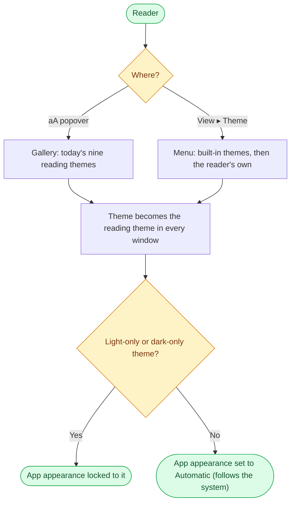
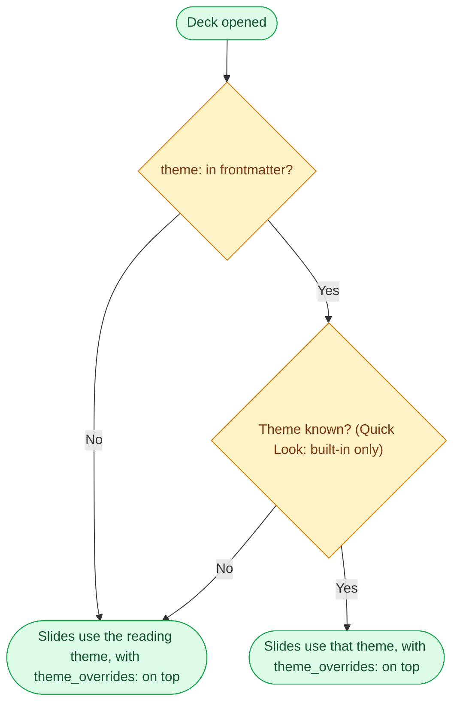
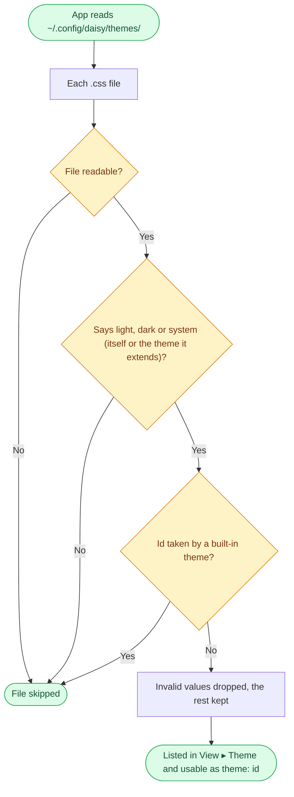
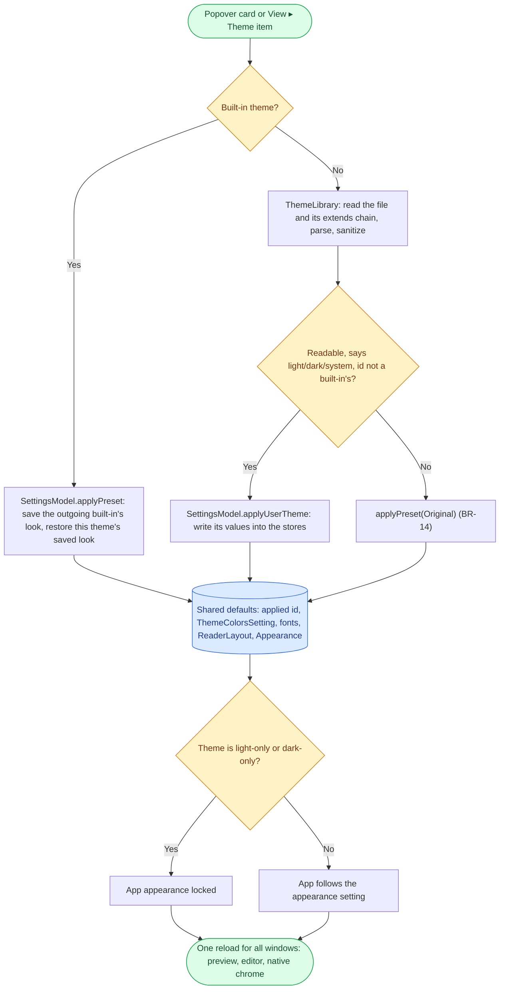
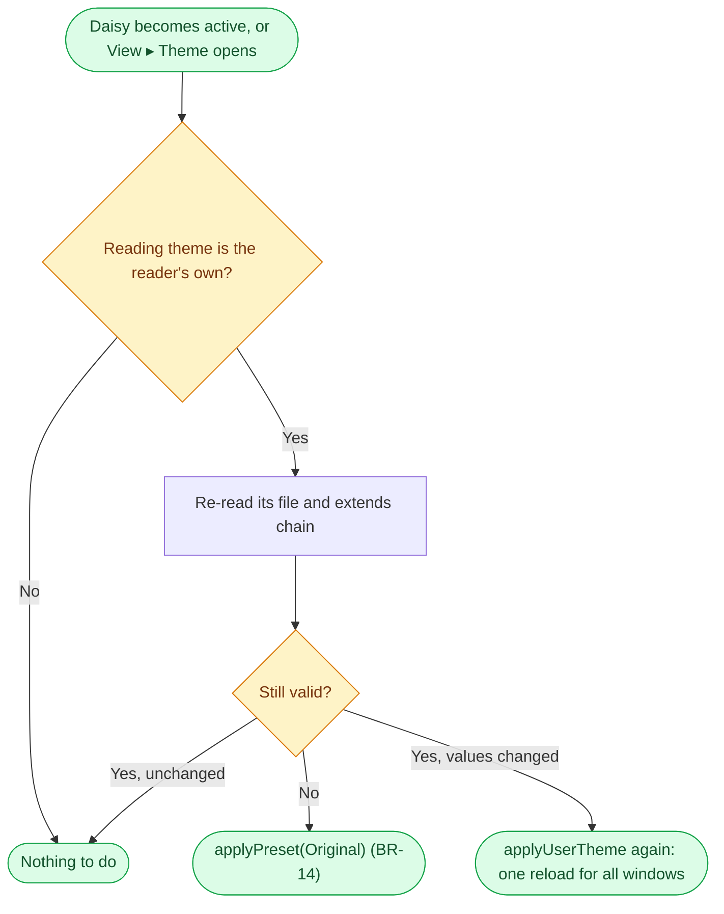
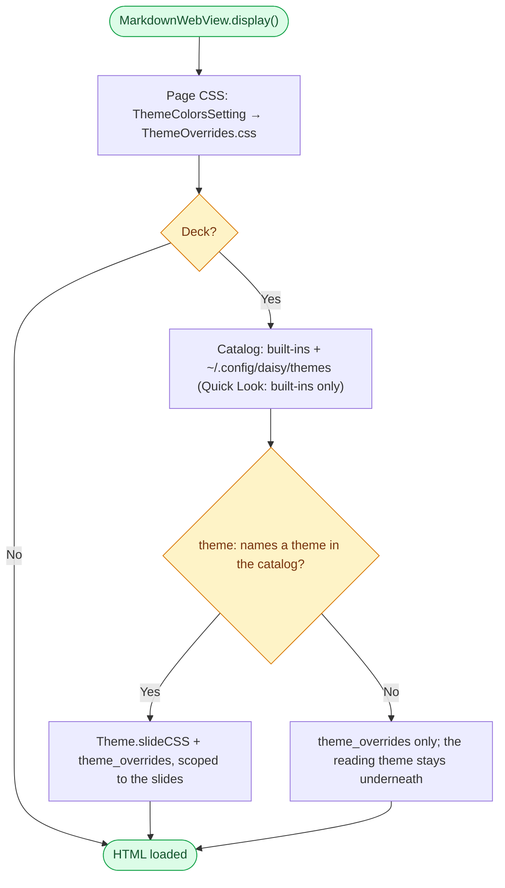

# [FEATURE] Unified CSS themes for reading, editor and slides

| | |
| --- | --- |
| Design ticket | [#75 [DESIGN] Unified CSS themes for reading, editor and slides](https://github.com/bluzky/daisy-app/issues/75) |
| Target branch | Not set yet (asked when the spec PR is opened) |
| Spec PR | Not opened |
| ClickUp Doc | n/a (GitHub tracker) |
| Author (engineer) | Daniel (flex) |
| Drafted with | Draft — PO agent (§1, §3), Draft — Tech design agent (§2); not yet reviewed by the author |
| Reviewer | tech lead |
| Status | Draft, not approved (Gate 1 not passed) |
| Target release | next minor |
| Design slides | `docs/features/unified-css-themes-slides.md` (optional) |
| Implementation plan | `docs/features/unified-css-themes-plan.md` (after Gate 1) |

## 1. Business flow

**Problem:** Daisy has two theme systems that describe the same look in two ways. Reading themes (used by the preview and the editor) are built into the app, and a reader can't add their own (`daisy/Theme/ThemePreset.swift:223`). Slide themes are YAML with different key names (`daisy/Rendering/Slides/SlideTheme.swift:199`), and a reader can add their own in `~/.config/daisy/slide-themes/` (`docs/slides.md:113`). Because of this, a reading theme such as Ember can't be used on a deck, a slide theme can't be used for reading, and someone who wants one brand look has to write it twice, in two formats.

**Goal:** One theme format, a CSS file, that works for the reading view, the editor and slides. Any theme, built-in or the reader's own, can be picked for reading or named by a deck (#75).

**Out of scope:**
- Word export themes (`DocxTheme`, JSON). They style Word documents, not CSS pages.
- An in-app editor for theme files. Readers write their own themes in any text editor.
- Importing, sharing or downloading themes.
- Quick Look preview colors: Quick Look keeps today's default colors whatever the reading theme is (`MarkdownWebView.swift:546-554`; Q-22). A follow-up may change this.
- Converting old YAML slide themes to CSS (Q-28). Authors rewrite them by hand; `docs/slides.md` says how.
- Syntax-highlighting colors. Themes don't set them today (`daisy/Theme/ThemePreset.swift:12`); a slide theme only switches between the light and dark code palettes (`SlideTheme.swift:130`).

**Not handled** (rare, or easy to fix by hand):
- A cycle in `extends` (A extends B, B extends A). Both themes still load, but the one where the cycle is found loses its base, and which one that is isn't defined (current slide behaviour, `SlideTheme.swift:277-290`). The author can break the cycle.

### Flow 1: Pick the reading theme

The reading theme drives the preview, the editor, and any deck that doesn't name a theme (Flow 2).



### Flow 2: A deck's theme



### Flow 3: Load the reader's own themes



**Business rules:**

| ID | Rule | Source |
| --- | --- | --- |
| BR-1 | A theme is one CSS file. The same theme can be used for the reading view, the editor and slides. | #75 |
| BR-2 | The aA popover's gallery lists nine reading themes: Original, Quiet, Paper, Pitch, Calm, Focus, Ember, Dusk, Midnight. Pitch takes the place of the removed Bold (Q-34). The other bundled themes (`paper-warm`, `midnight-navy`) appear only in View ▸ Theme and as `theme:`. | #75; Q-11 |
| BR-3 | View ▸ Theme lists every theme: built-in themes first, then the reader's own. The active reading theme is checked. Choosing a theme makes it the reading theme in every open window, the same as picking one in the popover. | #75; popover applies to every window today (`SettingsModel.swift:320`) |
| BR-4 | A deck picks its theme with `theme:` in the frontmatter, and any theme in the list can be named (in Quick Look, built-in themes only, BR-15). A theme's id is its file name without `.css`, and `theme:` matches it ignoring case. Without `theme:`, or with a name that isn't known, the slides use the reading theme. | #75; current fallback `docs/slides.md:98`, `docs/slides.md:109`; id from the file name and case-insensitive today (`SlideThemeStore.swift:8`, `SlideDeckSettings.swift:150`) |
| BR-5 | A theme file holds only design tokens (CSS custom properties), separately for light and dark: colors, fonts and table style, and the settings listed in BR-8 and BR-10. Colors are hex (`#rgb`, `#rgba`, `#rrggbb`, `#rrggbbaa`). Anything else in the file, and any value the app can't accept (including color names), is ignored, and the rest of the theme still applies. The same holds for colors in a deck's `theme_overrides:` (Q-32). | Q-2, Q-18; current slide behaviour (`SlideTheme.swift:52`); light and dark palettes in reading themes (`ThemePreset.swift:64`) |
| BR-10 | These theme settings apply to the reading view, the editor and slides alike: a color for each heading level (H1–H6), the table header text color, separate body, heading and code fonts, the widget colors (`default`, `accent`, `success`, `info`, `warning`, `danger`, series 1–8) used by cards, badges, shapes, stat tiles, progress bars and charts, bold body text weight, and the color of bold text. If a theme sets no heading or code font, headings use the body font and code keeps the default monospace. | Engineer, in chat (2026-11-25); Q-13. Today heading levels are reading-only (`ThemePreset.swift:35`); table header text, heading and code fonts, and widget colors are slide-only (`SlideTheme.swift:95-100`, `:184-192`, `:158`), and `docs/widgets.md:275` says reading themes can't change widget colors |
| BR-6 | A theme must say whether it is light, dark, or follows the system, or inherit that from the theme it `extends`; a theme that does neither is ignored. A light-only or dark-only reading theme locks the app's appearance to match; choosing a theme that follows the system sets the app's appearance to Automatic. On slides, a light-only or dark-only theme keeps its look whatever the window's appearance. | Q-12, Q-24, Q-29; current reading behaviour (`ThemePreset.swift:113`, `:204-206`); current slide behaviour (`docs/slides.md:109`, `SlideTheme.swift:48`) |
| BR-7 | A theme can `extends` another theme and change only some values. | Current slide behaviour (`docs/slides.md:113`) |
| BR-8 | Settings that only make sense on slides (title and section slide colors, header, footer, base font size) apply only to slides. The reading view and the editor ignore them. | Current slide theme keys (`SlideTheme.swift:15`) |
| BR-9 | Upgrading doesn't change what a reader sees: the selected reading theme, its customizations, and existing decks look the same as before, except decks covered by BR-17 and BR-18. | Saved looks per theme (`ThemePreset.swift:184`) |
| BR-11 | The reader's own themes are `.css` files in `~/.config/daisy/themes/`. View ▸ Theme ends with "Open Themes Folder". | Q-1 |
| BR-12 | A theme file whose id is a built-in theme's id is ignored, and the built-in theme is used. (Today a slide theme file with a built-in id replaces it, `SlideThemeStore.swift:9`.) | Q-6 |
| BR-13 | While one of the reader's own themes is the reading theme, Customize is unavailable and the page uses the app's default spacing (line, letter and word spacing, margins); the reader changes the theme by editing its file. Every built-in theme, in the gallery or not, can be customized. | Q-7, Q-26 |
| BR-14 | If the active reading theme's file is deleted, can't be read, or becomes ignored (BR-6), the reading theme falls back to Original. | Q-8 |
| BR-15 | Decks in Quick Look can use only built-in themes; a deck that names one of the reader's own themes uses the reading theme there. | Q-9; current behaviour (`MarkdownWebView.swift:420`) |
| BR-16 | A change to a theme file, or its deletion, is picked up when the reader comes back to Daisy (Daisy becomes active) and when View ▸ Theme opens; View ▸ Theme reads the folder again each time it opens. | Q-10, Q-31 |
| BR-17 | `paper` and `midnight` mean the reading themes Paper and Midnight. The slide themes of those names are renamed `paper-warm` ("Paper Warm") and `midnight-navy` ("Midnight Navy"), so a deck with `theme: paper` or `theme: midnight` shows the reading look after the update. The slide themes `light` and `dark` are removed: a deck naming them uses the reading theme. `theme: default` is still accepted and means the reading theme. | Q-3, Q-4, Q-21 |
| BR-18 | YAML slide themes in `~/.config/daisy/slide-themes/` are no longer read and aren't converted. A deck that names one uses the reading theme (BR-4). The YAML files are left on disk untouched. | Q-28 (replaces Q-5) |

## 2. Technical design

> **Draft — Tech design agent.** Not reviewed by the author yet.

**Pattern followed.** Picking a user theme works like picking a built-in preset today: its values are written into the stores the app already reads (`SettingsModel.applyPresetValues`, `SettingsModel.swift:326-340`): `ThemeColorsSetting`, `DocumentFontSetting`, `ReaderLayoutSetting` and `AppearanceMode`, all in the shared app-group defaults. The preview, the editor and the native chrome (about 15 readers, see the impact table) need no new way to read the theme. The deck catalog works like `SlideThemeStore` (`SlideThemeStore.swift:30-47`): built-ins plus the user folder, read on each deck render; Quick Look gets built-ins only. The View ▸ Theme submenu is rebuilt each time it opens, like the Bookmarks submenu (`AppDelegate.swift:1120-1135`, `:1920-1924`).

### Diagrams

#### Apply a reading theme (Flow 1)



#### Pick up theme file changes (BR-14, BR-16)



#### Render a document or deck (Flows 2 and 3)



**API changes:** None (client app). The contract is the theme file format.

**Theme file format** (replaces the YAML slide-theme format; BR-1, BR-5):

```css
/* @theme
name: My Brand
appearance: system        # light | dark | system — required (BR-6)
extends: ember            # optional (BR-7)
footer: "{title} | | {slide_number}/{total}"   # slides only (BR-8)
*/
:root { --bg: #FFFFFF; --text: #1A1A1A; --link: #0057B8; --font-body: Inter, sans-serif; }
@media (prefers-color-scheme: dark) { :root { --bg: #1C1C1E; --text: #F2F2F7; } }
```

- **id:** the file name without `.css`, lowercased (BR-4); lookups ignore case. Built-ins keep their stored ids (`Paper`, `Ember`, …; `ThemePreset.swift:109`, `:121`, `:191`), so saved looks and the applied-theme key need no migration (BR-9).
- **Metadata:** the first comment that starts with `@theme`, parsed with the existing `SlideYAML.parse` (`SlideDeckSettings.swift:33`). Keys: `name`, `appearance`, `extends`, `header`, `footer`. `appearance` is inherited from the base when `extends` is set; a theme with none after resolving `extends` is ignored (BR-6, Q-24).
- **Palettes:** `:root { … }` is the light palette; `@media (prefers-color-scheme: dark) { :root { … } }` is the dark palette. A `light` or `dark` theme has one palette (its `:root`; the media block is ignored). In a `system` theme, a token the dark block doesn't set falls back to the app's dark default, as a light-only Customize color does today (`ThemeColorsSetting.swift:142-144`). Fonts, weight, table style and slide font size are read from `:root` only.
- **Parsing:** only `--name: value;` declarations inside those two blocks are read. Any other rule, unknown name or invalid value is dropped; the rest applies (BR-5).
- **extends:** resolved as today (`SlideTheme.swift:268-291`). A light-only or dark-only base gives its one palette to both schemes.

| Token | Type / sanitizer | Preview | Editor | Slides |
| --- | --- | --- | --- | --- |
| `--bg` | color | `html` background + native window (`windowBackground` slot) | page background (`ThemeColorsSetting.swift:313-316`) | `--mdp-slide-bg` |
| `--text`, `--link`, `--heading`, `--heading-1`…`-6`, `--code-bg` (also `--widget-card`), `--table-header-bg`, `--table-border`, `--table-stripe` | color (`sanitizedHexColor`, `MarkdownHTML.swift:97-104`; Q-18; under Q-18 (a), `#rgb`/`#rgba` are expanded to 6/8 digits before they're stored) | existing variables | existing variables | existing variables |
| `--table-header-text`, `--bold` (BR-10, Q-13) | color | `--table-header-text` (already used, `MarkdownHTML+Stylesheet.swift:1003`); `--bold` needs a new `strong, b { color: var(--bold, inherit) }` | same | same |
| `--widget-default`, `-accent`, `-success`, `-info`, `-warning`, `-danger`, `--widget-series-1`…`-8` (BR-10) | color | `:root` buckets (`MarkdownHTML+Widgets.swift:193-215`) | not used: the editor shows widgets as text | same names (`WidgetColor.cssProperty`, `MarkdownHTML+Widgets.swift:111-114`) |
| `--font-body`, `--font-heading`, `--font-code` (BR-10) | `SlideTheme.sanitizedFontFamily` (`SlideTheme.swift:84-90`) | body `var(--font-body, var(--mdp-doc-font, …))`; new `h1…h6 { font-family: var(--font-heading, inherit) }`; code `var(--font-code, <today's mono>)` at `MarkdownHTML+Stylesheet.swift:200, 391, 473, 699, 715` | `EditorHTML.swift:126, 158, 749` (body), `:190, 357, 540, 633, 661, 736` (code) | same variables, scoped |
| `--body-weight` (BR-10) | `400` or `600` only (`ReaderLayoutSetting.swift:58`) | stored as `ReaderLayoutSetting.boldText` | same | `--mdp-body-weight` |
| `--table-style` | `MarkdownHTML.TableStyle` raw value (`MarkdownHTML+Stylesheet.swift:15-19`) | `ThemeColorsSetting.tableStyle` | — | `tableStyleRules(scope:)` |
| `--slide-title-bg`, `--slide-title-text`, `--slide-font-size` (BR-8) | color; `SlideDeck.fontSize` (`SlideDeck.swift:545-553`) | ignored | ignored | title/section rule, `--mdp-font-size` (today `SlideTheme.swift:153`, `:172-180`) |

`theme_overrides:` in deck frontmatter keeps its YAML `colors:` / `fonts:` keys (Q-25). They're mapped to tokens with a YAML-key-to-token table (the inverse of today's `SlideTheme.apply` keys, `SlideTheme.swift:53-72`) and applied on top of the deck's theme, also when the deck has no `theme:`.

**DB changes:** None (no database). Settings and files that change:

| Store | Key / path | Change | Migration |
| --- | --- | --- | --- |
| Shared app-group defaults | `MarkdownPreview.theme.appliedPreset` (`ThemePreset.swift:121`) | Holds a built-in id (unchanged) or a user theme id | None; an unknown id already resolves to Original (`ThemePreset.swift:180-182`) |
| Shared defaults | `MarkdownPreview.themeColor.<scheme>.<slot>` (`ThemeColorsSetting.swift:71-73`) | 16 new `ThemeColorSlot` cases: `tableHeaderText`, `boldText`, 14 widget colors | None; a missing key means the default |
| Shared defaults | new `MarkdownPreview.themeFont.body` / `.heading` / `.code` (sanitized strings) | Fonts `DocumentFontSetting`'s fixed list can't express (`DocumentFontSetting.swift:24-36`). Stored as fields of `ThemeColorsSetting`, so a SavedLook keeps them. Picking a font in Customize clears `themeFont.body`, so the picker always shows its effect | None |
| Shared defaults | `MarkdownPreview.theme.savedLook.v1.<id>` (`ThemePreset.swift:191`) | Built-ins only; the JSON gains the new slot keys. User themes never save a look (BR-13) | Old JSON decodes unchanged |
| Files | `~/.config/daisy/themes/*.css` | New user folder (BR-11), from the real home directory as `SlideThemeStore.swift:22-27` does | Created by "Open Themes Folder" (`DocxThemeStore.ensureUserDirectory`, `DocxThemeStore.swift:34-37`) |
| Files | `~/.config/daisy/slide-themes/*.yaml|yml` | No longer read; left on disk (BR-18) | None |

**Data model:**
- **`Theme`** (new, `daisy/Rendering/Theme.swift`, also in Quick Look): `id`, `name`, `appearance` (`light|dark|system`), `extends`, `light: [String: String]`, `dark: [String: String]`, `header`, `footer`. Holds the parser, `slideCSS` and `requiredAppearance`.
- **`BuiltInThemes`** (new, also in Quick Look): the CSS of the 12 built-ins (the 9 gallery themes, `pitch`, `paper-warm` and `midnight-navy`, Q-21). `light` and `dark` are removed (BR-17). Each built-in is a file `daisy/Resources/Themes/<id>.css`, the same format as a reader's theme, bundled in the app and in Quick Look and parsed by the same parser (Q-17). `BuiltInThemes` loads them from the bundle like `DocxThemeStore` loads `daisy/Resources/DocxThemes/` (`DocxThemeStore.swift:8-10, 40-42`).
- **Original** has no tokens for the reading view; applying it still clears overrides, as `usesDefaultColors` does (`ThemePreset.swift:80-83`). On slides, a deck with `theme: original` gets the stylesheet's default light and dark palette, so it shows Original rather than the reading theme (BR-4).
- **`ThemePreset`** becomes an adapter built from a built-in `Theme` (name, flavor, font matched against `DocumentFontSetting.fontFamily`, boldText, swatches, and `setting` from a new `ThemeColorsSetting(theme:)`). `ThemePreset.builtIn` stays the nine gallery themes (BR-2); a new `ThemePreset.all` holds all 12 for the menu and for Customize (per Q-26).
- **`ThemeLibrary`** (new, `daisy/Theme/ThemeLibrary.swift`, app only): user folder, `catalog()` (BR-12: a user file with a built-in id is skipped, the reverse of `SlideTheme.swift:269-286`), `applied` (`.builtIn(ThemePreset)` or `.user(Theme)`), `refreshAppliedUserTheme()`.
- **Removed:** `SlideTheme`, `SlideTheme.builtIns`, `SlideThemeStore` and YAML theme reading. `MarkdownHTML.render(…slideThemes:)` takes `[String: Theme]`.
- **`Theme.slideCSS`** (Q-30: rewritten from tokens). Besides the variables, it must keep today's slide rules, or existing decks change (BR-9): headings reset to `initial` when the theme sets a background or text color but no heading color (`SlideTheme.swift:143-149`); list markers in the accent color (`:166-167`); `--secondary` mixed from the text color (`:141`); title and section slides get `--slide-title-bg`, `--slide-title-text`, and `--secondary`/`--heading` from the title text (`:172-179`). `primary` → link color when there's no accent (`:150`) is handled by the built-ins' CSS and the `theme_overrides:` key table.

**Jobs / events / config / feature flags:**
- **Launch:** `applicationDidFinishLaunching` (`AppDelegate.swift:135-139`) computes the appearance lock from `ThemeLibrary.applied` instead of `ThemePreset.applied()`.
- **Refresh (BR-14, BR-16):** `applicationDidBecomeActive` (`AppDelegate.swift:184-208`, the existing "another app changed the shared look" hook) and the Theme menu's `menuNeedsUpdate` call `ThemeLibrary.refreshAppliedUserTheme()`. It re-applies only when the resolved values changed, and falls back to Original when the file is gone or invalid.
- **Menu:** View ▸ Theme after Content Width (`AppDelegate.swift:1467-1500`), `delegate = self`, rebuilt in `menuNeedsUpdate` (BR-16). Order: the 9 gallery built-ins, the 3 other built-ins, separator, user themes by name, separator, "Open Themes Folder" (BR-3, BR-11). The applied theme is checked. Built-in items call `SettingsModel.applyPreset`; user items call the new `SettingsModel.applyUserTheme`.
- **Appearance for a user `system` theme:** applying it sets the app appearance to `.automatic`, like a built-in's first selection (`ThemePreset.swift:204-206`).
- **Feature flag:** none.

**Impact & risk:**

| Area | What changes | Impact | Risk | Mitigation |
| --- | --- | --- | --- | --- |
| Applied-theme readers: `AppDelegate.swift:137, 192, 206, 390, 694, 737`; `SettingsModel.swift:41, 295, 315, 457`; `CustomizeThemeView.swift:137`; `ThemeSettingsView.swift:21`; `ThemePresetGallery.swift:22` | `ThemePreset.applied()` → `ThemeLibrary.applied` | Appearance lock (BR-6), gallery selection (AC-1.3), "Current theme" label | `applied()` returns Original for an unknown id: a user theme would show as Original and never lock | Change every call site; tests for AC-1.3, AC-1.4 |
| `SettingsModel.applyPresetValues` (`SettingsModel.swift:329-332`) | Saves the outgoing look only when it's a built-in | BR-9, BR-13 | Otherwise leaving a user theme writes its colors into Original's saved look | Guard + unit test |
| Customize: popover (`ThemesPopoverView.swift:75`) and Settings ▸ Appearance (`ThemeSettingsView.swift:70`) | Disabled while a user theme is applied | BR-13 | The Settings pane is easy to miss | Disable both |
| Native readers of `ThemeColorsSetting.current`: `ContentViewController.swift:714, 961, 1007`; `DocumentWindowController.swift:380-424, 831`; `DocumentWindowController+Toolbar.swift:317`; `EditorViewController.swift:231-237, 538-546, 978, 1045`; `SidebarViewController.swift:359`; `ProjectNavigatorView.swift:1337`; `JournalCalendarView.swift:43`; `TaskCalendarView.swift:24` | None: a user theme is written into the same store | Window background and accent follow user themes | Only hex reaches native colors | Q-18 |
| `ThemeColorsSetting` (`ThemeColorsSetting.swift:20-47, 178-222, 227-327`) | New slots and font fields, emitted by `markdownThemeOverrides` and `editorOverrideCSS` | BR-10 in preview and editor | `defaultColor` switch must stay exhaustive; widget defaults from `WidgetColor.defaultHex` | Compiler-checked; test the emitted CSS |
| `MarkdownHTML.ThemeOverrides.css` (`MarkdownHTML.swift:69-207`) | New color and font fields in the three palette buckets | BR-10 in the preview | Wrapped in `@media screen` (`:203-206`): user fonts would be lost in print while built-in fonts (`:549-556`) still print | Emit font tokens outside the screen wrapper |
| Stylesheets: `MarkdownHTML+Stylesheet.swift:200, 391, 473, 699, 715, 1052`; `EditorHTML.swift:126-749` | Font, heading-font, code-font, bold-color variables | BR-10 | Headings deliberately inherit the body family today (`MarkdownHTML.swift:545-548`) | Fall back to `inherit`: no change when unset |
| Slide rendering (`MarkdownHTML.swift:386-395, 583-589`; `SlideTheme.swift:126-194`) | Rewritten as `Theme.slideCSS` (Q-30); a system theme needs all three buckets scoped to `:where(.mdp-deck) .mdp-slide`; light/dark-only themes keep today's pinning (`SlideTheme.swift:130-137`) | BR-4, BR-6, BR-9, AC-3.1, AC-3.3 | The rewrite drops one of today's non-variable rules (see Data model) and existing decks change | Golden test: for `pitch` and each former slide theme, the new `slideCSS` gives the same computed values as today's `SlideTheme.css` |
| Catalog callers: `MarkdownWebView.swift:420-426`, `MarkdownWebView+PDFExport.swift:850` | `ThemeLibrary.catalog()`; Quick Look gets `BuiltInThemes` | BR-4, BR-12, BR-15 | — | — |
| Deck frontmatter (`SlideDeckSettings.swift:150-151`) | `theme_overrides` mapped through the YAML-key-to-token table | Flow 2 | — | Keep the `SlideThemeTests` override cases |
| Theme file refresh (`AppDelegate.swift:184-208`, Theme menu `menuNeedsUpdate`) | Re-reads the active user theme when Daisy becomes active or the menu opens | BR-14, BR-16, AC-1.6, AC-2.10 | A change made while Daisy stays frontmost (e.g. a script) shows only on the next switch back | Accepted (Q-31) |
| Snapshot cache (`ReaderRenderSettings.swift:14-29`, `ContentViewController.swift:500`) | Fingerprint includes `themeOverrides.css`, which gains fields | No stale snapshot | — | — |
| View menu (`AppDelegate.swift:1467-1500, 1920-1924`) | New Theme submenu | BR-3, BR-11, BR-16 | Inserted twice on a rebuilt menu | Guard by menu identity like Bookmarks (`submenu === Self.themeMenu`, `AppDelegate.swift:1120-1126`) |
| Quick Look target (`daisy.xcodeproj/project.pbxproj:107-150`) | Add `Theme.swift`, `BuiltInThemes.swift` and the 12 `Resources/Themes/*.css` files to the Quick Look exceptions (Q-17) | BR-15 | Xcode may rewrite `DEVELOPMENT_TEAM` (AGENTS.md) | Check the pbxproj diff; revert any signing hunk |
| Quick Look colors (`PreviewViewController.swift:612-633`, `PreviewProvider.swift:31-52`) | None unless Q-22 says otherwise | Flow 1 wording | Doc/BR mismatch | Q-22 |
| Test package (`tests/swift-tests/Sources/MarkdownHelpers/`, symlinks) | Link `Theme.swift`, `BuiltInThemes.swift`, `ThemeLibrary.swift`; remove `SlideThemeStore.swift` and `SlideTheme.swift`; tests read the built-in CSS from `daisy/Resources/Themes/` (as `DocxThemeTests.swift:11` does) | Tests compile | — | Golden test: record today's nine `ThemePreset` settings/font/bold and assert the CSS-built ones match (BR-9) |
| Docs (AGENTS.md: same commit) | `docs/slides.md:96-169`; `docs/widgets.md:275`; `README.md:55-56`; `.agents/skills/daisy-slides/SKILL.md:3, 30, 177-204`; `.agents/skills/daisy-slides/scripts/check_deck.py:29, 122-147`; `docs/technical/slides-proposal.md:286` (historical, optional) | Claims become false otherwise | The skill ships inside the app (`AgentSkillsInstaller.swift:21`) | Update in the same PR |

**Rollout and rollback:**
- Rollout: one release, no feature flag. YAML slide themes stop working in that release (BR-18); the release notes and `docs/slides.md` say how to rewrite one as CSS.
- Rollback (downgrade to the previous version):
  - YAML themes are untouched, so they work again in the old version.
  - An applied user theme id is unknown to the old version: it shows Original as selected but keeps the stored colors.
  - Saved-look JSON with the new slot keys fails to decode in the old version (`ThemePreset.swift:199-203`): that theme shows its defaults; nothing crashes.

## 3. User stories & acceptance criteria

### US-1: As a reader, I want to pick any theme, mine included, from the View menu, so that I can read in my own look

- AC-1.1 (BR-3, BR-11): Given two theme files in `~/.config/daisy/themes/`, when I open View ▸ Theme, then I see the built-in themes, a separator, and my two themes, with the active one checked.
- AC-1.2 (BR-3): Given two windows are open, when I choose my theme in View ▸ Theme, then both windows' preview and editor redraw in it.
- AC-1.3 (BR-2): Given my theme is the reading theme, when I open the aA popover, then my theme isn't in the gallery and no built-in card is shown as selected.
- AC-1.4 (BR-6): Given a theme file that says it is dark-only, when I choose it, then the app switches to dark and the popover's appearance button is disabled, as it is for Quiet today.
- AC-1.5 (BR-13): Given I changed Paper's line spacing in Customize, when I choose my own theme, then Customize is disabled in the aA popover and in Settings, and the page uses the default line spacing.
- AC-1.6 (BR-14, BR-16): Given my own theme is the reading theme, when I delete its file and switch back to Daisy, then the reading theme is Original.

### US-2: As a theme author, I want to write one CSS file and use it for reading and for slides, so that I keep one brand look in one place

- AC-2.1 (BR-1, BR-4): Given my theme file `brand.css`, when I choose it in View ▸ Theme and also open a deck with `theme: brand`, then the preview, the editor and the slides all use its colors and fonts.
- AC-2.2 (BR-5): Given a theme file with one invalid color and valid other values, when I use the theme, then the invalid color is as if the file didn't set it (the base theme's value if it extends one) and the other values apply.
- AC-2.3 (BR-5, BR-6): Given a theme that follows the system and has light and dark values, when I switch macOS between light and dark, then the preview changes to the matching values.
- AC-2.4 (BR-7, BR-6): Given `brand.css` extends `ember` and sets only the link color, when I use it, then everything is Ember except the links.
- AC-2.6 (BR-10): Given my theme sets the `accent` widget color, when a document has a `color=accent` card and a `{{badge: … color=accent}}`, then both use that color in the preview and on slides.
- AC-2.5 (BR-8, BR-10): Given my theme sets a heading font, a code font, an H2 color, title slide colors and a footer, when I use it as the reading theme and as a deck's theme, then both show the fonts and the H2 color, and only the slides show the footer and the title slide colors.
- AC-2.7: ~~removed~~ (merged into AC-2.5)
- AC-2.8 (BR-6): Given a theme file that doesn't say light, dark or system, when I open View ▸ Theme, then it isn't listed, and a deck naming it uses the reading theme.
- AC-2.9 (BR-12): Given a theme file `ember.css` in my themes folder, when I choose Ember, then the built-in Ember is used and my file isn't listed.
- AC-2.10 (BR-16): Given my theme is the reading theme, when I change its link color in another app and switch back to Daisy, then the preview shows the new link color without reselecting the theme.

### US-3: As a deck author, I want to name any theme in the frontmatter, so that my slides can use a reading theme or my own

- AC-3.1 (BR-4): Given a deck with `theme: ember`, when I open it, then the slides use the colors and fonts Ember sets, whatever the reading theme is. (Values Ember doesn't set still come from the reading theme, as today; Q-23.)
- AC-3.2 (BR-4): Given a deck with no `theme:` or with `theme: nope` (no such theme), when the reading theme is my own theme, then the slides use my theme.
- AC-3.3 (BR-6): Given a deck whose theme is dark-only, when the window is light, then the slides and their code blocks stay dark.
- AC-3.4 (BR-15): Given a deck with `theme: brand` (my own theme), when I Quick Look it, then the slides use the reading theme.

### US-4: As an existing user, I want my theme and decks to look the same after updating, so that the update doesn't break my setup

- AC-4.1 (BR-9): Given I customized Paper's colors before updating, when I update, then Paper is still the reading theme and keeps my colors.
- AC-4.2 (BR-9, BR-17): Given a deck with `theme: pitch` and another with `theme: midnight`, when I update, then the first looks the same and the second shows the reading theme Midnight.
- AC-4.3 (BR-18): Given my YAML slide theme `brand.yaml` in `~/.config/daisy/slide-themes/`, when I update, then decks with `theme: brand` use the reading theme, and `brand.yaml` is still on disk.
- AC-4.4 (BR-17): Given a deck with `theme: dark`, when I update, then the slides use the reading theme.
- AC-4.5: ~~removed~~ (no conversion, Q-28)

**Mockup:** No new screen. The only new UI is the View ▸ Theme submenu, which is a standard menu.

## 4. Open questions & decisions

| ID   | Question                                                                                                                                                                                                                                                                                                        | Options                                                                                                                                                                                                                                                                                                                                                                                                                                                                                                                                                                                                         | Decision                                                                                                                     | By        | Date       |
| ---- | --------------------------------------------------------------------------------------------------------------------------------------------------------------------------------------------------------------------------------------------------------------------------------------------------------------- | --------------------------------------------------------------------------------------------------------------------------------------------------------------------------------------------------------------------------------------------------------------------------------------------------------------------------------------------------------------------------------------------------------------------------------------------------------------------------------------------------------------------------------------------------------------------------------------------------------------- | ---------------------------------------------------------------------------------------------------------------------------- | --------- | ---------- |
| Q-1  | Where do the reader's theme files live?                                                                                                                                                                                                                                                                         | (a) `~/.config/daisy/themes/`, next to the existing `slide-themes/` folder; (b) reuse `~/.config/daisy/slide-themes/`. Either way, View ▸ Theme ends with "Open Themes Folder". **Recommend (a):** these themes aren't only for slides.                                                                                                                                                                                                                                                                                                                                                                         | a, merge with slide themes                                                                                                   | tech lead |            |
| Q-2  | What may a theme file contain?                                                                                                                                                                                                                                                                                  | (a) Design tokens only (CSS custom properties such as `--text` or `--link` in `:root` and a dark block); anything else is ignored; (b) any CSS. **Recommend (a):** a rule written for the reading page breaks on slides and the other way round, and slide themes today can't inject CSS (`SlideTheme.swift:7`).                                                                                                                                                                                                                                                                                                | a                                                                                                                            | tech lead |            |
| Q-3  | `paper` and `midnight` exist as both reading and slide themes, and look different. Which keeps the name?                                                                                                                                                                                                        | (a) The reading look keeps the name and the slide variants are renamed (for example `paper-warm`, `midnight-navy`), so decks with `theme: midnight` change look; (b) the slide look keeps the name and the reading themes are renamed; (c) the old slide names stay as aliases of the renamed slide themes. **Recommend (a) + (c):** existing decks don't change.                                                                                                                                                                                                                                               | a                                                                                                                            | tech lead |            |
| Q-4  | The slide themes `light` and `dark` are close to Original pinned to light or dark. Keep them?                                                                                                                                                                                                                   | (a) Keep them as themes of their own; (b) make them aliases of Original locked to light or dark. **Recommend (b):** fewer near-duplicate themes.                                                                                                                                                                                                                                                                                                                                                                                                                                                                | c, remove them (engineer, after explanation)                                                                                 | engineer  | 2026-11-25 |
| Q-5  | What happens to existing YAML slide themes in `~/.config/daisy/slide-themes/`?                                                                                                                                                                                                                                  | (a) Still read and treated like CSS themes, and documented as deprecated; (b) converted to `.css` once, automatically; (c) no longer read. **Recommend (a).**                                                                                                                                                                                                                                                                                                                                                                                                                                                   | B — superseded by Q-28 (no conversion) | tech lead |            |
| Q-6  | A reader's theme file uses a built-in theme's id. What happens?                                                                                                                                                                                                                                                 | (a) It replaces the built-in everywhere, as slide theme files do today (`SlideThemeStore.swift:9`), including the popover card's look; (b) it's skipped and the built-in wins. **Recommend (b):** keeps the popover built-ins fixed (BR-2); `extends` covers the "tweak a built-in" case.                                                                                                                                                                                                                                                                                                                       | B                                                                                                                            | tech lead |            |
| Q-7  | Can the reader use Customize (fonts, colors, layout) while their own theme is the reading theme?                                                                                                                                                                                                                | (a) No: Customize is disabled and they edit the file instead; (b) yes, and the changes are saved for that theme like a built-in's. **Recommend (a).**                                                                                                                                                                                                                                                                                                                                                                                                                                                           | A                                                                                                                            | tech lead |            |
| Q-8  | The active reading theme's file is deleted or can no longer be read. What then?                                                                                                                                                                                                                                 | (a) Fall back to Original; (b) keep the last colors that loaded. **Recommend (a)**, like an unknown deck theme (BR-4).                                                                                                                                                                                                                                                                                                                                                                                                                                                                                          | A                                                                                                                            | tech lead |            |
| Q-9  | Can decks in Quick Look use the reader's own themes? Today Quick Look decks use only built-in themes (`MarkdownWebView.swift:420`).                                                                                                                                                                             | (a) No change: built-ins only, and an unknown name falls back to the reading theme; (b) yes, which needs file access in the sandboxed extension. **Recommend (a).**                                                                                                                                                                                                                                                                                                                                                                                                                                             | A                                                                                                                            | tech lead |            |
| Q-10 | When a theme file changes on disk, when does Daisy show the change?                                                                                                                                                                                                                                             | (a) On the next render of the document, as slide theme files work today (`SlideThemeStore.swift:10`); (b) live, by watching the folder. **Recommend (a)**, with View ▸ Theme re-reading the folder each time it opens.                                                                                                                                                                                                                                                                                                                                                                                          | A                                                                                                                            | tech lead |            |
| Q-11 | Which themes count as "built-in" for the aA popover gallery (BR-2)? Once slide themes join the list, "built-in" means two sets.                                                                                                                                                                                 | (a) Only today's nine reading themes (Original … Midnight, `ThemePreset.swift:223`). Former slide-only themes (`light`, `dark`, `pitch`, and the slide `paper` and `midnight`) appear only in View ▸ Theme and as `theme:`; (b) every bundled theme, which adds cards to the 3×3 gallery. **Recommend (a):** the gallery stays as it is, and `pitch`'s title-slide colors don't belong in a reading gallery.                                                                                                                                                                                                    | A                                                                                                                            | tech lead |            |
| Q-12 | A theme file that doesn't say whether it's light, dark or follows the system (BR-6). What is it treated as?                                                                                                                                                                                                     | (a) Follows the system; (b) worked out from its background color, as slide themes are today (`SlideTheme.swift:102-109`). **Recommend (b):** existing slide themes don't set `appearance`, and with (a) a dark deck in a light window would get light code colors, breaking AC-3.3 and BR-9.                                                                                                                                                                                                                                                                                                                    | ignore that theme                                                                                                            | tech lead |            |
| Q-13 | The remaining settings that exist on only one side today: bold text weight (reading, the Bold theme, `ReaderLayoutSetting.swift:58`), bold text color (slides, `SlideTheme.swift:169`). Do they also apply to both?                                                                                             | (a) Both apply in the reading view and on slides, like BR-10; (b) each stays on its side (bold color in BR-8's slide-only list). **Recommend (a):** both are plain text styling that reads the same on a page and a slide.                                                                                                                                                                                                                                                                                                                                                                                      | A                                                                                                                            | tech lead |            |
| Q-14 | Q-12 ignores themes that don't say light, dark or system, but old YAML slide themes rarely say it. What does the conversion (Q-5) write?                                                                                                                                                                        | (a) Light or dark, worked out once from the background; (b) `system`; (c) nothing, so the theme is ignored until edited.                                                                                                                                                                                                                                                                                                                                                                                                                                                                                        | a — superseded by Q-28 (no conversion) | engineer  | 2026-11-25 |
| Q-15 | After conversion, what happens to the YAML files?                                                                                                                                                                                                                                                               | (a) Left untouched; (b) deleted; (c) renamed to `.yaml.bak`.                                                                                                                                                                                                                                                                                                                                                                                                                                                                                                                                                    | b. Lucy's reading: only files that were converted are deleted; skipped files (Q-16) stay, so nothing is lost. Please confirm — superseded by Q-28 (no conversion) | engineer  | 2026-11-25 |
| Q-16 | A user's YAML theme with a built-in id (for example `pitch.yaml`) replaces the built-in today. What does the conversion do with it?                                                                                                                                                                             | (a) Convert it under a new id; (b) skip it.                                                                                                                                                                                                                                                                                                                                                                                                                                                                                                                                                                     | b — superseded by Q-28 (no conversion) | engineer  | 2026-11-25 |
| Q-17 | Where do the built-in themes' CSS live?                                                                                                                                                                                                                                                                         | (a) Bundled `daisy/Resources/Themes/*.css`, added to both targets and to the test package as resources; (b) CSS text compiled into `BuiltInThemes.swift`, parsed by the same parser, as slide built-ins are today (`SlideTheme.swift:199-259`); (c) keep the nine presets in Swift with an adapter, and only the three slide themes as CSS. **Recommend (b):** one format and one parser, no pbxproj resource or `Package.swift` changes; a golden test locks BR-9.                                                                                                                                             | (a) Bundled `daisy/Resources/Themes/<id>.css`, one folder for every built-in theme, the former slide themes included (engineer, in chat; replaces b) | engineer | 2026-11-25 |
| Q-18 | Theme colors: hex only, or CSS color names too? YAML slide themes accept names (`SlideDeck.swift:515-519`, `docs/slides.md:155`); the reading color store and native window colors take hex only (`ThemeColorsSetting.swift:92`).                                                                               | (a) Hex only (`#rgb`, `#rgba`, `#rrggbb`, `#rrggbbaa`); the converter turns names into hex so converted themes look the same (BR-18); (b) names accepted, but they reach only the page and slides, not the window and sidebar tint. **Recommend (a).**                                                                                                                                                                                                                                                                                                                                                          | A                                                                                                                            | tech lead |            |
| Q-19 | Converting a YAML theme with no `appearance` and no hex background, even after `extends` (BR-18 works it out from the background).                                                                                                                                                                              | (a) Write `system`, which matches today (no color scheme is pinned when unknown, `SlideTheme.swift:104-109`); (b) write `light`; (c) don't convert it. **Recommend (a).**                                                                                                                                                                                                                                                                                                                                                                                                                                       | A — superseded by Q-28 (no conversion) | tech lead |            |
| Q-20 | Converting a YAML theme whose `extends:` names a slide theme BR-17 renames (`paper`, `midnight`) or removes (`light`, `dark`), or `default`. Copied as-is, its look changes (BR-9). The documented example uses `extends: light` (`docs/slides.md:111-125`).                                                    | (a) Point `extends` at the renamed id; for `light`/`dark`, copy the removed theme's values into the file and drop `extends`; `default` → no `extends`; (b) copy `extends` as-is. **Recommend (a).**                                                                                                                                                                                                                                                                                                                                                                                                             | A — superseded by Q-28 (no conversion) | tech lead |            |
| Q-21 | Final ids and names of the renamed slide themes `paper` and `midnight` (BR-17; Q-3 only gave examples). And is `theme: default` still accepted (today a documented theme, `docs/slides.md:102`)?                                                                                                                | Ids: e.g. `paper-warm` / "Paper Warm", `midnight-navy` / "Midnight Navy". `default`: (a) accepted as "the reading theme"; (b) unknown name, which also falls back to the reading theme (BR-4). **Recommend (a)** for `default`: same result, and the docs can say so.                                                                                                                                                                                                                                                                                                                                           | A                                                                                                                            | tech lead |            |
| Q-22 | Flow 1 says the reading theme drives Quick Look's preview colors. Today Quick Look uses the default colors (`MarkdownWebView.swift:546-554`; `PreviewViewController.swift:627-633`; it does get font and layout). No BR covers it.                                                                              | (a) In scope: compile `ThemeColorsSetting` into Quick Look and pass its overrides (values are already in the shared defaults); (b) out of scope: fix the Flow 1 wording, and Quick Look keeps today's default colors. **Recommend (b)** (FLOW-09), (a) as a follow-up.                                                                                                                                                                                                                                                                                                                                          | B                                                                                                                            | tech lead |            |
| Q-23 | When a deck names a theme, do reading-theme values that theme doesn't set still show on its slides? Today they do; only heading colors are reset (`SlideTheme.swift:143-149`).                                                                                                                                  | (a) Yes, as today: existing decks look the same (BR-9), but the reading font or a Customize table stripe can show on a `theme: ember` deck; (b) no: the deck theme replaces the whole reading look, so AC-3.1 holds strictly, but `pitch` and converted decks lose the reading font and colors they inherit today. **Recommend (a)**, and AC-3.1 reads "the values Ember sets".                                                                                                                                                                                                                                 | A                                                                                                                            | tech lead |            |
| Q-24 | Does a theme that `extends` another inherit its light/dark/system from the base? As written, BR-6 ignores AC-2.4's `brand.css` (extends `ember`, sets only the link color).                                                                                                                                     | (a) Yes: only a theme with no `appearance` and no base that has one is ignored, as slide themes inherit it today (`SlideTheme.swift:48`); (b) no: every file must state it. **Recommend (a).**                                                                                                                                                                                                                                                                                                                                                                                                                  | A                                                                                                                            | tech lead |            |
| Q-25 | Which keys does a deck's `theme_overrides:` take once themes are CSS?                                                                                                                                                                                                                                           | (a) The current YAML `colors:` / `fonts:` keys (`docs/slides.md:169`), mapped to tokens (what §2 drafts); (b) CSS token names; (c) both. **Recommend (a):** existing decks keep working (BR-9) and deck authors write YAML, not CSS.                                                                                                                                                                                                                                                                                                                                                                            | A                                                                                                                            | tech lead |            |
| Q-26 | While one of the reader's own themes is active (Customize disabled, BR-13), which non-theme settings apply: line, character and word spacing, margins? They're saved per theme today (`ThemePreset.swift:184`). And can Customize be used on built-ins outside the gallery (`pitch`, the renamed slide themes)? | Settings: (a) app defaults; (b) the previous theme's; (c) a saved look per user theme, editable only for those settings. Non-gallery built-ins: (a) yes, like gallery built-ins; (b) no. **Recommend** settings (a), non-gallery built-ins (a).                                                                                                                                                                                                                                                                                                                                                                 | Spacing: (a) app defaults; non-gallery built-ins: (a) yes (engineer, in chat) | engineer | 2026-11-25 |
| Q-27 | Q-15 deletes converted YAML. On a downgrade, the old app no longer finds those themes (§2 Rollout and rollback).                                                                                                                                                                                                | (a) Keep "delete"; (b) rename to `.yaml.bak` instead (Q-15 option c), so a downgrade is a rename. **Recommend (a)** unless downgrades matter.                                                                                                                                                                                                                                                                                                                                                                                                                                                                   | A — superseded by Q-28 (no conversion) | engineer  |            |
| Q-28 | Convert once (with an "already converted" flag), or convert any YAML theme found at each launch?                                                                                                                                                                                                                | (a) Once, with a flag (what §2 drafts; matches Q-5's "converted once"); (b) every launch: converted files are deleted, so it's safe to repeat, and it also covers YAML files added later from old docs; no flag needed. **Recommend (b).**                                                                                                                                                                                                                                                                                                                                                                      | No conversion: YAML themes are ignored and left on disk (replaces Q-5; confirmed in chat) | engineer | 2026-11-25 |
| Q-29 | When the reader applies a user theme that follows the system, what happens to the app's Light/Dark/Automatic choice? §2 resets it to Automatic; Flow 1 reads as "keeps following the appearance setting".                                                                                                       | (a) Reset to Automatic, like a built-in's first selection (`ThemePreset.swift:204-206`); (b) keep the current choice (after a locked theme, that's the locked value). **Recommend (a).**                                                                                                                                                                                                                                                                                                                                                                                                                        | a                                                                                                                            | tech lead |            |
| Q-30 | Slide rendering: rewrite it from `Theme` tokens (§2 as drafted), or keep today's `SlideTheme.css` and turn a `Theme` into a `SlideTheme` (reverse key table, plus a dark bucket for `system` themes)?                                                                                                           | (a) Rewrite: one model, but `slideCSS` must copy the rules beyond variables that today's slide CSS has (heading reset `SlideTheme.swift:143-149`, accent `li::marker` `:166-167`, `accent ?? primary` `:150`, `--secondary` from the text color `:141`, title-slide `--secondary`/`--heading` `:172-179`); (b) keep `SlideTheme.css` as the slide renderer: reuses tested code, `theme_overrides:` unchanged (Q-25 a), BR-9 holds for `pitch` and converted decks with no new code. **Recommend (b).**                                                                                                          | (a) Rewrite from tokens (engineer, in chat) | engineer | 2026-11-25 |
| Q-31 | When is a changed or deleted user theme file picked up (BR-14, BR-16)? §2 re-checks it in `MarkdownWebView.display`.                                                                                                                                                                                            | (a) In `display` (§2 as drafted): matches "next render", but needs a modification-date cache and a re-entrancy guard (re-applying reloads every window, which calls `display`), and an editor-only window never re-checks; (b) when Daisy becomes active (`applicationDidBecomeActive`, `AppDelegate.swift:184-208`, the existing "another app changed the shared look" hook) and when View ▸ Theme opens: simpler; the change shows when the reader switches back from the editor app they edited the file in. **Recommend (b)**; it changes BR-16's wording from "next render" to "when you return to Daisy". | (b) When Daisy becomes active and when View ▸ Theme opens (engineer, in chat) | engineer | 2026-11-25 |
| Q-32 | `theme_overrides:` in deck frontmatter accept CSS color names today (`SlideDeck.swift:515-519`). Keep them, or hex only like theme files (BR-5)? | (a) Keep names for existing decks (BR-9); (b) hex only, no backward compatibility. | (b) Hex only; no backward compatibility needed (engineer, in chat) | engineer | 2026-11-26 |
| Q-33 | When a re-read picks up an edit to the reading theme's file (BR-16) and the theme follows the system, what happens to the reader's Light/Dark/Automatic choice? | (a) Keep the current choice; (b) reset to Automatic, as when the theme is chosen (Q-29). | (a) Keep the current setting; only choosing a theme resets it (engineer, in chat) | engineer | 2026-11-26 |
| Q-34 | Replace the built-in Bold theme with Pitch? | (a) Remove Bold; Pitch takes its gallery card; (b) Bold moves to View ▸ Theme only; (c) rename Pitch to Bold. | (a) Remove Bold entirely. A reader whose reading theme is Bold gets Original (their saved Bold look is no longer used), and `theme: bold` uses the reading theme. An exception to BR-9 (engineer, in chat) | engineer | 2026-11-26 |
