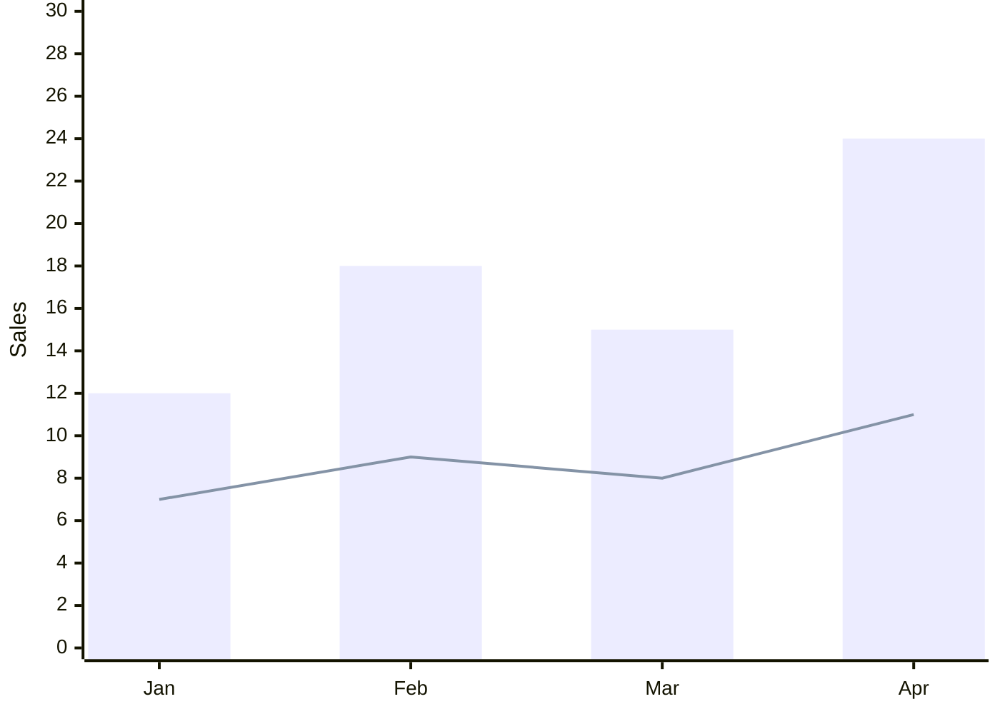
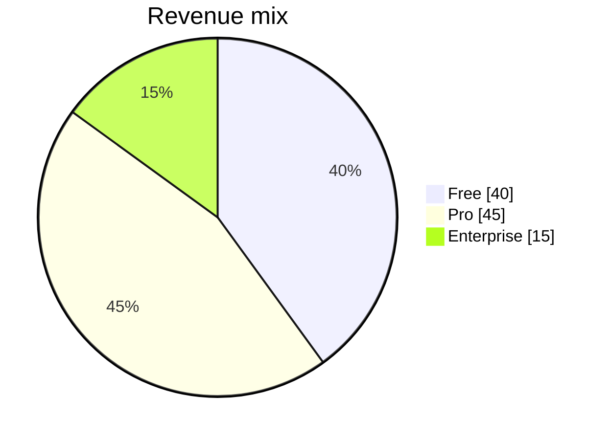

# Weekly dashboard

```stat
label: Revenue
value: $48.2k
delta: +12%
trend: up
note: vs last month
link: #sales-by-month
---
label: Active users
value: 3,204
delta: +3.1%
trend: up
---
label: Churn
value: 2.1%
delta: -0.4%
trend: down
good: down
---
label: Support backlog
value: 41
delta: +6
trend: up
good: down
```

## Sales by month



## Revenue mix



## Release 4.2

```progress
label: Features
value: 7
max: 12
---
label: Tests passing
value: 182
max: 190
```

```badge
text: Build passing
status: ok
---
text: Docs outdated
status: warn
---
text: Notarization failing
status: fail
```

This block is missing its `value`, so it stays a plain code block:

```stat
label: Broken tile
```
