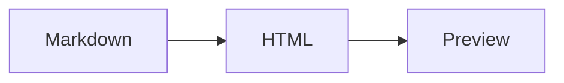

+++
title = "Sample Markdown Cheat Sheet"
date = "2026-05-21"
tags = ["markdown", "frontmatter", "toml"]
+++

Sample Markdown Cheat Sheet
=========================== 

This is a sample markdown file to help you write Markdown quickly :)

Daisy opens Markdown files from Finder in Read Mode, and files chosen in the Files sidebar or OmniSearch in Edit Mode. Choose *View → Toggle Edit Mode* to switch between editing and reading preview.

The other samples, which also exercise Back and Forward between files:

- [Layout: columns, cards and text alignment](layout.md)
- [Mermaid diagrams](mermaid.md)
- [Slides](slides.md)
- [Widgets: charts, stats, progress and shortcodes](widgets.md)
- [Templates](templates.md)

## Text basics
this is *italic* and this is **bold** .  another _italic_ and another __bold__

this is `important` text. and percentage signs : % and `%`

This is a paragraph with a footnote. [^note-id]

This is ~~struck through~~ and this is ==highlighted==. A bare address such as https://example.com becomes a link.

## Indentation
> Here is some indented text
>> even more indented

## Titles
# Big title (h1)
## Middle title (h2)
### Smaller title (h3)
#### and so on (hX)
##### and so on (hX)
###### and so on (hX)

## Example lists (1)

 - bullets can be `-`, `+`, or `*`
 - bullet list 1
 - bullet list 2
    - sub item 1
    - sub item 2

        with indented text inside

 - bullet list 3
 + bullet list 4
 * bullet list 5

## Links

This is an [example inline link](http://lmgtfy.com/) and [another one with a title](http://lmgtfy.com/ "Hello, world").

Links can also be reference based : [reference 1][ref1] or [reference 2 with title][ref2].

References are usually placed at the bottom of the document

## Images

A sample image :


As links, images can also use references instead of inline links :

![revolunet logo][revolunet-logo]


## Code

It's quite easy to show code in markdown files.

Backticks can be used to `highlight` some words.

Also, any indented block is considered a code block. Fenced code blocks with a language are highlighted.

    <script>
        document.location = 'http://lmgtfy.com/?q=markdown+cheat+sheet';
    </script>

## Math

Math is drawn with KaTeX. Inline math goes between `$…$` or `\\(…\\)`: \\(\frac{\pi}{2}\\) $\pi$.

Display math goes between `$$…$$` or `\\[…\\]`, on its own line:

$$F(\omega) = \frac{1}{\sqrt{2\pi}} \int_{-\infty}^{\infty} f(t) \, e^{ - i \omega t}dt$$

\\[\int_0^1 f(t) \mathrm{d}t\\]

\\[\sum_j \gamma_j^2/d_j\\]


## GitHub Flavored Markdown

Daisy supports [GitHub Flavored Markdown][gfm]: tables, task lists, strikethrough, autolinks and fenced code.

- [x] A finished task
- [ ] A task still to do

Some Python code :

```python
import random

class CardGame(object):
    """ a sample python class """
    NB_CARDS = 32
    def __init__(self, cards=5):
        self.cards = random.sample(range(self.NB_CARDS), 5)
        print 'ready to play'
```

Some Javascript code :

```js
var config = {
    duration: 5,
    comment: 'WTF'
}
// callbacks beauty un action
async_call('/path/to/api', function(json) {
    another_call(json, function(result2) {
        another_another_call(result2, function(result3) {
            another_another_another_call(result3, function(result4) {
                alert('And if all went well, i got my result :)');
            });
        });
    });
})
```

[^note-id]: This is the text of the note. 

## Extensions

Code highlighting, callouts, comments, KaTeX and Mermaid can each be switched off in *Settings → Extensions*.

> [!NOTE]
> A callout, written as a GitHub alert.

## Columns and cards

Side-by-side columns, cards and text alignment have their own sample: [Layout](layout.md).

## Examples

### Tables

| Year | Temperature (low) | Temperature (high) |  
| ---- | ----------------- | -------------------|  
| 1900 |               -10 |                 25 |  
| 1910 |               -15 |                 30 |  
| 1920 |               -10 |                 32 |  


## Reading rhythm

A reading view should make **structure** easy to scan while keeping ordinary paragraphs comfortable. Inline `code` belongs on the same baseline as the surrounding text.

### A heading with `inline code` that stays readable when it wraps onto a second line

Headings need enough line height for two lines, with a predictable gap before the next paragraph. This sample compares typography, spacing, and alignment.

- A short list item
- A longer item that wraps naturally and keeps its continuation aligned with the first word rather than the bullet marker.
  - A nested item with its own consistent indent
  - Another nested item
- [x] A completed task
- [ ] A task that can still be checked

> A quotation with **emphasis** and a softly rounded rule.
>
> A second paragraph inside the same quotation.

```swift
struct Preview {
    let title: String
    let isReadable = true
}
```

### Tables keep their alignment

| Document | Status | Size |
| :--- | :---: | ---: |
| Short note | Ready | 12 |
| Longer document with a wrapped title | Ready | 1,024 |
| Unicode: café 日本語 🧪 | Review | 256 |

#### Smaller headings still form a hierarchy

Inline math remains available: $E = mc^2$. Footnotes still belong to the reading experience.[^note]

##### Extra authored blank lines remain intentional

A paragraph before two blank lines.


A paragraph after two blank lines.

### Right-to-left content

<div dir="rtl">

هذه فقرة لاختبار المحاذاة والمسافات بين السطور.

- العنصر الأول
- العنصر الثاني

> اقتباس لاختبار موضع الخط الجانبي.

</div>

[^note]: This note uses our existing Markdown pipeline.

## Bullet markers

Each marker should be round, vertically centered, and visibly separated from the first letter at every text size and with every document font.

<details open>
<summary><strong>Expanded details with a Markdown list</strong></summary>

- [Every linked item needs a clear marker gap.](../README.md)
- Run `inline code` after the marker without touching it.
- One item wraps onto a second line so its continuation stays aligned with the first letter rather than the marker or the page edge. This sentence is deliberately long enough to wrap in a normal document window.
- Never let an uppercase vertical stroke merge with the marker.
- New files and proportional fonts should behave alike.
- Tests: punctuation immediately after the first word should not matter.
- Non-public methods provide a hyphenated first word.
- Comments begin with a round letter.
- Exact values include `--mdp-list-gap` and other code.

</details>

- Parent item
  - Nested item beginning with a vertical stroke
  - Another nested item that wraps onto a second line so nested continuation alignment is easy to inspect at a glance in the preview.

1. Ordered markers remain right-aligned.
2. Ordered list text keeps the same visual gap.

- [ ] An unchecked task keeps its checkbox gap.
- [x] A checked task keeps its checkbox gap.

## More code languages

This file exercises Shiki syntax highlighting for common fenced code blocks.
Mermaid blocks should still render as diagrams instead of highlighted code.

```swift
import Foundation

struct Release: Decodable {
    let version: String
    let publishedAt: Date
}

func newestRelease(from data: Data) throws -> Release {
    let decoder = JSONDecoder()
    decoder.dateDecodingStrategy = .iso8601
    return try decoder.decode(Release.self, from: data)
}
```

```javascript
const buttons = document.querySelectorAll('[data-action]')

for (const button of buttons) {
  button.addEventListener('click', () => {
    console.log(`Running ${button.dataset.action}`)
  })
}
```

```json
{
  "bundleId": "doc.daisy",
  "productName": "Daisy",
  "features": ["math", "mermaid", "shiki"]
}
```

```bash
./scripts/release.sh --version 0.0.2 --draft
```



## Right-to-left text

A document for stress-testing right-to-left rendering, bidirectional runs,
and mixed-script paragraphs in the preview.

---

### 1. Pure Dhivehi paragraph

އައްސަލާމް ޢަލައިކުމް! މިއީ ކަނާތުން ވާތަށް ލިޔުމުގެ ޓެސްޓު ކުރުމަށް
ހަދާފައިވާ ލިޔުމެކެވެ. ދިވެހި ބަސް ތާނަ އަކުރުން ލިޔެވެއެވެ. މި ލިޔުމުގެ
މަޤްޞަދަކީ ތާނަ އަކުރުތައް ރަނގަޅަށް ދައްކާތޯ ބެލުމެވެ.

މިއީ ދެވަނަ ޕެރެގްރާފެކެވެ. ޖުމްލަތަކުގެ ދޭތެރޭ ހުންނަ ޖާގަ، ތިރި ތިރިއަށް
ހުންނަ ސަފުތަކުގެ ދޭތެރޭ ހުންނަ ޖާގަ، އަދި ހާސިޔާ ރަނގަޅުތޯ ޓެސްޓު
ކުރުމަށެވެ.

### 2. Pure Arabic paragraph

مرحبا بالعالم! هذا مستند لاختبار العرض من اليمين إلى اليسار. الهدف هو
التحقق من أن النص يتدفق في الاتجاه الصحيح، وأن علامات الترقيم تلتصق
بالكلمة الصحيحة، وأن علامات الاستفهام والفواصل لا تقفز إلى الجانب الخطأ.

فقرة ثانية لنرى التباعد بين الأسطر وما إذا كانت الهوامش تبدو صحيحة عند
وجود عدة أسطر متتالية.

### 3. Pure Hebrew paragraph

שלום עולם! זהו מסמך לבדיקה של תצוגה מימין לשמאל. המטרה היא לוודא שהטקסט
זורם בכיוון הנכון, שהפיסוק נצמד למילה הנכונה, ושסימני שאלה ופסיקים לא
קופצים לצד הלא נכון. האם זה עובד? כן, אני מקווה שכן.

הנה פסקה שנייה כדי לראות את המרווחים בין שורות והאם השוליים נראים נכון
כאשר יש כמה שורות זו אחר זו.

### 4. Mixed bidi within a single paragraph

This English sentence has a Dhivehi name އަޙްމަދު, an Arabic name محمد,
and a Hebrew name דָּוִד inside it, followed by a number 12345 and a
parenthetical (with English) and (ދިވެހި ތެރޭ) and (مع العربية) and
(עם עברית) — punctuation should hug the right side of each run.

މިއީ ދިވެހި ޕެރެގްރާފެކެވެ، "Swift" ބަސް އާއި 77 ނަންބަރު އަދި `inline code`
މެދުގައި ހިމެނޭ، އަދި ސުވާލަކުން ނިމޭ: ހުރިހާ ކަމެއް ރަނގަޅުތަ؟

هذه فقرة عربية تحتوي على كلمة "TypeScript" ورقم 99 وعبارة `inline code`
في المنتصف، وتنتهي بسؤال: هل كل شيء على ما يرام؟

זוהי פסקה בעברית שמכילה את המילה "JavaScript" ואת המספר 42 ואת הביטוי
`code snippet` באמצע, ונגמרת בשאלה: האם הכל תקין?

### 5. Lists

#### Unordered (Dhivehi)

- ފުރަތަމަ ބައި
- ދެވަނަ ބައި **ބޯ ލިޔުން** އަދި *ރޮދި ލިޔުން*
- `inline` ކޯޑު ހިމެނޭ ބައި
- އެކުވެފައިވާ ބައި: hello ދިވެހި مرحبا עולם 123

#### Ordered (Arabic)

1. العنصر الأول في القائمة
2. العنصر الثاني مع **نص غامق** و*مائل*
3. عنصر مع كود `inline` في الوسط
4. عنصر مختلط: hello ދިވެހި مرحبا עולם 123

#### Unordered (Hebrew)

- פריט ראשון ברשימה
- פריט שני עם **טקסט מודגש** ו*נטוי*
- פריט עם קוד `inline` באמצע
- פריט מעורב: hello ދިވެހި مرحبا עולם 123

#### Nested

- English root
  - ދިވެހި ނެސްޓެޑް
    - عنصر فرعي بالعربية
      - תת-פריט בעברית
        - back to English
- ދިވެހި މައި
  - ހެލޯ
  - مرحبا
  - שלום
  - hello

### 6. Blockquotes

> މިއީ ދިވެހި ކޯޓުކެވެ. ކޯޓުގެ ތެރި ރޮނގު ޕެރެގްރާފުގެ ކަނާތު ފަރާތުގައި
> ހުންނަން ޖެހޭނެއެވެ، ވާތު ފަރާތުގައި ނޫނެވެ.

> هذا اقتباس بالعربية. يجب أن يكون الشريط العمودي للاقتباس على الجانب
> الأيمن من الفقرة، وليس على الجانب الأيسر.

> זהו ציטוט בעברית. הפס האנכי של הציטוט אמור להיות בצד הימני של הפסקה,
> לא בצד השמאלי, אם הכיוון הוגדר נכון.

> A plain English blockquote, for comparison — bar on the left.

### 7. Tables

| ނަން    | الاسم  | שם   | Role        |
|---------|--------|------|-------------|
| އަޙްމަދު | محمد   | דוד  | Engineer    |
| ޢާއިޝާ  | سارة   | מרים | Designer    |
| ޙަސަން   | علي    | Alex | PM          |
| ފާޠިމާ  | فاطمة  | רחל  | Researcher  |
| އިބްރާހިމް | إبراهيم | יוסף | Team Lead   |

### 8. Code blocks (should stay LTR even in RTL context)

ދިވެހި ޕެރެގްރާފުގެ ތެރޭގައި Python ކޯޑުގެ މިސާލެކެވެ:

```python
greetings = {
    "dv": "ހެލޯ",
    "ar": "مرحبا",
    "he": "שלום",
    "en": "Hello",
}
for lang, word in greetings.items():
    print(f"{lang}: {word}")
```

وهذا مثال بلغة JavaScript داخل فقرة عربية:

```javascript
const names = ["ދިވެހި", "محمد", "דוד", "Alex"];
names.forEach((n) => console.log(`Hello, ${n}!`));
```

הנה דוגמה לקוד Swift בתוך פסקה עברית:

```swift
func greet(name: String) -> String {
    // English comment
    return "Hello, \(name)!"
}

// בעברית: greeting בעברית
let message = greet(name: "עולם")
print(message)
```

### 9. Inline formatting torture test

**ދިވެހި ބޯ** و**عربي غامق** ו**עברית מודגשת** and **English bold**, mixed
with *ދިވެހި ރޮދި* and *مائل* and *נטוי* and *italic*, plus ~~ހުރަސް~~
~~مشطوب~~ ~~יישור~~ ~~strikethrough~~ and `ކޯޑު` and `كود` and `קוד` and
`code`.

A line with [ދިވެހި ލިންކު](https://example.com),
[رابط بالعربية](https://example.com), [קישור בעברית](https://example.com),
and [English link](https://example.com).

### 10. Numbers, punctuation, and edge cases

- Phone number in Dhivehi sentence: 7774444 އަށް ގުޅާލާށެވެ.
- Phone number in Arabic sentence: اتصل بـ 05-9876543 من فضلك.
- Phone number in Hebrew sentence: התקשרו אל 03-1234567 בבקשה.
- Mixed quotes: one said "ހެލޯ", another replied "مرحبا", a third said
  "שלום", and they all said "hi".
- Parentheses around RTL: (ދިވެހި ބުރެކެޓުގެ ތެރޭ) and (عربية بين قوسين)
  and (עברית בסוגריים) and (English).
- Question marks: ދިވެހި؟ · العربية؟ · עברית? · English?
- Semicolons: ދިވެހި؛ العربية؛ עברית; English;
- Range: 2020–2026 inside ދިވެހި, inside العربية, and inside עברית.

### 11. Headings of every level

## H1 — ބޮޑު ސުރުޚީ — العنوان الرئيسي — כותרת ראשית
### H2 — ތަންވެ ސުރުޚީ — العنوان الفرعي — כותרת משנה
#### H3 — ކުޑަ ސުރުޚީ — عنوان فرعي — תת-כותרת
##### H4 — ބައި — قسم — סעיף
###### H5 — ކުޑަ ބައި — قسم فرعي — תת-סעיף
###### H6 — ނޯޓު — ملاحظة — הערה

### 12. A paragraph with a forced LTR run

Even when surrounded by ދިވެހި and العربية and עברית, identifiers like
`MarkdownPreview.app` and URLs like https://github.com/example/repo
and version strings like `v1.2.3-rc.4` should remain left-to-right and
readable.

### 13. Long Dhivehi paragraph for word-wrap

ދިވެހި ބަސް އަކީ ރާއްޖޭގެ ޤައުމީ ބަސް ކަމުގައިވާ، ތާނަ އަކުރުން ކަނާތުން
ވާތަށް ލިޔެވޭ ބަހެކެވެ. މި ޕެރެގްރާފަކީ ވަރަށް ދިގު ޖުމްލައެއް ހިމެނޭ، ތާނަ
އަކުރުގެ ވިއްސާރަ، ފިލި، އަދި ނިޝާންތައް އެކުލެވޭ ބަހުގެ ތެރޭގައި ލައިން
ރެޕިން ކިހިނެއް މަސައްކަތް ކުރޭތޯ ބެލުމަށް ހަދާފައިވާ ޓެސްޓެކެވެ.

### 14. Long Arabic paragraph for word-wrap

في البدء خلق الله السماوات والأرض — وهذه جملة طويلة بشكل خاص تحتوي على
تشكيل كامل وعلامات اقتباس وشرطات، لاختبار كيفية تعامل آلية التفاف
الأسطر مع النص العربي الذي يحتوي على علامات خاصة يجب أن تبقى متصلة
بالحرف الذي تنتمي إليه.

### 15. Long Hebrew paragraph for word-wrap

ספר בראשית מתחיל במילים "בְּרֵאשִׁית בָּרָא אֱלֹהִים אֵת הַשָּׁמַיִם וְאֵת
הָאָרֶץ" — זוהי שורה ארוכה במיוחד שכוללת ניקוד מלא, גרשיים, ומקפים, כדי
לבדוק כיצד מנגנון גלישת השורות מתמודד עם טקסט עברי עם סימנים מיוחדים
שאמורים להישאר מחוברים לאות שלהם.

---

End — ނިމުނީ — النهاية — סוף

## Long footnotes

Use this file to test whether footnote references jump to the footnote section
and whether backlinks return to the original reference on a long page.

### Section 1

This opening section has the first footnote reference.[^first] Clicking it
should jump near the bottom of the document.

Lorem ipsum dolor sit amet, consectetur adipiscing elit. Integer posuere erat a
ante venenatis dapibus posuere velit aliquet. Donec ullamcorper nulla non metus
auctor fringilla.

Curabitur blandit tempus porttitor. Maecenas faucibus mollis interdum. Etiam
porta sem malesuada magna mollis euismod. Vestibulum id ligula porta felis
euismod semper.

### Section 2

This section intentionally has no footnotes. It gives the page enough height to
make anchor jumps obvious.

- Item one has enough text to wrap on narrower windows and make the page taller.
- Item two should remain ordinary Markdown content.
- Item three gives the list a little more vertical weight.

Sed posuere consectetur est at lobortis. Aenean lacinia bibendum nulla sed
consectetur. Cras justo odio, dapibus ac facilisis in, egestas eget quam.

### Section 3

A second footnote appears here.[^middle] After clicking it, use the backlink in
the footnote section to confirm it returns to this exact part of the page.

```swift
let literalFootnoteMarker = "[^middle]"
print(literalFootnoteMarker)
```

The marker inside the code block above should not become a footnote link.

Praesent commodo cursus magna, vel scelerisque nisl consectetur et. Morbi leo
risus, porta ac consectetur ac, vestibulum at eros.

### Section 4

More filler content follows. Scroll position should move clearly when you click
footnote links from this document.

Donec sed odio dui. Nulla vitae elit libero, a pharetra augue. Integer posuere
erat a ante venenatis dapibus posuere velit aliquet.

Vivamus sagittis lacus vel augue laoreet rutrum faucibus dolor auctor. Fusce
dapibus, tellus ac cursus commodo, tortor mauris condimentum nibh.

### Section 5

This section references the same footnote twice.[^repeat-long] The first backlink
should return here, and the second backlink should return to the next paragraph.

Here is the second reference to the same footnote.[^repeat-long] It should create
a second inline backlink in the footnote definition.

`[^repeat-long]` inside inline code should stay literal.

### Section 6

This is another spacer section.

1. Ordered list item one.
2. Ordered list item two.
3. Ordered list item three.
4. Ordered list item four.

Phasellus viverra nulla ut metus varius laoreet. Quisque rutrum. Aenean
imperdiet. Etiam ultricies nisi vel augue.

### Section 7

A multiline footnote reference lives here.[^multi-long] Its definition includes
multiple paragraphs and a nested list.

Aliquam lorem ante, dapibus in, viverra quis, feugiat a, tellus. Phasellus
viverra nulla ut metus varius laoreet. Quisque rutrum.

### Section 8

More text to make the page long enough for jump testing.

Nam quam nunc, blandit vel, luctus pulvinar, hendrerit id, lorem. Maecenas nec
odio et ante tincidunt tempus. Donec vitae sapien ut libero venenatis faucibus.

Nullam quis ante. Etiam sit amet orci eget eros faucibus tincidunt. Duis leo.
Sed fringilla mauris sit amet nibh.

### Section 9

One final footnote appears near the end of the body.[^near-end] This should still
jump down, but the scroll distance will be shorter than the first reference.

Donec sodales sagittis magna. Sed consequat, leo eget bibendum sodales, augue
velit cursus nunc, quis gravida magna mi a libero.

### Section 10

End of the long body. The footnote section should appear below this paragraph.

Click each backlink arrow in the footnotes and confirm it returns to the matching
reference location.

[^first]: First footnote. Use the backlink to confirm the page jumps back to
    Section 1.

[^middle]: Middle footnote with **bold text** and a [link](https://md-preview.app).

[^repeat-long]: Repeated footnote. This should show two backlinks inline at the
    end of this definition.

[^multi-long]: Multiline footnote first paragraph.

    Second paragraph in the same footnote.

    - Nested bullet one.
    - Nested bullet two with inline math: $a^2 + b^2 = c^2$.

[^near-end]: Footnote referenced near the end of the document.

## About

This sample file demonstrates Markdown syntax rendered by Daisy.

 [ref1]: http://revolunet.com
 [ref2]: http://revolunet.com "rich web apps"
 [MarkdownREF]: http://daringfireball.net/projects/markdown/basics
 [revolunet-logo]: http://www.revolunet.com/static/parisjs8/img/logo-revolunet-carre.jpg "revolunet logo"
 [gfm]: https://help.github.com/articles/github-flavored-markdown/
