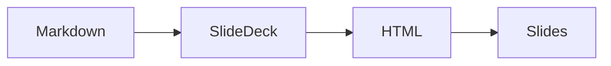

# Daisy slides
A Markdown file shown as a deck

???
Open with View ▸ Present (⌥⌘P). Arrow keys, Space and a clicker's
Page Up/Down move between slides; Esc ends the presentation.

---

## How a deck works

- `slides: true` in the frontmatter turns a file into a deck
- `---` on its own line starts the next slide
- `???` starts the speaker notes for a slide
- The layout of each slide comes from what is on it[^layout]

???

Notes show under each slide in Read Mode and never on the presented slide.

[^layout]: Title, section, quote, code, math, image and grid layouts.

---

## Part two

---

> The best way to predict the future is to invent it.

---

## Code

```swift
let deck = SlideDeck(document: Document(parsing: markdown))
print(deck.slides.count)
```

---

## Math

$$
e^{i\pi} + 1 = 0
$$

---

## A diagram



---

## The end

Thanks for watching.
