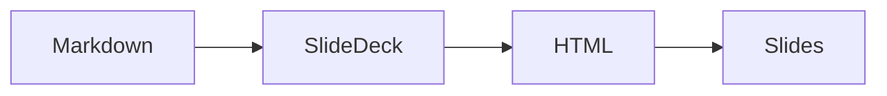

# Daisy slides
A Markdown file shown as a deck

???
Open with View ▸ Present (⌥⌘P). Arrow keys, Space and a clicker's
Page Up/Down move between slides; Esc ends the presentation.

---

## How a deck works

- `slides: true` in the frontmatter turns a file into a deck
- `---` on its own line starts the next slide
- `???` starts the speaker notes for a slide
- The layout of each slide comes from what is on it[^layout]

???

Notes show under each slide in Read Mode and never on the presented slide.

[^layout]: Title, section, quote, code, math, image and grid layouts.

---

## Reveal step by step

- Arrows and Space reveal one item at a time
- Items marked with a step comment wait for a click <!-- step -->
- `step: 2` puts several items on the same click <!-- step -->

???
The steps all show in Read Mode and in a PDF.

---

## Beside a picture


- `![bg right]` puts the image on one half
- `![bg]` alone fills the whole slide
- `fit` shows all of the image

---

<!-- _class: invert center -->

## Classes

`<!-- _class: invert center -->` darkens and centres this slide

---

<!-- layout: section -->

## Part two

---

> The best way to predict the future is to invent it.

---

## Code

```swift
let deck = SlideDeck(document: Document(parsing: markdown))
print(deck.slides.count)
```

---

## Math

$$
e^{i\pi} + 1 = 0
$$

---

## A diagram



---

## The end

Thanks for watching.
