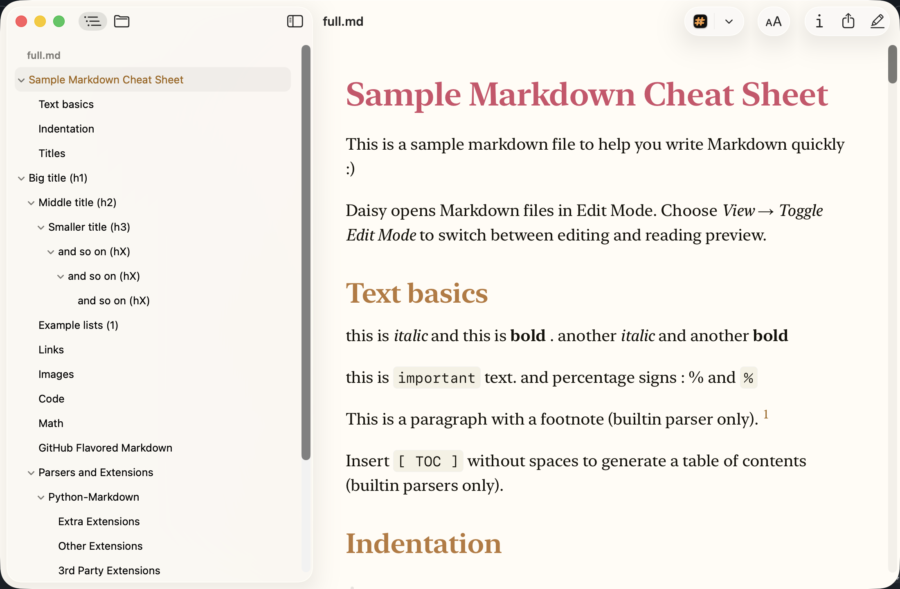
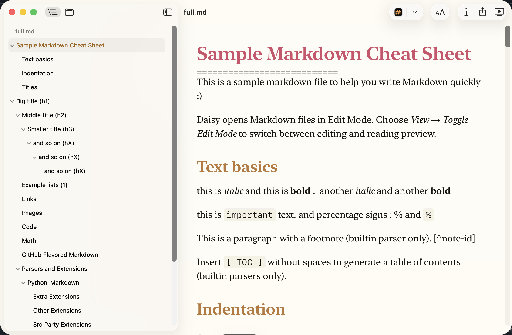
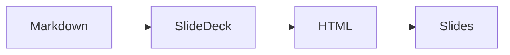
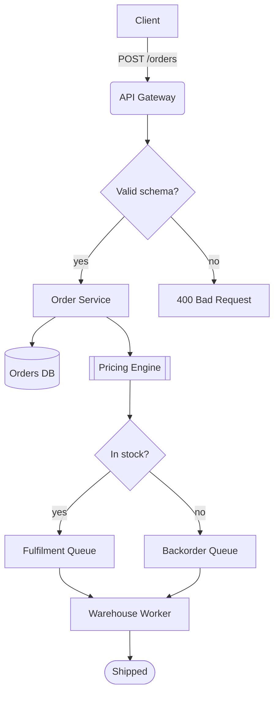

# Daisy slides
A Markdown file shown as a deck

???
Open with View ▸ Present (⌥⌘P). Arrow keys, Space and a clicker's
Page Up/Down move between slides; Esc ends the presentation.

---

## How a deck works

- `slides: true` in the frontmatter turns a file into a deck
- `---` on its own line starts the next slide
- `???` starts the speaker notes for a slide
- The layout of each slide comes from what is on it[^layout]

???

Notes show under each slide in Read Mode and never on the presented slide.

[^layout]: Title, section, quote, code, math, image, split and columns layouts.

---

## Reveal step by step

- Arrows and Space reveal one item at a time
- Items marked with a step comment wait for a click <!-- step -->
- `step: 2` puts several items on the same click <!-- step -->

???
The steps all show in Read Mode and in a PDF.

---

## Beside a picture


- `![bg right]` puts the image on one half
- `![bg]` alone fills the whole slide
- `fit` shows all of the image

---

## Columns

- `<!-- column -->` on its own line
- starts the next column

<!-- column -->

- The heading stays across the top
- Columns share the width equally

<!-- end-columns -->

<!-- space -->

`<!-- end-columns -->` puts the rest of the slide below the columns, and `<!-- space -->` adds an empty line.

---

## Text above the columns

Anything above `<!-- columns -->` spans the whole slide, not just a heading.

<!-- columns -->

- Add `<!-- columns -->` where the columns begin
- Lines above it stay across the top

<!-- column -->

- `<!-- column -->` starts the next column
- Two to four columns share the width

<!-- end-columns -->

???
The opener is optional; without it only a heading at the top stays above the columns.

---

## A gallery


<!-- column -->



<!-- column -->



<!-- end-columns -->

!caption[The app icon, Read Mode and Edit Mode]

???
Images side by side are columns: each image fits inside its column.

---

# Text on a picture

`` darkens and blurs the image behind the text


---

<!-- _class: invert center -->

## Classes

`<!-- _class: invert center -->` darkens and centres this slide

---

<!-- layout: section -->

## Part two

---

> The best way to predict the future is to invent it.

---

## Code

```swift
let deck = SlideDeck(document: Document(parsing: markdown))
print(deck.slides.count)
```

---

## Math

$$
e^{i\pi} + 1 = 0
$$

---

## A diagram



---

## Long mermaid




---

# Widgets on slides

A business review built from stat tiles, charts, progress, cards and shortcodes

---

## Q3 at a glance

```stat
label: Revenue
value: $48.2k
color: success
delta: +12%
trend: up
note: vs Q2
style: solid
---
label: Active users
value: 3,204
delta: +18%
trend: up
style: accent
color: info
---
label: Churn
value: 2.1%
delta: -0.4%
trend: down
good: down
style: accent
color: success
---
label: NPS
value: 54
delta: +6
trend: up
style: accent
color: accent
```

`{{badge: "Revenue on plan" color=success}}` `{{badge: "Hiring behind" color=warning}}` `{{badge: "Notarization flaky" color=danger}}`

???
Four numbers to remember. Revenue, users and NPS all up; churn down, which is the direction we want.
The badges are the honest part: hiring is behind plan and notarization keeps failing in CI.

---

## Revenue grew 12% on Pro upgrades

<!-- card style=accent color=success -->
```chart
type: bar
title: Monthly revenue (k$)
height: 230
colors: #6366F1, #22C55E
grid: false
legend:
  position: top
| Month | 2025 | 2026 |
| ----- | ---- | ---- |
| Jul   | 12   | 14   |
| Aug   | 13   | 16   |
| Sep   | 15   | 18   |
```
<!-- end-card -->

<!-- column -->

<!-- card style=filled color=success padding=compact -->
### What moved it

- Annual Pro plan launched in July
- 41 teams upgraded from Free
- No price change

<!-- end-card -->

???
Every month of Q3 beat the same month last year. The jump is upgrades, not new pricing.
The annual plan did most of the work: 41 teams moved from Free to Pro.

---

## Growth

---

## Signups doubled since July

```chart
type: line
title: Weekly signups
height: 300
grid: false
colors: #22D3EE, #A78BFA
legend:
  position: right
| Week | Organic | Paid |
| ---- | ------- | ---- |
| W27  | 80      | 30   |
| W29  | 104     | 38   |
| W31  | 121     | 47   |
| W33  | 138     | 55   |
| W35  | 152     | 61   |
| W37  | 171     | 66   |
```

???
Organic is the story: it more than doubled while paid grew steadily.
The template gallery and the Quick Look extension both landed in W31, right where the organic curve bends.

---

## Pro brings in two thirds of revenue

<!-- card align=center -->
```chart
type: donut
title: Revenue by plan (k$)
height: 260
colors: #64748B, #6366F1, #F59E0B
legend:
  position: right
| Plan       | Revenue |
| ---------- | ------- |
| Free       | 3       |
| Pro        | 32      |
| Enterprise | 13      |
```
<!-- end-card -->

<!-- column -->

<!-- card style=accent bar=top color=warning -->
### Enterprise is the next lever

- 4 pilots running
- 2 contracts in legal
- Average deal 6× Pro

<!-- end-card -->

???
Free costs us little but feeds Pro. Enterprise is small today, but each deal is worth six Pro teams, so that is where Q4 sales time goes.

---

## Two of three goals on track

<!-- card align=center padding=compact -->
### Revenue
```progress
shape: ring
label: $48k of $52k
value: 48
max: 52
color: success
```
<!-- end-card -->

<!-- column -->

<!-- card align=center padding=compact -->
### Onboarding
```progress
shape: ring
label: of new teams
value: 81
max: 100
```
<!-- end-card -->

<!-- column -->

<!-- card align=center padding=compact style=accent color=danger -->
### Support SLA
```progress
shape: ring
label: target 90%
value: 68
max: 100
color: danger
```
<!-- end-card -->

???
Revenue and onboarding are close to target. Support SLA is the miss, and the next section explains why.

---

## Delivery

---

## Release 4.2 is nearly done

<!-- card style=accent color=accent -->
```progress
label: Features
value: 9
max: 12
striped: true
---
label: Tests
value: 184
max: 190
color: success
---
label: Docs
value: 5
max: 9
color: warning
---
label: Blockers
value: 2
max: 10
color: danger
```
<!-- end-card -->

<!-- column -->

```stat
label: Days to release
value: 9
note: Code freeze on Friday
fill: soft
bar: top
border: none
color: warning
```

`{{badge: "Beta feedback in" color=success}}` `{{badge: "Docs behind" color=warning}}`

???
Nine of twelve features are in; the striped bar is the work still moving.
Docs are the risk to the date, not code. Two blockers left, both with owners.

---

## Support load shifted to questions

```chart
type: bar
title: Tickets by week
height: 230
stacked: true
grid: false
colors: #F43F5E, #6366F1, #22C55E
legend:
  position: top
| Week | Bugs | Questions | Requests |
| ---- | ---- | --------- | -------- |
| W33  | 14   | 22        | 6        |
| W35  | 11   | 25        | 9        |
| W37  | 9    | 29        | 7        |
| W39  | 8    | 31        | 12       |
```

<!-- column -->

```chart
type: bar
title: Open tickets by team
height: 230
stacked: true
direction: horizontal
grid: false
colors: #F59E0B, #6366F1, #22C55E
legend:
  position: top
x-axis:
  visible: false
| Team     | Open | Review | Closed |
| -------- | ---- | ------ | ------ |
| Platform | 12   | 6      | 30     |
| Mobile   | 8    | 4      | 22     |
| Web      | 15   | 9      | 18     |
```

???
Bugs fell every week. Questions rose, which is why SLA slipped: the team is answering how-to questions, not fixing defects.
That points at docs and onboarding, not engineering.

---

## Q3 in three numbers

<!-- card shape=circle style=filled color=success -->
### $48.2k
Revenue
<!-- end-card -->

<!-- column -->

<!-- card shape=circle style=outline color=accent -->
### 3,204
Active users
<!-- end-card -->

<!-- column -->

<!-- card shape=circle style=outline color=info -->
### 54
NPS
<!-- end-card -->

???
The same quarter as three round numbers, for the recap.

---

## Q4 commitments

<!-- card style=accent bar=top color=success -->
### `{{shape: 1 color=success}}` Grow

- 2 Enterprise deals
- $60k a month
<!-- end-card -->

<!-- column -->

<!-- card style=accent bar=top color=accent -->
### `{{shape: 2}}` Ship

- 4.2 on Oct 18
- Cards in Quick Look
<!-- end-card -->

<!-- column -->

<!-- card style=accent bar=top color=warning -->
### `{{shape: 3 color=warning}}` Support

- SLA back to 90%
- Top 20 answers in docs
<!-- end-card -->

???
One owner per column. We review these three at the start of every month.


---
# The end

Thanks for watching.
